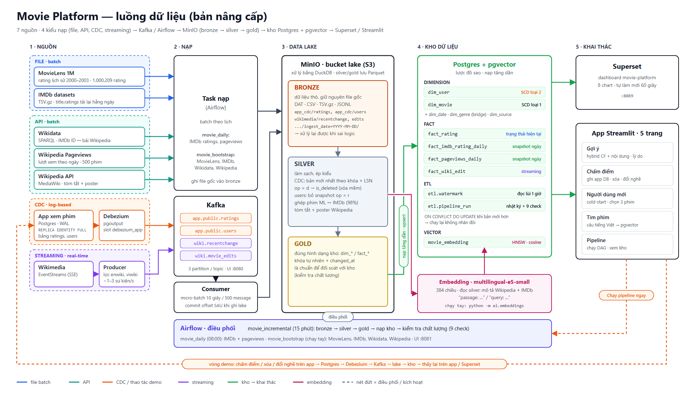

# Movie Platform – Kho dữ liệu và Khai phá dữ liệu (MovieLens 1M)

Bài tập lớn cuối kỳ môn **Kho dữ liệu và Khai phá dữ liệu**, Học viện Công nghệ Bưu chính Viễn thông.
Nhóm: Nguyễn Văn Luân (B23DCCC106), Vũ Văn Hùng (B23DCCC078) · Giảng viên: Phan Lý Huỳnh.

Đề tài gồm hai phần:

- **Bản nền tảng:** kho dữ liệu PostgreSQL theo lược đồ sao, 6 truy vấn OLAP, 3 dashboard Superset, phân cụm người dùng bằng K-Means và gợi ý Top-5 bằng item-based CF trên MovieLens 1M.
- **Bản nâng cấp** (nhánh `nang-cap`): mở rộng thành nền tảng dữ liệu **7 nguồn**, có **CDC** (Debezium → Kafka), **data lake** MinIO ba tầng, **kho nạp tăng dần** có SCD loại 2, **Airflow**, ứng dụng web, dashboard thời gian thực và **gợi ý lai** có tìm phim bằng câu tiếng Việt.

| Tài liệu | Đường dẫn |
|---|---|
| Báo cáo (87 trang, chương 5 là bản nâng cấp) | [PDF](docs/report/bao_cao_kho_du_lieu_khai_pha.pdf) · [DOCX](docs/report/bao_cao_kho_du_lieu_khai_pha.docx) |
| Slide trình bày bản nâng cấp (5 phút, lời nói trong Notes) | [movie_platform_nang_cap.pptx](docs/slides/movie_platform_nang_cap.pptx) |
| Hướng dẫn trình bày, kịch bản demo, câu hỏi thường gặp | [docs/ban_nang_cap.md](docs/ban_nang_cap.md) |
| Kịch bản video và bộ câu hỏi ôn bảo vệ | [docs/demo/kich_ban_video.md](docs/demo/kich_ban_video.md) |
| Mục lục toàn bộ tài liệu | [docs/README.md](docs/README.md) |

## Bản nâng cấp so với bản nền tảng

| Bản nền tảng | Bản nâng cấp |
|---|---|
| 1 nguồn: MovieLens 1M, tệp tĩnh | 7 nguồn, 4 kiểu nạp: tệp (MovieLens, IMDb), API (Wikidata, Wikipedia Pageviews, Wikipedia tóm tắt và poster), CDC (Postgres của app xem phim), streaming (Wikimedia EventStreams) |
| Không có data lake | MinIO (chuẩn S3), bronze → silver → gold, xử lý bằng DuckDB, lưu Parquet |
| Không có CDC | Debezium đọc WAL của Postgres → Kafka → consumer ghi bronze (at-least-once) |
| Nạp toàn bộ, chạy tay | Nạp tăng dần (watermark + upsert), Airflow 3 DAG, 9 kiểm tra chất lượng |
| 1 bảng fact | SCD loại 2 cho người dùng, xóa mềm, 4 bảng fact (rating, điểm IMDb theo ngày, lượt xem Wikipedia theo ngày, sửa bài Wikipedia) |
| Demo trên terminal | App Streamlit 5 trang có panel theo dõi thay đổi, dashboard Superset tự làm mới 60 giây |
| Item-based CF | Gợi ý lai CF + nội dung (embedding `multilingual-e5-small`), tìm phim bằng câu tiếng Việt (pgvector) |



Một lượt chấm điểm trên app đi qua Postgres → Kafka (1 giây) → MinIO bronze (3 giây) → Airflow → kho dữ liệu trong khoảng **40 giây**.

## Chạy bản nâng cấp

**Yêu cầu:** Docker Desktop (cấp khoảng 8 GB RAM), Python 3.12.

```bash
# 1. Môi trường Python trên máy
python -m venv .venv
.venv\Scripts\activate
pip install -r requirements-nang-cap.txt

# 2. Cấu hình: sao chép .env.example thành .env và điền mật khẩu
#    (Superset dùng tệp riêng dashboard/superset/.env)

# 3. Khởi động dịch vụ: kho, Postgres của app, Kafka, Debezium, MinIO, Airflow, consumer, producer
docker compose up -d
docker compose -f dashboard/superset/compose.yaml --env-file dashboard/superset/.env up -d
```

**Lần đầu tiên** cần nạp dữ liệu và khởi tạo:

```bash
# 4. Airflow (http://localhost:8081): bật và chạy DAG movie_bootstrap
#    -> tải MovieLens, IMDb, Wikidata, Wikipedia vào lake rồi nạp kho

python -m app_source.seed                       # 5. nạp người dùng, phim vào Postgres của app
python -m cdc.register                          # 6. đăng ký Debezium connector
python -m ai.embeddings                         # 7. tạo vector phim (cần PyTorch)
python dashboard/platform/create_dashboard.py   # 8. tạo dashboard Superset
```

**Mỗi lần chạy:**

```bash
streamlit run app/streamlit_app.py              # app tại http://localhost:8501
python -m app_source.simulate                   # (tuỳ chọn) giả lập người dùng thao tác trên app
```

| Giao diện | Địa chỉ |
|---|---|
| App Streamlit | http://localhost:8501 |
| Kafka UI | http://localhost:8080 |
| MinIO Console | http://localhost:9001 (bucket `lake`) |
| Airflow | http://localhost:8081 |
| Superset | http://localhost:8089/superset/dashboard/movie-platform/ |
| Kho dữ liệu (Postgres + pgvector) | `localhost:5433`, database `movie_dw` |
| Postgres của app | `localhost:5434`, database `movie_app` |

Sau lần đầu, DAG `movie_incremental` chạy mỗi 15 phút (hoặc bấm **Chạy pipeline ngay** trên app), `movie_daily` chạy 8:00 mỗi ngày.

## Kết quả chính

| | Câu hỏi | Kết quả |
|---|---|---|
| **Q1** | Người dùng chia thành những nhóm sở thích nào? | K-Means (K = 4) chia 6.038 người thành 4 nhóm: đa dạng (41,0%), Drama và tình cảm (23,1%), hài (12,6%), hành động và viễn tưởng (23,3%); ổn định (ARI > 0,97). Nhóm hành động có 87,4% nam, so với 71,7% chung. |
| **Q2** | Gợi ý 5 phim cho một người dùng thế nào? | Item-based CF (k = 40): Precision@5 = **0,231**, Recall@5 = **0,0353** trên 1.154 người dùng của tập test, cao hơn Popularity Baseline (0,202 và 0,0271). Dữ liệu chia theo thời gian, không rò rỉ. |
| **Q3** | Lượt đánh giá theo thể loại biến động thế nào qua các quý? | Đỉnh ở quý 4/2000 (446.574 lượt) rồi giảm mạnh từ 2001; Animation tăng mạnh nhất quý 4/2000 (+53,17%). |
| **Q4** | Tích hợp nhiều nguồn và đưa thay đổi mới vào kho gần thời gian thực thế nào? | CDC + Kafka + data lake + nạp tăng dần: thay đổi trên app vào kho sau khoảng 40 giây, không trùng lặp; xóa và đổi thông tin được phản ánh bằng xóa mềm và SCD loại 2; 9 kiểm tra chất lượng đều đạt. |

Gợi ý lai, đánh giá đúng giao thức của Q2 ([kết quả](results/mining/hybrid_evaluation.json)):

| Tập test, 1.154 người dùng | Precision@5 | Recall@5 |
|---|---|---|
| Popularity Baseline | 0,2017 | 0,0271 |
| Item-based CF | 0,2310 | **0,0353** |
| Chỉ nội dung (E5 + mô tả Wikipedia, IMDb) | 0,2175 | 0,0318 |
| Lai, α = 0,9 | **0,2314** | 0,0352 |

Mô hình lai chỉ ngang CF; mô hình chỉ dùng nội dung phim đã vượt baseline theo độ phổ biến.

## Cấu trúc thư mục

```
Bản nâng cấp
  docker-compose.yml   Toàn bộ dịch vụ (trừ Superset)
  sources/             Thu thập MovieLens, IMDb, Wikidata, Wikipedia vào tầng bronze
  app_source/          Postgres của app xem phim: lược đồ, nạp ban đầu, giả lập người dùng
  cdc/                 Cấu hình Debezium, consumer Kafka → bronze
  streaming/           Producer Wikimedia EventStreams → Kafka
  pipeline/            Cấu hình chung, truy cập data lake (MinIO / thư mục cục bộ)
  transform/           bronze → silver → gold bằng DuckDB
  warehouse/           Lược đồ kho mới, nạp tăng dần, 9 kiểm tra chất lượng
  orchestration/       Image và 3 DAG Airflow
  ai/                  Embedding, gợi ý lai, đánh giá
  app/                 App Streamlit và panel theo dõi thay đổi
  dashboard/platform/  Tạo dashboard Superset thời gian thực

Bản nền tảng
  database/            Lược đồ kho, view OLAP, từ điển dữ liệu, ánh xạ nguồn – đích
  etl/                 ETL nạp toàn bộ: staging → dimension → bridge → fact
  olap/                6 truy vấn OLAP
  mining/              EDA, K-Means, chia dữ liệu, item-based CF, baseline, CLI gợi ý
  dashboard/           3 dashboard Superset (superset_export.zip), cấu hình, phục hồi
  tests/               225 ca kiểm thử (tests/warehouse, tests/mining)
  results/             Kết quả EDA, đối soát, OLAP, phân cụm, gợi ý

docs/                  Báo cáo, slide, demo, sơ đồ, tài liệu (xem docs/README.md)
```

## Bản nền tảng

**Yêu cầu:** Python 3.12, PostgreSQL 17, Docker (cho Superset).

```bash
pip install -r requirements.txt
python -m mining.source_fetcher                                        # tải MovieLens 1M, kiểm tra mã băm
python -m etl.s05_staging bootstrap --env-file .env                    # tạo lược đồ
python -m etl.run_etl refresh --env-file .env --raw-dir data/raw/ml-1m # ETL + đối soát
python -m olap.run_olap install --env-file .env                        # 6 view OLAP
python -m mining.clustering --source dw                                # K-Means
python -m mining.recommend --source dw --user-id 1 --mode demo --top-n 5
```

Dashboard: [dashboard/superset/README.md](dashboard/superset/README.md) (khởi động) và [dashboard/restore/README.md](dashboard/restore/README.md) (nhập 3 dashboard).

Kiểm thử:

```bash
python -m pytest tests/mining
python -m unittest discover -s tests/warehouse -p "test_*.py"
```

## Dựng lại tài liệu

```bash
python docs/report/make_figures_nang_cap.py   # hình chương 5
python docs/report/build_report.py            # DOCX + PDF (cần LibreOffice, hoặc Microsoft Word trên Windows)
python docs/demo/make_video.py                # video demo có lồng tiếng (cần hệ thống đang chạy)
```

Slide dựng bằng `docs/slides/build_slides.js` (pptxgenjs). Video không lưu trên Git vì dung lượng lớn.
