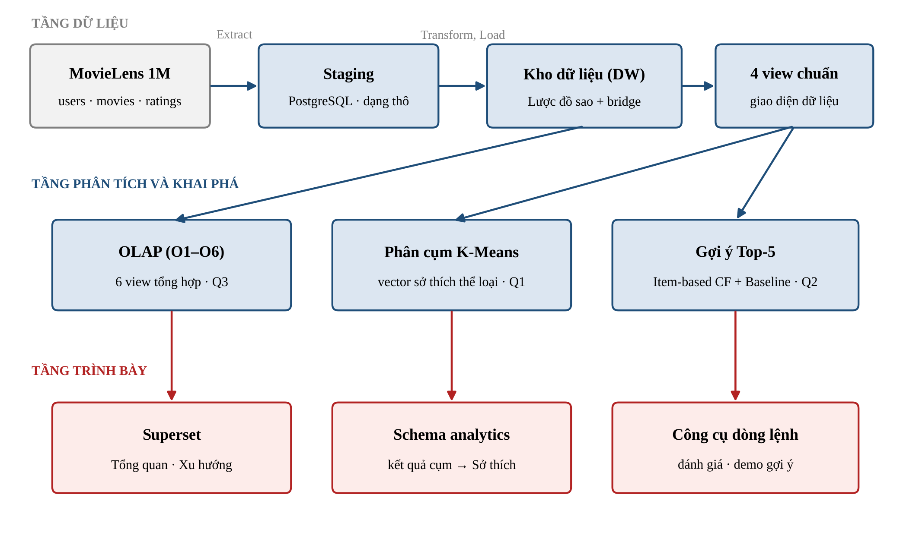
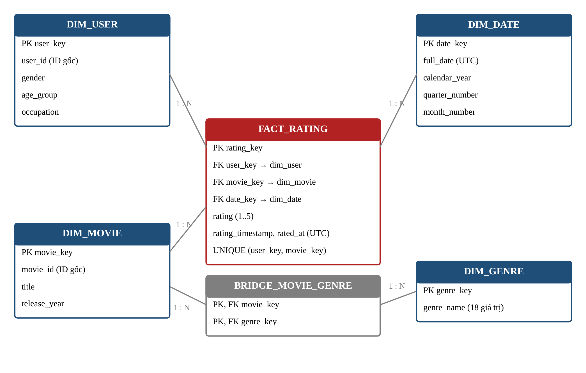

# Kho dữ liệu và Khai phá dữ liệu – MovieLens 1M

Bài tập lớn cuối kỳ môn **Kho dữ liệu và Khai phá dữ liệu** (Học viện Công nghệ Bưu chính Viễn thông).

Đề tài xây dựng một hệ thống phân tích hoàn chỉnh trên bộ dữ liệu **MovieLens 1M** (6.040 người dùng, 3.883 phim, 1.000.209 lượt đánh giá):

- **Kho dữ liệu** PostgreSQL theo lược đồ sao, ETL bằng Python nạp toàn bộ trong một giao dịch và đối soát trước khi xác nhận.
- **6 truy vấn OLAP** (roll-up, drill-down, slice, dice, pivot) và **3 dashboard** Apache Superset.
- **Khai phá dữ liệu:** phân cụm người dùng bằng K-Means và gợi ý Top-5 phim bằng item-based Collaborative Filtering.

📄 **Báo cáo:** [PDF](docs/report/bao_cao_kho_du_lieu_khai_pha.pdf) · [DOCX](docs/report/bao_cao_kho_du_lieu_khai_pha.docx)

## Câu hỏi nghiên cứu và kết quả chính

| | Câu hỏi | Kết quả |
|---|---|---|
| **Q1** | Người dùng chia thành những nhóm sở thích nào? Cơ cấu tuổi, giới khác nhau ra sao? | K-Means (K = 4) chia 6.038 người thành 4 nhóm: đa dạng (41,0%), Drama và tình cảm (23,1%), hài (12,6%), hành động và viễn tưởng (23,3%). Kết quả ổn định (ARI > 0,97). Nhóm hành động có 87,4% nam, so với 71,7% trên toàn bộ người dùng. |
| **Q2** | Gợi ý 5 phim cho một người dùng như thế nào? | Item-based CF (k = 40) đạt Precision@5 = **0,231**, Recall@5 = **0,0353** trên tập test (1.154 người), cao hơn Popularity Baseline (0,202 và 0,0271). Dữ liệu được chia theo thời gian nên không rò rỉ dữ liệu tương lai. |
| **Q3** | Lượt đánh giá theo thể loại biến động thế nào qua các quý? | Lượt đánh giá đạt đỉnh ở quý 4 năm 2000 (446.574 lượt) rồi giảm mạnh từ 2001. Animation tăng mạnh nhất quý 4 năm 2000 (+53,17%). |

## Kiến trúc



| Schema | Nội dung |
|---|---|
| `staging` | 3 bảng dữ liệu thô `users_raw`, `movies_raw`, `ratings_raw` |
| `dw` | `dim_user`, `dim_movie`, `dim_date`, `dim_genre`, `bridge_movie_genre`, `fact_rating` (grain: một lượt đánh giá) và 4 view chuẩn `v_ml_*` cho phần khai phá |
| `analytics` | 6 view OLAP `v_olap_*`, kết quả phân cụm `model_registry`, `user_cluster`, `cluster_genre_profile` |



## Cấu trúc thư mục

```
database/    Lược đồ kho (schema.sql), view OLAP (views.sql), từ điển dữ liệu, ánh xạ nguồn – đích
etl/         ETL: staging → dimension → bridge → fact, nạp kết quả phân cụm
olap/        6 truy vấn OLAP (queries.sql) và chương trình chạy
mining/      EDA, đặc trưng, K-Means, chia dữ liệu, item-based CF, baseline, đánh giá, CLI gợi ý
dashboard/   SQL các dataset, file xuất 3 dashboard (superset_export.zip), cấu hình Superset
tests/       Kiểm thử tự động: tests/warehouse (135 ca) và tests/mining (90 ca)
results/     Kết quả EDA, đối soát, OLAP, thực nghiệm phân cụm và gợi ý
docs/        Báo cáo, đặc tả, hợp đồng dữ liệu
```

## Cài đặt và chạy

**Yêu cầu:** Python 3.12, PostgreSQL 17, Docker (để chạy Superset).

```bash
# 1. Môi trường Python
python -m venv .venv
.venv\Scripts\activate            # Linux/macOS: source .venv/bin/activate
pip install -r requirements.txt

# 2. Cấu hình kết nối PostgreSQL: sao chép .env.example thành .env rồi điền thông tin

# 3. Tải MovieLens 1M từ GroupLens và kiểm tra mã băm (dữ liệu không lưu trên Git)
python -m mining.source_fetcher

# 4. Tạo lược đồ và chạy ETL
python -m etl.s05_staging bootstrap --env-file .env
python -m etl.run_etl refresh --env-file .env --raw-dir data/raw/ml-1m
python tests/warehouse/check_warehouse.py --env-file .env     # kiểm tra kho (chỉ đọc)

# 5. OLAP
python -m olap.run_olap install --env-file .env
python -m olap.run_olap run --env-file .env

# 6. Khai phá dữ liệu
python -m mining.clustering --source dw                      # phân cụm K-Means
python -m mining.recommend --source dw --user-id 1 --mode demo --top-n 5   # gợi ý 5 phim
```

Lệnh `--source dw` đọc kho dữ liệu qua các biến môi trường `PG*` (xem `.env.example`). Kết quả đánh giá chính thức trên tập test đã được chốt trong [results/mining/cf_test_evaluation_receipt.json](results/mining/cf_test_evaluation_receipt.json), không chạy lại để điều chỉnh.

**Dashboard Superset:** xem [dashboard/superset/README.md](dashboard/superset/README.md) để khởi động container và [dashboard/restore/README.md](dashboard/restore/README.md) để nhập 3 dashboard từ `dashboard/superset_export.zip`.

## Kiểm thử

```bash
python -m pytest tests/mining
python -m unittest discover -s tests/warehouse -p "test_*.py"
```

Một số test cần dữ liệu MovieLens đã tải ở bước 3 hoặc cơ sở dữ liệu đã nạp.

## Báo cáo

Báo cáo được sinh tự động từ nội dung trong `docs/report/noi_dung/`:

```bash
python docs/report/make_figures.py    # vẽ lại biểu đồ, sơ đồ
python docs/report/build_report.py    # dựng DOCX và PDF (cần LibreOffice)
```

Thông tin trên bìa (giảng viên, mã học phần, thành viên) sửa trong biến `COVER` ở đầu `build_report.py`.

## Tài liệu khác

- [Đặc tả dự án](docs/project_spec.md) · [Hợp đồng dữ liệu](docs/shared/data_contract.md) · [Từ điển dữ liệu](database/data_dictionary.md) · [Ánh xạ nguồn – đích](database/source_to_target.md)
- [Kết quả OLAP chi tiết](docs/P1/olap_findings.md) · [Diễn giải phân cụm](docs/P2/clustering_interpretation.md) · [Giao thức đánh giá gợi ý](docs/P2/evaluation_protocol.md)
- Nhật ký quá trình thực hiện: [docs/agent/README_lich_su.md](docs/agent/README_lich_su.md)
