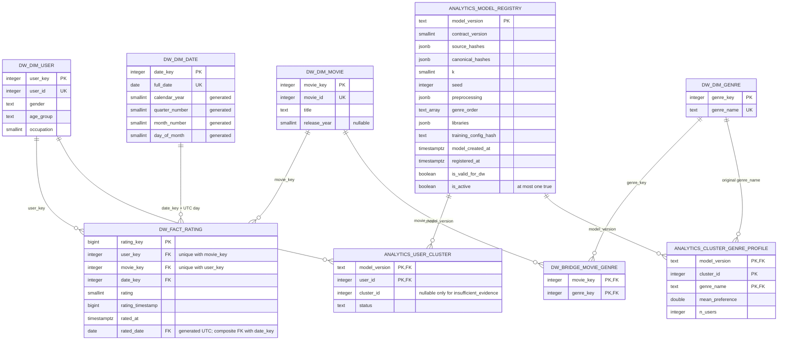

# ERD nháp S04

P1-S04-draft-v2, WAITING_REVIEW. Kế thừa nguyên mô hình v1; chỉ cập nhật căn cứ PR #5, không thêm quan hệ/cột. Ký hiệu `||--o{`: một hàng cha có thể có 0..N hàng con, mỗi con có đúng một cha. Tất cả FK trong SQL mặc định NO ACTION; không tự cascade xóa dữ liệu. Trong Mermaid, `text_array` biểu diễn SQL text[] và `double` biểu diễn double precision.

Tên có tiền tố DW/ANALYTICS tương ứng schema viết thường trong SQL. FK ngày thực tế là `(date_key,rated_date) → dim_date(date_key,full_date)`; ERD chỉ có một đường quan hệ đó. UNIQUE fact `(user_key,movie_key)` không bao gồm thời điểm vì G1 đã đối soát không cặp user–movie lặp. Không suy mỗi người chỉ xem phim một lần.

Staging là lớp giữ trường nguồn, không có FK trực tiếp sang DW trước validation:

| Bảng staging | PK | Trường text nguồn |
|---|---|---|
| users_raw | source_line | user_id_raw, gender_raw, age_code_raw, occupation_raw |
| movies_raw | source_line | movie_id_raw, title_raw, genres_raw |
| ratings_raw | source_line | user_id_raw, movie_id_raw, rating_raw, timestamp_raw |

Hai bảng analytics là 0..N theo dimension khi giữ nhiều phiên bản; trong **một model_version** chỉ một hàng/user, và mỗi profile có một hàng/(cluster,genre). Không có FK trực tiếp user_cluster→cluster_genre_profile vì một cluster có nhiều genre; tính liên kết cluster/K được kiểm cả gói trước activate.

## Ví dụ tổng hợp, không phải dữ liệu người dùng thật

Giả sử phim M thuộc Action và Comedy. Bridge có hai hàng cho M. Hai đánh giá giả lập cho M là 4 và 2:

- Fact có hai hàng, tổng điểm 6, điểm trung bình 6/2=3.
- Join bridge để phân tích genre cho ra bốn hàng: Action count 2 và Comedy count 2. Tổng rating **duy nhất vẫn 2**, không cộng 2+2 thành 4.
- Tỷ trọng lượt gán genre trong tập ví dụ: Action 2/(2+2)=50%, Comedy 50%; mẫu số 4 lượt gắn, khác 2 rating duy nhất.
- View `dw.v_ml_ratings` không join bridge nên vẫn hai hàng; view `dw.v_ml_movie_genres` chỉ trả hai liên kết M–genre.

Bridge không giới hạn mỗi phim chỉ có hai genre; số liên kết phải khớp nguồn và manifest đã kiểm nhận. Biểu đồ trên không thêm director/actor hoặc dimension khác nguồn.
