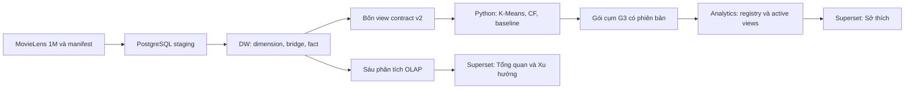

# Chương 1. Giới thiệu bài toán và phạm vi nghiên cứu

> Bản thảo P1-v1, ngày 24/10/2026 — **WAITING_REVIEW**. Viết theo dàn ý13A đã được điều phối duyệt. Chưa ghép phần P2 hoặc chốt G4.

## 1.1. Bối cảnh và vấn đề đặt ra

Dữ liệu đánh giá phim có thể hỗ trợ hai nhóm công việc: mô tả những gì đã xảy ra trong lịch sử và xây dựng gợi ý dựa trên lịch sử được phép sử dụng. Hai nhóm công việc này cần một nền dữ liệu nhất quán. Nếu báo cáo BI và mô hình khai phá tự chuẩn hóa nguồn theo những cách khác nhau, cùng một câu hỏi có thể cho kết quả khác nhau dù đều được gọi là phân tích MovieLens. Đồ án vì vậy kết hợp xây dựng kho dữ liệu, truy vấn OLAP và khai phá trên một hợp đồng dữ liệu chung, thay vì chỉ trình bày riêng từng công cụ. [Nguồn: E01, E04 trong [danh mục bằng chứng](../report_evidence_index.md).]

Nguồn sử dụng là MovieLens 1M của GroupLens. Snapshot đã khảo sát gồm 6.040 hồ sơ người dùng, 3.883 phim trong danh mục và 1.000.209 bản ghi đánh giá, trong khoảng từ 25/04/2000 đến 28/02/2003 theo UTC. Đây là dữ liệu đánh giá lịch sử: một bản ghi thể hiện số sao người dùng gửi cho phim và thời điểm gửi đánh giá. Nguồn không cung cấp lượt xem, thời lượng xem hoặc doanh thu. Do đó, các đại lượng được báo cáo trong đồ án phải được diễn đạt là số đánh giá và điểm đánh giá. [Nguồn: [data_profile.csv](../../../results/eda/data_profile.csv), [source_manifest.json](../../../data/source_manifest.json), E02–E03.]

Một khó khăn đặc trưng là phim có thể thuộc nhiều thể loại. Việc nối trực tiếp đánh giá với bảng thể loại rồi cộng số dòng sẽ làm một đánh giá xuất hiện nhiều lần. Khó khăn thứ hai là dữ liệu phân bố không đều theo thời gian và theo người dùng; phép tổng hợp cần ghi rõ mẫu số, còn đánh giá hệ gợi ý cần tách lịch sử huấn luyện với dữ liệu tương lai. Kiến trúc và cách kiểm chứng của đồ án được xây dựng để xử lý các vấn đề này trước khi diễn giải kết quả.

## 1.2. Mục tiêu và ba câu hỏi nghiên cứu

Mục tiêu chung là tạo được một luồng dữ liệu có thể truy vết từ nguồn đến DW, từ DW đến báo cáo và khai phá, với kết quả được đối soát theo cùng quy ước. Mục tiêu không chỉ là có bảng dữ liệu hoặc biểu đồ, mà còn giải thích được một con số được tính từ đâu, ở grain nào và trong phạm vi quan sát nào.

**Bảng 1.1. Câu hỏi, phương pháp và đầu ra.**

| Câu hỏi | Nội dung | Cách giải quyết | Đầu ra và căn cứ |
|---|---|---|---|
| Q1 | Có những nhóm sở thích nào và cơ cấu tuổi/giới của các nhóm khác nhau như thế nào trong dữ liệu lịch sử? | Tỷ lệ thể loại từ đánh giá tích cực → K-Means; ghép tuổi/giới sau phân cụm | Hồ sơ cụm, bảng thử cấu hình, heatmap và dashboard Sở thích; E12–E13 |
| Q2 | Gợi ý Top 5 phim theo lịch sử đánh giá như thế nào? | Item-based CF so với Popularity Baseline, chia thời gian và đánh giá cùng cohort | Bảng validation/test, Precision@5, Recall@5, fallback và CLI; E14–E16 |
| Q3 | Số đánh giá thuộc từng thể loại biến động như thế nào qua các quý trong thời kỳ dữ liệu? | OLAP theo quý, count, QoQ, tỷ trọng và cờ quý biên | O4/O5/O6 và dashboard Xu hướng; E10–E11 |

Nguồn bảng: [đặc tả dự án](../../project_spec.md), [tiêu chí nội bộ](../../acceptance.md), [danh mục bằng chứng E01–E20](../report_evidence_index.md). Bảng mô tả thiết kế nghiên cứu, không thay thế kết quả thực nghiệm ở chương 4 và chương 5.

Q1 mang tính mô tả cắt ngang trên dữ liệu lịch sử; sự khác nhau giữa các nhóm tuổi không chứng minh sở thích của cùng một người thay đổi theo tuổi. Q2 đánh giá gợi ý từ lịch sử rating, không suy luận đạo diễn hoặc diễn viên vì nguồn không có các thuộc tính đó. Q3 phân tích hoạt động gửi đánh giá trong tập dữ liệu, không đại diện cho nhu cầu hiện tại của thị trường.

## 1.3. Phạm vi dữ liệu, công nghệ và sản phẩm

Đồ án sử dụng ba tệp dữ liệu nghiệp vụ users, movies và ratings cùng README nguồn để kiểm provenance và mã dữ liệu. Dữ liệu được đọc theo Latin-1 với dấu phân cách `::`, sau đó chuẩn hóa thành bốn bảng logic users, movies, movie_genres và ratings theo contract v2. ID MovieLens được giữ nguyên ở giao diện trao đổi; khóa thay thế chỉ phục vụ quan hệ nội bộ DW. ZIP code không được sử dụng. [Nguồn: [hợp đồng v2](../../shared/data_contract.md), E02–E04.]

PostgreSQL đảm nhiệm lưu trữ staging, DW, các view OLAP và kết quả cụm đã kiểm nhận. Python thực hiện đọc nguồn, ETL, đối soát và khai phá. Apache Superset cung cấp giao diện phân tích với tài khoản BI có quyền đọc các view cần thiết. Môi trường Superset và metadata của nó tách khỏi DW; môi trường Python chạy ETL/ML cũng tách khỏi container Superset. Phiên bản và môi trường thực nghiệm được trình bày ở chương 4, không coi phiên bản công cụ là bằng chứng chức năng đã đạt.

**Bảng 1.2. Sản phẩm trong phạm vi và ý nghĩa kiểm chứng.**

| Thành phần | Sản phẩm | Điều cần chứng minh |
|---|---|---|
| DW | ERD, schema, từ điển, mapping, bốn view giao tiếp | Grain, khóa, UTC và dữ liệu đầu ra đúng contract |
| ETL | Staging và full refresh theo transaction | Chạy lại tương đương; lỗi không để lại dữ liệu nạp dở |
| OLAP/BI | Sáu truy vấn và ba dashboard | Chỉ số, bộ lọc và mẫu số khớp SQL độc lập |
| Q1 | K-Means và gói cụm có phiên bản | Feature đúng; lựa chọn cấu hình có lý do; thiếu bằng chứng được tách riêng |
| Q2 | CF, baseline, đánh giá và CLI | Không rò rỉ tương lai; cùng cohort/candidate; kết quả test có receipt |
| Tái lập/tài liệu | Requirements, hướng dẫn, bằng chứng, báo cáo và demo | Phân biệt đã kiểm tại P1 với xác nhận P2 và nghiệm thu cuối |

Nguồn bảng: [acceptance.md](../../acceptance.md), [integration_checklist.md](../../integration_checklist.md), E01/E18–E20. CF không bị đặt điều kiện phải thắng baseline; kết quả được báo theo metric thực tế.

Ngoài phạm vi hiện tại là Apriori, Power BI, website sản phẩm, streaming, học sâu, bổ sung đạo diễn/diễn viên, SCD Type 2 và ETL tăng dần. Các nội dung này không được coi là phần đã triển khai hoặc dùng để mở rộng kết luận của đồ án. [Nguồn: [project_spec.md](../../project_spec.md), mục phạm vi.]

## 1.4. Kiến trúc giải pháp và phân công

Luồng dữ liệu của hệ thống được tổ chức như Hình 1.1. Các mũi tên mô tả trách nhiệm và quan hệ phụ thuộc; hình không thay thế bằng chứng chạy thực tế.

*Hình 1.1. Kiến trúc luồng dữ liệu, biên tập từ [mapping](../../../database/source_to_target.md), [quy trình refresh](../../../database/refresh_and_reconciliation.md) và [hướng dẫn tích hợp](../integration_runbook.md). Nhánh CF trả gợi ý qua CLI; gói G3 trong hình là gói cụm Q1.*

P1 phụ trách thiết kế DW, ETL, OLAP, Superset và tổng hợp tài liệu cuối. P2 phụ trách khảo sát/adapter dữ liệu, đặc trưng, K-Means, CF, baseline và đánh giá. Sự phân công dựa trên giao diện chung: P1 cung cấp bốn view đúng contract; P2 sử dụng cùng ID nguồn và serializer; kết quả cụm được P1 kiểm nhận trước khi đưa vào BI. Cách tổ chức này cho phép hai phần phát triển song song nhưng vẫn có các điểm đối soát rõ ràng. [Nguồn: [workflow](../../shared/github_workflow.md), E04/E08/E13.]

Đối với báo cáo, P1 viết chương 1, 3, 4; P2 viết chương 2, 5, 6. P1 chỉ ghép bản tổng sau khi hai phần được duyệt. Nội dung thuật toán và phân tích thực nghiệm Q1/Q2 được trình bày tập trung ở chương 5; chương 4 chỉ mô tả giao diện và cách sử dụng kết quả cụm trong BI để tránh lặp phần khai phá.

## 1.5. Phương pháp kiểm chứng và trạng thái tích hợp

Kiểm chứng được tổ chức theo nhiều lớp. Lớp dữ liệu so nguồn, bảng canonical và view DW bằng schema, số dòng, khóa, miền, UTC và SHA-256 theo serializer chung. Lớp ETL dùng fixture tự tạo để kiểm lỗi và rollback, đồng thời so hai lần chạy trên cùng code/config. Lớp BI đối soát SQL với API/UI trên nhiều tổ hợp filter. Lớp khai phá giữ cố định giao thức validation/test và nguồn receipt, không chạy lại test để thay kết quả khi viết tài liệu. [Nguồn: E06–E18.]

Trong phép kiểm tích hợp tại P1, hai chu trình trên database thử riêng đã hoàn thành với các checkpoint sau ETL và sau nạp G3 được phân biệt. Điều đó hỗ trợ kết luận về luồng đã kiểm trên máy P1, chưa tự động chứng minh tái lập trên mọi máy hoặc mọi hệ điều hành. Chi tiết kết quả và giới hạn được trình bày ở chương 4; run/hash/lệnh dài được đưa vào phụ lục truy vết của bản thảo. [Nguồn: [summary12A](../../../results/warehouse/s12a/57c1e8e3d3f445c4b3eeddbfc3364709/summary.json), E18.]

Tại thời điểm viết ngày 24/10/2026, PR25 đã merge; merge commit của PR này là candidate đang kiểm nhận. Theo thông tin điều phối, P2 đã báo tái lập trên máy Windows độc lập, Python 3.12.6 và PostgreSQL 17.4, đồng thời báo G2 CONFIRMED. Bằng chứng công bố của P2 đang chờ điều phối review; đây chưa phải lượt P1 kiểm độc lập hoặc nghiệm thu G4. Không có cơ sở ghi đã kiểm Linux. [Nguồn: [ghi nhận P2](../p2_intake_reported_20261024.json), E20.]

Các yêu cầu kỹ thuật được dùng hiện tại là tiêu chí nội bộ của nhóm. Rubric và mẫu trình bày chính thức chưa được xác minh bằng tài liệu đã nhận; việc thiếu chúng không ngăn viết bản thảo nhưng cần được bổ sung trước khi hoàn thiện bản nộp. Đồ án không tự đặt số trang hay thể thức bắt buộc để thay yêu cầu giảng viên. Phần kết luận tích hợp cuối sẽ được cập nhật sau báo cáo P2 được review và nghiệm thu 12B/G4.

## 1.6. Bố cục báo cáo

Sau chương mở đầu, chương 2 trình bày cơ sở lý thuyết và phương pháp. Chương 3 mô tả dữ liệu, chất lượng, hợp đồng và mô hình DW. Chương 4 trình bày ETL, kiểm chứng, OLAP và dashboard, trong đó có kết quả trả lời Q3. Chương 5 tập trung thực nghiệm K-Means cho Q1 và CF/baseline cho Q2. Chương 6 tổng hợp kết luận, giới hạn và hướng phát triển, với trạng thái tích hợp được khóa theo nghiệm thu cuối thay vì suy ra từ riêng một báo cáo kỹ thuật.
