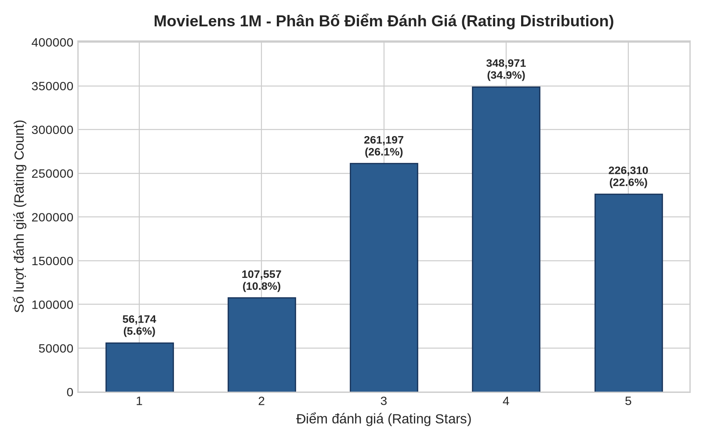
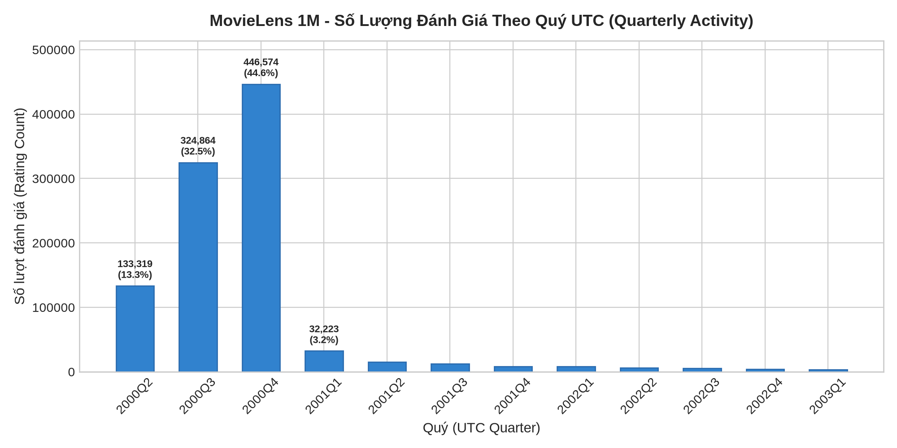
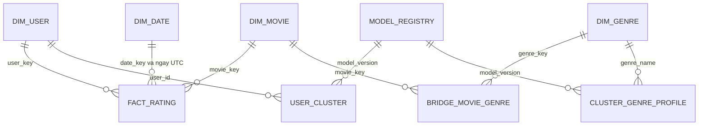

# Chương 3. Dữ liệu nguồn và thiết kế kho dữ liệu

## 3.1. Nguồn dữ liệu và phạm vi quan sát

Theo tài liệu nguồn [R01](references.md), MovieLens 1M gồm ba tệp dữ liệu chính: users mô tả người dùng, movies mô tả danh mục phim và thể loại, ratings lưu đánh giá. README đi kèm cung cấp quy ước nguồn; nó được kiểm hash nhưng không nạp thành một bảng nghiệp vụ. Mỗi máy tải nguồn theo manifest thay vì trao đổi toàn bộ thư mục raw. Cách này tách việc có cùng dữ liệu logic khỏi đường dẫn cục bộ của từng thành viên. [Nguồn: [source_manifest.json](../../../data/source_manifest.json), [hợp đồng v2](../../shared/data_contract.md), E02–E04 trong [chỉ mục](../report_evidence_index.md).]

**Bảng 3.1. Quy mô snapshot và các bảng logic chuẩn.**

| Thành phần | Số dòng dữ liệu | Khóa logic | Ý nghĩa |
|---|---:|---|---|
| users | 6.040 | user_id | Hồ sơ người dùng nguồn |
| movies | 3.883 | movie_id | Toàn bộ phim trong danh mục |
| movie_genres | 6.408 | movie_id, genre_name | Các cặp phim–thể loại sau tách chuỗi |
| ratings | 1.000.209 | user_id, movie_id sau kiểm EDA | Đánh giá nguồn, không phải phiên xem |

Nguồn: [canonical_manifest.json](../../../results/eda/canonical_manifest.json), [data_profile.csv](../../../results/eda/data_profile.csv). Số dòng không tính header CSV. SHA đầy đủ và quy tắc byte được dẫn ở phụ lục truy vết, không đặt vào từng bảng nội dung.

Khoảng quan sát theo thời điểm đánh giá là `2000-04-25T23:05:32Z` đến `2003-02-28T17:49:50Z`. Hai quý ngoài cùng không chứa đủ khoảng thời gian của quý lịch. Vì vậy, sự thay đổi số rating giữa các quý cần xét cờ biên trước khi diễn giải tăng trưởng; việc có đủ khoảng ngày của quý nội bộ cũng không chứng minh dữ liệu đại diện toàn thị trường. [Nguồn: [eda_metrics.json](../../../results/eda/eda_metrics.json), [olap_findings.md](../olap_findings.md).]

## 3.2. Những kết quả EDA ảnh hưởng thiết kế

### 3.2.1. Khóa, quan hệ và tính đầy đủ

EDA ghi nhận không có cặp user–movie trùng trong 1.000.209 rating. Kết quả này là căn cứ cho UNIQUE của fact, không phải giả định ban đầu về hành vi người dùng. Trong DW, UNIQUE được đặt trên cặp surrogate user_key–movie_key sau khi mỗi ID nguồn đã được ánh xạ duy nhất sang dimension. Ràng buộc này không cho phép kết luận một người chỉ xem một phim một lần. [Nguồn: [data_profile.csv](../../../results/eda/data_profile.csv), [schema.sql](../../../database/schema.sql), E03/E05.]

Các kiểm khóa tham chiếu và miền mã được mô tả trong [data_understanding.md](../../P2/data_understanding.md), manifest và đối soát DW. ETL vẫn kiểm lại ánh xạ thay vì dựa vào kết luận tổng quát “dữ liệu sạch”: thiếu dimension, rating sai miền hoặc cặp trùng phải tạo lỗi, không bị mất qua inner join hoặc tự loại bỏ.

**Bảng 3.2. Quan sát dữ liệu và hệ quả thiết kế.**

| Quan sát | Kết quả của snapshot | Quyết định |
|---|---|---|
| Trùng khóa user–movie | 0 cặp trùng | UNIQUE(user_key,movie_key) và kiểm trước commit |
| Điểm đánh giá | Số nguyên 1..5 | Kiểu smallint, NOT NULL và CHECK |
| Thể loại | 18 tên gốc, 6.408 cặp | Dimension genre và bridge, không thêm cột genre đơn vào phim |
| Phim chưa có rating | 177 trong 3.883 phim | Giữ đầy đủ danh mục; KPI danh mục khác KPI phim có rating |
| Người không có rating ≥ 4 | 2 người | Không là user thiếu mọi rating; tách insufficient_evidence trong Q1 |
| Năm phát hành | Snapshot trích xuất được; miền năm 1919–2000 | Vẫn cho phép NULL theo contract nếu không khớp mẫu ở nguồn khác |

Nguồn: [data_profile.csv](../../../results/eda/data_profile.csv), [eda_metrics.json](../../../results/eda/eda_metrics.json), [data_understanding.md](../../P2/data_understanding.md), [từ điển](../../../database/data_dictionary.md). Quy tắc NULL là thiết kế giao diện, không phải phát biểu rằng snapshot hiện tại có phim thiếu năm.

### 3.2.2. Phân bố đánh giá, hoạt động và nhân khẩu học

Mức 4 sao có 348.971 đánh giá, cao nhất trong năm mức; mức 1 sao có 56.174 đánh giá. Điểm trung bình toàn bộ snapshot xấp xỉ 3,5816. Đây là phân bố trong dữ liệu đã thu thập, không phải thước đo trực tiếp sự hài lòng của toàn bộ khán giả. Hình 3.1 cho thấy sự bất cân xứng giữa các mức sao và là cơ sở để phân biệt rating tích cực dùng cho Q1 với toàn bộ rating dùng trong kho. [Nguồn: [eda_metrics.json](../../../results/eda/eda_metrics.json), E03.]

*Hình 3.1. Phân bố rating 1–5 trong MovieLens 1M. Nguồn: EDA P2, `results/eda/rating_distribution.png`; số liệu đối chiếu E03.*

Số rating mỗi người dùng có trung vị 96 và trung bình khoảng 165,60, trong khi giá trị lớn nhất là 2.314. Trung bình cao hơn trung vị cho thấy mức đóng góp không đồng đều; một nhóm người đánh giá nhiều có thể ảnh hưởng đáng kể đến thống kê theo rating. Phân tích quy mô cụm vì vậy đếm user, không đếm rating thay user. [Nguồn: [data_profile.csv](../../../results/eda/data_profile.csv), nhóm users_activity.]

Hồ sơ nguồn gồm 4.331 người mang mã M và 1.709 người mang mã F; nhóm 25–34 có 2.096 hồ sơ, lớn nhất trong bảy nhóm tuổi. Những chênh lệch này cần được giữ làm ngữ cảnh khi mô tả cụm. Chúng không chứng minh mẫu đại diện cơ cấu dân số và không giải thích quan hệ nhân quả giữa tuổi/giới với sở thích. [Nguồn: [eda_metrics.json](../../../results/eda/eda_metrics.json), users.gender_distribution và age_distribution.]

### 3.2.3. Phim nhiều thể loại và thời gian

Trong danh mục, 2.025 phim có một genre và 1.858 phim có nhiều genre, tối đa sáu genre. Mỗi phim vẫn chỉ có một dòng trong dim_movie. Nếu một đánh giá phim giả lập thuộc Comedy và Drama, fact có một rating, bridge có hai liên kết, còn thống kê theo genre nhận một lượt gán ở mỗi genre. Ví dụ tự tạo này minh họa quan hệ, không đưa lịch sử cá nhân thật vào báo cáo. [Nguồn số lượng: [data_profile.csv](../../../results/eda/data_profile.csv); quy tắc: [schema.sql](../../../database/schema.sql), E05.]

Hình 3.2 cho thấy rating tập trung mạnh ở các quý năm 2000. Việc giảm số rating sau đó có thể được mô tả bằng count/QoQ, nhưng không đủ dữ kiện để quy nguyên nhân cho thị trường phim hoặc thay đổi nhu cầu. Các nguyên nhân đó chỉ có thể là giả thuyết khi chưa có nguồn bổ sung.

*Hình 3.2. Hoạt động đánh giá theo quý UTC. Nguồn: EDA P2, `results/eda/quarterly_activity.png`, đối chiếu E03/E10. Quý 2000Q2 và 2003Q1 là quý biên có khoảng quan sát không đầy đủ.*

## 3.3. Hợp đồng dữ liệu chung

Hợp đồng v2 quy định không chỉ tên bảng mà cả kiểu, thứ tự cột, ID, xử lý NULL và serializer. users có user_id, gender, age_group, occupation; movies có movie_id, title, release_year; movie_genres có movie_id, genre_name; ratings có user_id, movie_id, rating, timestamp, rated_at. ID xuất ra là ID MovieLens, không phải surrogate của một lần nạp DW. [Nguồn: [data_contract.md](../../shared/data_contract.md), E04.]

Bảy nhóm tuổi được ánh xạ từ mã nguồn thành Under 18,18–24,25–34,35–44,45–49,50–55,56+; nhãn máy đọc giữ đúng chuỗi contract, gồm `Under 18`. Gender giữ F/M và occupation giữ mã 0..20. Title được bảo toàn; release_year chỉ lấy nhóm bốn chữ số trong ngoặc cuối, không khớp thì NULL. Các phép biến đổi này hạn chế việc hai phía tự “làm sạch” khác nhau và tránh suy diễn thêm thông tin không có trong nguồn.

CSV canonical dùng UTF-8 không BOM, LF, header và thứ tự cột cố định, số nguyên không có `.0`, NULL là ô rỗng. Mỗi bảng được sort theo khóa quy định trước băm. timestamp giữ giây Unix kiểu int64; rated_at là cùng thời điểm theo UTC và xuất ISO 8601 dạng kết thúc bằng Z. Nhờ vậy, hai đường đọc raw/CSV/DW có thể đối soát byte logic thay vì chỉ so số dòng. Các hash bằng nhau là bằng chứng tương đương theo serializer đã chốt, không thay cho toàn bộ kiểm catalog và ràng buộc.

## 3.4. Kiến trúc staging, DW và analytics

### 3.4.1. Staging giữ đầu vào trước diễn giải

Ba bảng users_raw, movies_raw và ratings_raw giữ các trường nguồn cần dùng dưới dạng text cùng source_line. source_line là vị trí dòng trong từng tệp, không là ID nghiệp vụ. Tách staging cho phép phát hiện lỗi số trường, ép kiểu hoặc miền giá trị tại vị trí nguồn cụ thể trước khi hình thành quan hệ DW. Không lưu nguyên dòng users có ZIP; trường ZIP được loại có chủ đích theo contract. [Nguồn: [từ điển](../../../database/data_dictionary.md), [mapping](../../../database/source_to_target.md), E05/E06.]

Việc một số cột staging cho phép NULL không có nghĩa ETL chấp nhận dữ liệu nghiệp vụ thiếu. Staging là lớp giữ dữ liệu trước validation; kiểm NULL và phép ép kiểu vẫn phải đạt trước commit snapshot DW. Không tự bỏ dòng lỗi để làm count cuối khớp kỳ vọng.

### 3.4.2. Grain và quan hệ trong DW

Fact_rating có grain một bản ghi đánh giá nguồn. Bốn dimension cung cấp ngữ cảnh người dùng, phim, ngày UTC và thể loại. Bridge biểu diễn quan hệ nhiều–nhiều của phim với genre. Thiết kế sao có bridge này giữ fact ổn định trong khi vẫn cho phép phân tích theo thể loại. [Nguồn: [ERD](../../../database/erd.md), [schema](../../../database/schema.sql), E05.]

*Hình 3.3. ERD quan hệ rút gọn từ `database/erd.md`; `||--o{` là một cha đến 0..N dòng con. PK/FK và kiểu đầy đủ ở bảng 3.3 và ERD nguồn. FK ngày thực là ghép date_key với ngày UTC, không chỉ so khóa kỹ thuật. ERD đầy đủ, gồm trường, kiểu và khóa, được cung cấp trong nguồn liên kết.*

**Bảng 3.3. Bảng chính và quyết định khóa.**

| Bảng | Khóa chính | Thuộc tính/quan hệ quan trọng |
|---|---|---|
| dim_user | user_key integer identity | user_id unique; gender,age_group,occupation có kiểm miền |
| dim_movie | movie_key integer identity | movie_id unique; title text; release_year smallint nullable |
| dim_date | date_key integer identity | full_date unique; năm/quý/tháng/ngày GENERATED STORED |
| dim_genre | genre_key integer identity | genre_name unique, giữ tên nguồn |
| bridge_movie_genre | movie_key,genre_key | Hai FK đến dimension; mỗi cặp đúng một lần |
| fact_rating | rating_key bigint identity | FK user/movie/ngày; UNIQUE(user_key,movie_key); rating 1..5; epoch và UTC tương đương |

Nguồn: [schema.sql](../../../database/schema.sql), [data_dictionary.md](../../../database/data_dictionary.md). Khóa kỹ thuật có thể thay đổi sau refresh; đối soát giữa hai lần chạy dùng ID nguồn và nội dung logic, không dùng equality của identity.

Lịch ngày được sinh liên tục từ ngày UTC nhỏ nhất đến lớn nhất trong rating. Cách này hỗ trợ báo cáo có các kỳ không phát sinh đánh giá. rated_at dùng timestamptz; rated_date được sinh theo UTC. FK ghép `(date_key,rated_date)` đến `(date_key,full_date)` ngăn lỗi một fact trỏ đúng khóa tồn tại nhưng sai ngày. CHECK bảo đảm epoch và rated_at biểu diễn cùng thời điểm, tránh kết quả phụ thuộc timezone máy. [Nguồn: schema và quy trình refresh, E05/E07.]

### 3.4.3. Index và tác dụng dự kiến

PK/UNIQUE tạo index cho ID nguồn, full_date, genre_name và cặp user–movie. Index bổ sung trên fact theo movie_key hỗ trợ truy vấn từ phim; index `(date_key,movie_key)` và rated_at phục vụ lọc thời gian/tổng hợp phim trong kỳ. Bridge có index ngược `(genre_key,movie_key)` để truy từ genre sang phim. Các bảng kết quả cụm có index phục vụ lọc version/cụm và tra user/genre. [Nguồn: [schema.sql](../../../database/schema.sql), các lệnh CREATE INDEX.]

Đây là lý do thiết kế theo đường truy cập, không phải khẳng định mọi truy vấn đã được tối ưu hoặc có mức tăng tốc cụ thể. Muốn kết luận hiệu năng cần kế hoạch thực thi và benchmark trong điều kiện tải xác định; bằng chứng hiện tại chủ yếu chứng minh tính đúng và chức năng của snapshot.

## 3.5. Ánh xạ nguồn–đích và giao diện dữ liệu

**Bảng 3.4. Các phép biến đổi chính.**

| Nguồn | Đích | Phép xử lý và kiểm |
|---|---|---|
| users:ID,gender,age,occupation | dim_user | Ép kiểu; ánh xạ bảy tuổi; giữ F/M và mã nghề; bỏ ZIP |
| movies:ID,title | dim_movie | Giữ title; trích năm đúng mẫu cuối; giữ ID gốc |
| movies:genres | dim_genre và bridge | Tách `|`, kiểm tên và cặp duy nhất; thiếu mapping phải lỗi |
| ratings:timestamp | dim_date và fact | Epoch → UTC, sinh lịch liên tục, kiểm ngày và thời điểm |
| ratings:user,movie,rating | fact_rating | Tra đúng một surrogate/ID; CHECK 1..5 và UNIQUE |
| G3 đã kiểm | registry,user_cluster,cluster_genre_profile | Kiểm identity/hash/cohort/genre rồi nạp cùng transaction |

Nguồn: [source_to_target.md](../../../database/source_to_target.md), E05/E13. Tên bảng trong bảng được rút gọn; schema đầy đủ ở SQL nguồn.

Bốn view `dw.v_ml_users`, `dw.v_ml_movies`, `dw.v_ml_movie_genres`, `dw.v_ml_ratings` là giao diện cho adapter P2 và các thành phần dùng dữ liệu chuẩn. Đặc biệt, ratings view không join bridge. Với một phim hai genre, nó vẫn trả một dòng cho một đánh giá; chỉ view movie_genres trả hai cặp. Việc tách này bảo vệ cả số rating toàn hệ thống lẫn dữ liệu ma trận của mô hình khỏi nhân dòng. [Nguồn: schema và [dw_handoff.md](../dw_handoff.md), E08.]

## 3.6. Quản lý kết quả cụm trong analytics

Registry lưu model_version, contract, source/canonical hashes, cấu hình huấn luyện, thư viện và trạng thái active/valid. User_cluster giữ một dòng mỗi user cho mỗi version; assigned có cluster_id, insufficient_evidence có NULL. Cluster_genre_profile lưu một dòng mỗi cụm×genre với mean_preference và n_users. Hai bảng cùng nối registry, tránh ghép profile và user từ hai phiên bản khác nhau. [Nguồn: [schema.sql](../../../database/schema.sql), E13.]

Snapshot đã nạp tại P1 có 6.040 dòng user, gồm 6.038 assigned và 2 thiếu bằng chứng; bốn cụm có 72 dòng profile. mean_preference là trung bình tỷ lệ genre gốc của user trong cụm, không phải tỷ lệ số user “thích” một genre. n_users lặp trên 18 genre của mỗi cụm nên không được cộng toàn cột để lấy tổng người. Chi tiết thực nghiệm và tên cụm do P2 trình bày ở chương 5; chương này chỉ xác định cách lưu và ý nghĩa dữ liệu. [Nguồn: [handoff_summary11B2](../../../results/warehouse/s11b2/handoff_summary.json), E12–E13.]

Hai active view chỉ trả version có cả is_active và is_valid_for_dw. Khi DW full refresh, kết quả cũ bị vô hiệu hóa; sự tồn tại của registry không đủ để BI tiếp tục dùng model đó. Loader chỉ kích hoạt lại sau khi đối soát đầy đủ nguồn hiện tại và gói. Cơ chế này bảo vệ ý nghĩa “cụm của snapshot DW đang dùng”, thay vì lựa chọn version mới nhất theo tên hoặc giữ kết quả cũ theo thói quen.

## 3.7. Ý nghĩa và giới hạn của thiết kế

Thiết kế giữ grain đánh giá, ID nguồn và UTC giúp DW phục vụ đồng thời BI và khai phá mà không buộc hai phía chia sẻ surrogate. Bridge giải quyết đa genre nhưng cũng đặt yêu cầu ghi rõ mẫu số khi tổng hợp. Staging và contract làm rõ nơi bảo toàn nguồn, nơi biến đổi và nơi xuất giao diện; registry bổ sung tính truy vết cho kết quả mô hình.

Các dimension không chứa đạo diễn/diễn viên hoặc lịch sử thay đổi nhân khẩu học vì nguồn không cung cấp chúng. Không có cơ sở tạo dimension phiên xem hoặc doanh thu. Schema được xây dựng cho full refresh của snapshot trong phạm vi dự án, không tự nhận là mô hình kho doanh nghiệp có SCD/incremental đầy đủ. Tái lập độc lập trên Windows của P2 đã được điều phối nghiệm thu sau PR28/PR29; G4 đạt ngày 24/10/2026 trong phạm vi I01–I15. Candidate thực chạy vẫn là merge PR25, không thay bằng commit hồ sơ. Không có kiểm chứng Linux hoặc phục hồi toàn stack trên máy mới. [Nguồn: [ma trận nghiệm thu](../integration_acceptance.md), [ghi nhận G4](../g4_acceptance_20261024.json).] Kết quả thực thi, chạy lại và cách sử dụng thiết kế trong OLAP/BI được trình bày ở chương 4.
