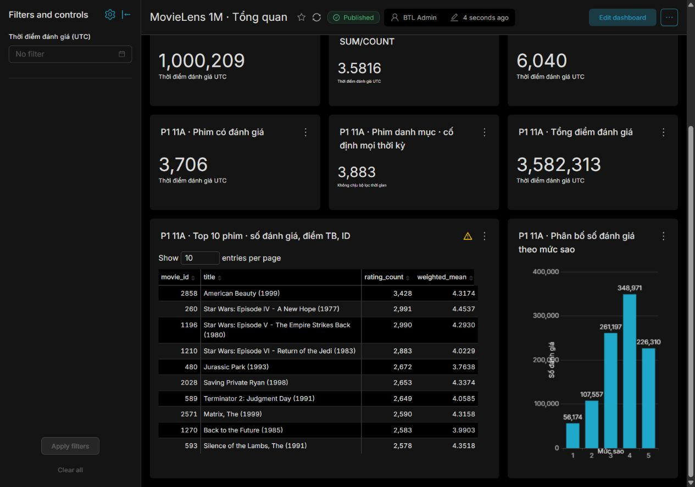
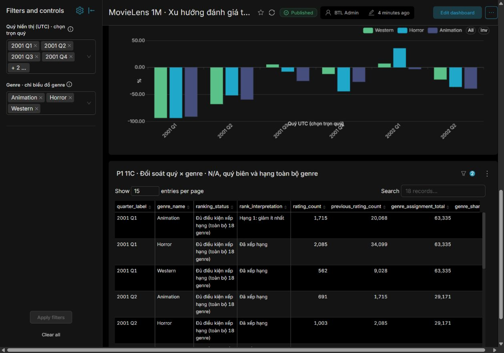
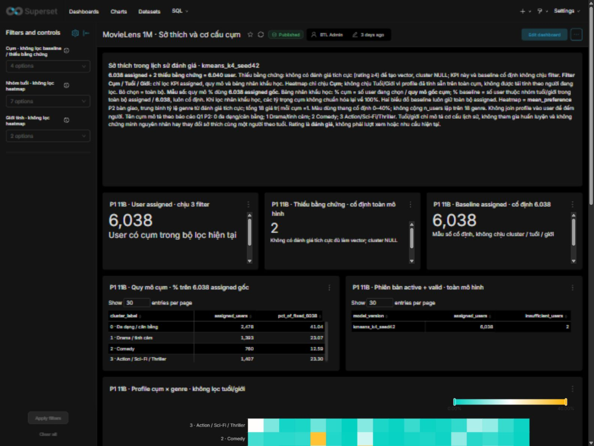
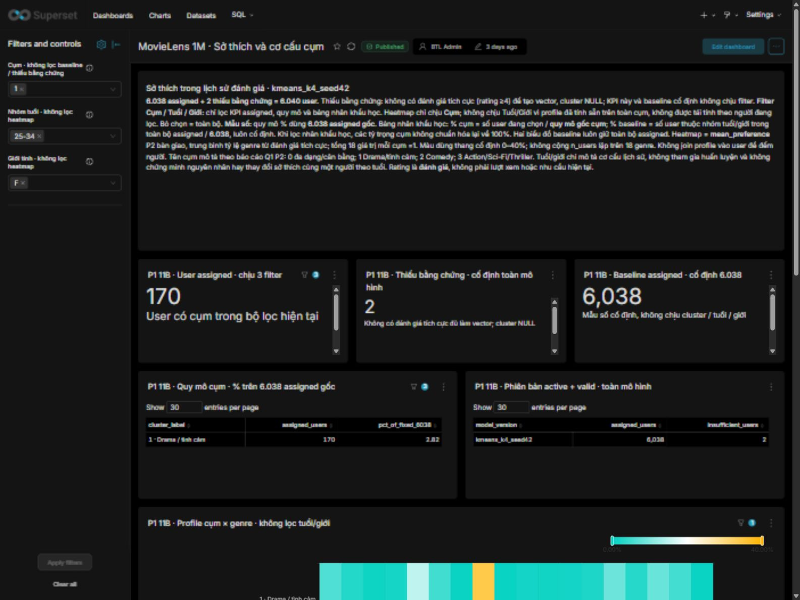

# Chương 4. ETL, đối soát, OLAP và dashboard

## 4.1. Môi trường và tổ chức thực thi

Phần P1 sử dụng PostgreSQL cho staging/DW/analytics, Python cho ETL và đối soát, Superset cho BI. Trong phép kiểm tích hợp 12A tại P1, môi trường mới dùng Python 3.12.14 trên Windows, PostgreSQL 17.11 và thư viện ghim trong requirements tổng. Các thư viện chính gồm numpy 2.0.2, pandas 2.3.3, scipy 1.14.1, scikit-learn 1.5.2 và psycopg2-binary 2.9.10. Cài đặt/import và kiểm dependency được lưu trong hồ sơ môi trường; Superset 6.1.0 có container/môi trường riêng, không cài chung vào venv ETL. [Nguồn: [environment.json](../../../results/warehouse/s12a/57c1e8e3d3f445c4b3eeddbfc3364709/environment.json), [requirements.txt](../../../requirements.txt), E18 trong [chỉ mục bằng chứng](../report_evidence_index.md).]

Tách môi trường mới khỏi môi trường demo giúp phép kiểm dependency không làm thay đổi môi trường đang phục vụ trình diễn. Cấu hình kết nối, mật khẩu, key, dump và output CLI gắn người dùng được giữ cục bộ ngoài Git. Database metadata Superset cũng tách khỏi database nghiệp vụ: phục hồi giao diện không đồng nghĩa đã phục hồi dữ liệu DW, và ngược lại. [Nguồn: [runbook tích hợp](../integration_runbook.md), [runbook chuẩn bị](../integration_prep/README.md), E18–E19.]

Database demo và database thử tích hợp được phân biệt bằng tên, marker, owner và guard. Lệnh có khả năng ghi không được mặc định chấp nhận mọi database. Context tích hợp chỉ cho phép đúng đích thử đã xác minh; guard production gốc không bị nới để checker chạy trên một clone bất kỳ. Đây là biện pháp giới hạn phạm vi thao tác, không là cơ chế phân quyền thay thế cho PostgreSQL. Lệnh dài và identity cụ thể được đưa vào [phụ lục truy vết](appendix_sources.md).

## 4.2. Extract và staging: giữ nguồn trước biến đổi

Luồng đọc kiểm tệp nguồn bằng hash/manifest trước khi nạp. Mỗi dòng được giải mã Latin-1, tách bằng `::` và kiểm số trường. Staging giữ các trường cần thiết cùng source_line để đối soát; ZIP không được giữ. Việc kiểm count chỉ là điều kiện đầu tiên: nội dung trường và thứ tự dòng cũng được so với nguồn để tránh trường hợp đúng số dòng nhưng mất ký tự hoặc đổi giá trị. [Nguồn: [S05](../../agent/steps/P1/S05.md), [summary S05](../../../results/warehouse/s05_summary.json), E06.]

Ba bảng staging được nạp trong một transaction. Lỗi malformed line, encoding hoặc ràng buộc phải làm thất bại lượt nạp thay vì bị bỏ qua. Bằng chứng S05 có kiểm chạy lại, bảo toàn trường/source_line và rollback fixture. Các lệnh tiểu bước S05 yêu cầu DW còn rỗng chỉ phù hợp với trạng thái lịch sử đó; chúng không được dùng để nạp lại staging khi DW đã có dữ liệu. Khả năng chạy lại toàn luồng được kiểm bằng pipeline tích hợp, không bằng cách ghép các CLI có commit riêng. [Nguồn: E06–E07, [quy trình refresh](../../../database/refresh_and_reconciliation.md).]

Sự khác nhau giữa staging và DW nằm ở trách nhiệm dữ liệu. Staging giữ biểu diễn nguồn để phát hiện lỗi và truy vết; DW cung cấp kiểu/ràng buộc/ngữ nghĩa phù hợp phân tích. Việc ép kiểu hoặc ánh xạ nhóm tuổi thuộc luồng biến đổi có kiểm soát, không phải thay nguồn thật.

## 4.3. Transform, Load và full refresh nguyên tử

### 4.3.1. Thứ tự nạp và ánh xạ

Dimension user, movie, genre và date được nạp trước bridge và fact. user giữ ID nguồn và ánh xạ đúng bảy nhóm tuổi; movie giữ title và trích năm ở ngoặc cuối; genre giữ tập tên gốc; date là lịch ngày liên tục theo UTC. Bridge tra movie_id và genre_name đến khóa dimension; fact tra user, movie và ngày UTC. Mỗi phép tra phải tìm đúng một ánh xạ. Thiếu hoặc nhiều ánh xạ đều là lỗi, không dùng inner join để âm thầm giảm số bản ghi. [Nguồn: [mapping](../../../database/source_to_target.md), [S06](../../agent/steps/P1/S06.md), E05/E07.]

Fact không join genre trong luồng nạp. Một phim nhiều genre vẫn tạo một rating nguồn trong fact; quan hệ đa genre chỉ được dùng khi truy vấn cần phân tích theo thể loại. Kiểm năm NULL, ký tự đặc biệt, nhóm tuổi, ngày sát biên UTC và khóa được thực hiện bằng fixture tự tạo, tách khỏi dữ liệu thật. Các report tiểu bước được giữ để truy vết, không sửa guard hoặc report cũ khi trạng thái DW chuyển sang bước sau. [Nguồn: summary 6A/6B/6C và E07.]

### 4.3.2. Ranh giới transaction và vòng đời model

Full refresh tích hợp dùng một connection, một transaction và khóa giao dịch chung với loader G3. Khái niệm transaction tham chiếu tài liệu PostgreSQL 17 [R06](references.md); việc áp dụng và kết quả kiểm của đồ án được chứng minh bằng artifact nội bộ. Trước thao tác ghi, pipeline kiểm nguồn/hash, cấu hình, marker và catalog. Sau khi khóa, registry được chuyển inactive/invalid; các bảng kết quả cụm, fact, bridge, dimension và staging được dọn theo một danh sách tường minh trong phạm vi dự án. Registry được giữ làm metadata kiểm toán, không dùng CASCADE hoặc DROP để mở rộng phạm vi ngoài danh sách. Sau đó pipeline nạp lại staging → dimension → bridge → fact. [Nguồn: [run_etl.py](../../../etl/run_etl.py), [refresh_and_reconciliation.md](../../../database/refresh_and_reconciliation.md), E07/E18.]

Trước COMMIT, chính connection đang nạp phải kiểm snapshot vừa hình thành. Một checker mở connection khác không thể thay bước này vì chưa đọc được dữ liệu chưa commit. Nếu phát hiện sai hash, miền, khóa hoặc UTC, toàn transaction rollback, bao gồm trạng thái active/valid của model. Nếu COMMIT thành công nhưng ghi manifest ra đĩa thất bại, database đã commit còn gói bàn giao chưa hoàn tất; không được báo rollback database trong tình huống đó. Nếu mất kết nối đúng lúc COMMIT, kết quả phải được ghi là chưa xác định và kiểm lại qua connection mới, không tự retry ghi. [Nguồn: E07, [quy trình refresh](../../../database/refresh_and_reconciliation.md).]

Sau một refresh thành công, kết quả cụm cũ không còn được dùng cho BI. Loader G3 phải kiểm lại gói với DW hiện tại rồi mới kích hoạt. Nhờ vậy, một dashboard Sở thích không vô tình hiển thị cụm được tính từ snapshot khác với fact đang phân tích. Cùng version và payload/config/provenance giống nhau có thể NO-OP hoặc reload theo trạng thái hợp lệ; cùng version nhưng nội dung khác phải bị từ chối, không UPSERT để ghi đè identity. [Nguồn: [g 3_transaction.py](../../../etl/g3_transaction.py), [handoff 11B2](../../../results/warehouse/s11b2/handoff_summary.json), E13/E18.]

### 4.3.3. Đối soát và bằng chứng chạy lại

Đối soát kiểm schema/thứ tự cột, ID nguồn, NULL, khóa/FK, rating, tổng điểm, phân bố sao, biên UTC và bốn canonical hash. Equality của surrogate không được dùng làm tiêu chí tương đương vì identity có thể thay đổi sau refresh. Hai snapshot được coi tương đương nghiệp vụ khi giao diện chuẩn và các điều kiện logic khớp, không chỉ khi count bằng nhau. [Nguồn: [dw_manifest.json](../../../results/warehouse/dw_manifest.json), E08/E18.]

**Bảng 4.1. Kết quả đối soát nghiệp vụ của snapshot.**

| Chỉ tiêu | Kết quả |
|---|---:|
| users / movies / movie_genres | 6.040 / 3.883 / 6.408 |
| ratings | 1.000.209 |
| Tổng điểm rating | 3.582.313 |
| User / phim có rating | 6.040 / 3.706 |
| Phân bố sao 1→5 | 56.174 /107.557 /261.197 /348.971 /226.310 |
| Bốn hash canonical | Khớp manifest theo serializer contract 2 |

Nguồn: [summary 6D](../../../results/warehouse/s06d_summary.json), [DW manifest](../../../results/warehouse/dw_manifest.json), [postflight 12A](../../../results/warehouse/s12a/57c1e8e3d3f445c4b3eeddbfc3364709/postflight.json). Đây là bằng chứng các lượt đã chạy, không là truy vấn mới lúc viết bản thảo.

Bằng chứng 6D ghi hai run cùng code/config và bốn hash tương đương; fixture kiểm parse, mapping/FK, rating, trùng và checksum, gồm phục hồi snapshot có sẵn cùng model state khi lỗi. Phép kiểm không dừng ở việc bảng mới trở về rỗng. Hai chu trình 12A sau khi đã có OLAP/G3 bổ sung bằng chứng về vòng đời tích hợp ở mục 4.7. Những phép kiểm này cho thấy các ca đã thử được bảo vệ; chúng không chứng minh mọi lỗi phần cứng/mất điện hoặc mọi khả năng cạnh tranh đều đã được bao phủ. [Nguồn: [rollback 6D](../../../results/warehouse/s06d_rollback_5c9c553454e54e81953fded2d524877c.json), E07/E18.]

## 4.4. Sáu truy vấn OLAP và kết quả

### 4.4.1. Các phép tổng hợp và thao tác phân tích

**Bảng 4.2. Nội dung và kết quả tiêu biểu O1–O6.**

| Truy vấn | Grain / thao tác | Kết quả tiêu biểu |
|---|---|---|
| O1 | KPI toàn snapshot từ fact | 1.000.209 rating, tổng 3.582.313, mean 3,5815644530 |
| O2 | Một phim; xếp count giảm, mean giảm, ID tăng | American Beauty đứng đầu với 3.428 rating |
| O3 | Genre×nhóm tuổi; slice giới/pivot | Bản đầy đủ 126 ô; dice F/18–24 có Comedy 19.136, Drama 15.977 rating |
| O4 | Năm→quý→tháng UTC | 4 năm+12 quý+35 tháng; tổng từng cấp riêng đều 1.000.209 |
| O5 | Genre×quý, zero-fill và LAG | 18 × 12=216 ô;156 ô đủ điều kiện xếp hạng trong 9 quý |
| O6 | Dice genre/tuổi/thời kỳ, drill-down tháng/phim | Comedy/18–24, nửa cuối 2000:53.541 rating, tổng điểm 185.726 |

Nguồn: [queries.sql](../../../olap/queries.sql), [views.sql](../../../database/views.sql), [report S07](../../../results/olap/s07_af6dbc20b40d4a47aa3ea71bde6fd107/report.json), [findings](../olap_findings.md), E09–E11. Không cộng 51 hàng của các cấp O4 thành một tổng vì một rating xuất hiện ở cấp năm, quý và tháng.

Roll-up được thể hiện bằng tổng hợp tháng lên quý/năm; drill-down đi từ năm/quý xuống tháng hoặc phim. Slice cố định một chiều, chẳng hạn giới F trong O3. Dice kết hợp F, nhóm 18–24 và hai genre, hoặc genre/tuổi/thời kỳ trong O6. Pivot chuyển nhóm tuổi thành cột, genre thành hàng nhưng giữ count và mean của từng ô. Các thao tác này hữu ích vì cùng một kho có thể trả câu hỏi ở nhiều mức chi tiết mà không cần tạo một nguồn dữ liệu riêng cho mỗi biểu đồ.

Mean của nhóm được tính `SUM(rating)::numeric/COUNT`, còn khi gộp nhóm phải gộp tổng điểm và count. Trung bình của hai mean có thể sai nếu hai nhóm có số rating khác nhau. Tương tự, khi chọn nhiều genre theo điều kiện hợp trong O6, mỗi rating thỏa ít nhất một genre chỉ được đếm một lần; không cộng hai kết quả genre đang chồng lấn. [Nguồn: SQL O3/O6, [test S07](../../../tests/warehouse/), E10.]

### 4.4.2. Trả lời Q3: QoQ, tỷ trọng và quý biên

Gọi n(g,t) là số rating được gắn genre g trong quý t. QoQ được tính bằng `100×(n(g,t)−n(g,t−1))/n(g,t−1)`. Lưới genre×quý phải đủ và được điền 0 trước LAG để quý trước là quý lịch liền kề, không phải quý có dữ liệu gần nhất. Khi quý trước bằng 0 hoặc chưa có, QoQ trả NULL/N/A. [Nguồn: [views.sql](../../../database/views.sql), O5; E11.]

Tỷ trọng genre trong quý là `100×n(g,t)/SUM_g n(g,t)`, với mẫu số là tổng lượt gán genre của mọi genre cùng quý. Một rating phim hai genre đóng góp hai lượt gán, vì vậy đây không phải tỷ lệ của tổng rating duy nhất. Việc chọn một genre để hiển thị không được làm mẫu số thu hẹp và biến share của genre đó thành 100%.

**Bảng 4.3. Một số kết quả QoQ đủ điều kiện.**

| Quý | Genre | Quý trước | Quý hiện tại | QoQ | Diễn giải |
|---|---|---:|---:|---:|---|
| 2000Q4 | Animation | 13.102 | 20.068 | +53,17% | Tăng dương trong dữ liệu đánh giá |
| 2001Q1 | Animation | 20.068 | 1.715 | −91,45% | Hạng 1 nhưng giảm ít nhất, không là tăng trưởng dương |
| 2001Q3 | Western | 179 | 189 | +5,59% | Tăng từ nền số tuyệt đối nhỏ |
| 2002Q1 | Horror | 514 | 697 | +35,60% | Tăng dương, cần trình bày cùng count |

Nguồn: [olap_findings.md](../olap_findings.md), bảng kết quả O5, và [reconciliation 11C](../../../dashboard/trends/evidence/reconciliation.json), E11. Quy tắc xếp hạng đang áp dụng yêu cầu quý trước có ít nhất 100 đánh giá thuộc genre; loại quý biên và cặp quý có quý trước là biên khỏi ranking. Quy tắc này được ghi trong phiên bản SQL và hồ sơ được đối soát.

Ví dụ Animation 2001Q1 có mẫu số lượt gán genre 63.335, share khoảng 2,7078% và QoQ−91,454056%. Mặc dù là hạng 1 trong tập đủ điều kiện quý đó, nó vẫn giảm so với quý trước. Chỉ nhìn thứ hạng mà gọi “tăng trưởng cao nhất” sẽ dẫn tới diễn giải sai dấu. Thống kê này mô tả lượng đánh giá đã thu thập; nó không cho phép kết luận nhu cầu hiện tại hoặc doanh thu của Animation giảm tương ứng. [Nguồn: [summary 12A](../../../results/warehouse/s12a/57c1e8e3d3f445c4b3eeddbfc3364709/summary.json), các đối soát 8092; E11/E18.]

## 4.5. Dashboard và phạm vi bộ lọc

### 4.5.1. Tổng quan

Dashboard Tổng quan cung cấp tổng rating, tổng điểm/mean, số user và phim có rating, danh mục phim, Top 10 và phân bố sao. Dataset rating có grain một đánh giá, chỉ join phim theo ID duy nhất, không join bridge. Cột thời gian từ view contract được chuyển thành timestamp UTC có kiểu để Superset lọc trước GROUP BY và Top 10. Mean dùng tỷ lệ tổng điểm/tổng count. KPI 3.883 phim danh mục cố định theo toàn snapshot được tách khỏi time filter và ghi nhãn rõ. [Nguồn: [README 11A](../../../dashboard/overview/README.md), [ratings_dataset.sql](../../../dashboard/overview/ratings_dataset.sql), E17.]

*Hình 4.1. Dashboard Tổng quan trên instance 8089, bộ lọc thời gian No filter. Nguồn ảnh lịch sử: `dashboard/overview/evidence/all_history_charts.jpg`; định nghĩa KPI tại bảng 4.1 và E17. Ảnh không đại diện cho một lần chụp mới trên instance 8092.*

Đối soát 11A so SQL độc lập với API trên toàn lịch sử, Q3/2000 và Q1/2001. Các tổng rating tương ứng là 1.000.209,324.864 và 32.223; dataset danh mục vẫn 3.883. Kết quả khác nhau giữa các khoảng là bằng chứng filter có tác động đến nguồn rating trước tổng hợp, thay vì chỉ đổi nhãn trên một view toàn lịch sử. Top 10 và phân bố sao cũng nằm trong các ca đối soát, không chỉ KPI tổng. [Nguồn: [reconciliation 11A](../../../dashboard/overview/evidence/reconciliation.json), E17.]

### 4.5.2. Xu hướng

Dashboard Xu hướng dùng riêng cấp quarter của O4 cho tổng hệ thống và O5 cho count/share/QoQ theo genre. Filter genre chỉ tác động các chart genre, không tác động chart rating duy nhất toàn hệ thống. Filter quý chọn các quý hiển thị sau khi đã tính QoQ trên chuỗi đầy đủ; do đó quý đầu vùng chọn vẫn giữ đúng số quý trước. Giao diện hướng dẫn chọn trọn quý thay vì khoảng ngày tùy ý rồi gọi đó là số liệu đầy đủ quý. [Nguồn: [README 11C](../../../dashboard/trends/README.md), [quarter_dataset.sql](../../../dashboard/trends/quarter_dataset.sql), [genre_dataset.sql](../../../dashboard/trends/genre_dataset.sql), E17.]

*Hình 4.2. Dashboard Xu hướng trên instance 8089, chọn Animation/Horror/Western trong khoảng quý 2001Q1–2002Q2. Nguồn ảnh lịch sử: `dashboard/trends/evidence/three_genres_qoq.jpg`, E17. Ảnh minh họa dấu QoQ và bộ lọc; kết quả định lượng dẫn tại bảng 4.3 và artifact tương ứng.*

### 4.5.3. Sở thích và tránh đếm lặp user

Dashboard Sở thích đọc hai active view của analytics; dataset user join thông tin nhân khẩu học ở grain một dòng/user, dataset profile giữ một dòng/cụm×genre. Không join 72 profile vào user rồi đếm số dòng. Heatmap dùng mean_preference đã bàn giao, không tái tính sau filter tuổi/giới. [Nguồn: [README 11B3](../../../dashboard/preferences/README.md), [users_dataset.sql](../../../dashboard/preferences/users_dataset.sql), E13/E17.]

**Bảng 4.4. Quy mô và scope của dashboard Sở thích.**

| Nội dung | Kết quả toàn mô hình | Bộ lọc và mẫu số |
|---|---:|---|
| Assigned | 6.038 | Chịu cluster/age/gender trên chart user |
| Insufficient evidence | 2 | KPI cố định, không biến mất do clusterNULL |
| Cụm 0/1/2/3 | 2.478 /1.393 /760 /1.407 | Tỷ trọng theo baseline assigned cố định 6.038 |
| Heatmap | 72 ô | Chỉ filter cluster; tuổi/giới không tác động |
| Baseline nhân khẩu học | Toàn bộ 6.038 assigned | Cố định, không chịu cả filter cluster lẫn tuổi/giới |

Nguồn: [reconciliation 11B3](../../../dashboard/preferences/evidence/reconciliation.json), [scope/metrics](../../../dashboard/preferences/README.md), E13/E17. Đây là số user, không phải số rating. Hai người insufficient không tham gia tính profile.

Ca lọc cụm 1/F/25–34 trả 170 assigned; baseline vẫn 6.038, insufficient vẫn 2, profile cụm 1 vẫn đủ 18 genre. Phần trăm user trong bảng nhân khẩu học theo cụm dùng quy mô gốc cụm, nên khi lọc đồng thời tuổi/giới, tổng các tỷ lệ đang hiển thị có thể dưới 100%. Baseline giới/tuổi cố định là phân bố đơn biến toàn assigned, không phải baseline đã điều kiện hóa theo các filter còn lại. Vì thế không được diễn giải so sánh là tác động nhân quả hoặc đã điều chỉnh nhân khẩu học. [Nguồn: reconciliation và README 11B3.]

Bảng 4.4 giữ tách biệt chỉ số đếm user, hồ sơ thể loại của cụm và các mẫu số cố định. Sự tách biệt này giúp bộ lọc tương tác không làm thay đổi ý nghĩa của profile đã được bàn giao.

*Hình 4.3. Dashboard Sở thích trên instance Superset 8089, chụp ngày 24/10/2026, không chọn cụm, tuổi hoặc giới tính. Mô hình `kmeans_k4_seed42`; assigned 6.038, baseline 6.038 và insufficient_evidence 2. Nguồn: ảnh UI gốc `all_kpis.jpg`, [manifest ảnh được chọn](captures/20261024_preferences/selected_manifest.json). Bảng 4.4 trình bày số chính xác và mẫu số.*

*Hình 4.4. Cùng instance 8089 và ngày chụp 24/10/2026, chọn cụm 1, giới tính F, nhóm tuổi 25–34. Assigned còn 170; baseline vẫn 6.038 và insufficient_evidence vẫn 2. Nguồn: ảnh UI gốc `cluster1_F_25_34_top.jpg` và manifest ảnh. Đây là ca lọc người dùng, không phải kết quả huấn luyện lại hoặc profile thể loại được tính lại cho nhóm nhân khẩu học.*

Scope của heatmap được xác định từ dữ liệu và cấu hình, không suy riêng từ hai ảnh. [SQL profile](../../../dashboard/preferences/profile_dataset.sql) đọc profile đã tính sẵn ở grain cụm × genre từ active view, không nối user hoặc trường tuổi/giới. Trong [snapshot cấu hình dashboard lấy qua API](../../../dashboard/preferences/dashboard_observed.json), `json_metadata.native_filter_configuration` loại chart 19 khỏi filter tuổi và giới, nhưng không loại nó khỏi filter cụm; chart 15 và 16 được loại khỏi cả ba filter nên hai KPI thiếu bằng chứng/baseline giữ cố định. [Đối soát SQL/API](../../../dashboard/preferences/evidence/reconciliation.json) cung cấp bằng chứng các tổ hợp lọc; phần scope/mẫu số vẫn theo bảng 4.4 và README 11B3. Vì vậy, chọn F/25–34 không biến heatmap thành profile đã tái tính cho nhóm này.

### 4.5.4. Tài khoản BI và tính nhất quán

Superset truy vấn bằng movielens_bi_reader. Kiểm quyền phải xét thuộc tính role, membership và quyền hiệu lực trên object, không suy từ việc đặt session READ ONLY. Phạm vi cấp là SELECT các view cần thiết và USAGE schema, không cấp quyền ghi/quản trị hoặc SELECT toàn schema. Hậu kiểm 12A xác nhận engine 8092 thực dùng roleBI trên database thử, UTC, đọc các view cần thiết và không có DML/CREATE trên object dự án. Quyền PUBLIC TEMP còn được ghi như giới hạn, không che thành “tài khoản không thể thực hiện bất kỳ thao tác ghi nào”. [Nguồn: bi_reader evidence từng dashboard, [postflight 12A](../../../results/warehouse/s12a/57c1e8e3d3f445c4b3eeddbfc3364709/postflight.json), E17–E18.]

## 4.6. Khả năng phục hồi và phạm vi đã kiểm

**Bảng 4.5. Ba cơ chế phục hồi khác nhau.**

| Cơ chế | Đối tượng được kiểm | Kết quả/phạm vi | Giới hạn |
|---|---|---|---|
| pg_dump/pg_restore DW | Schema, dữ liệu, view và model trong DBclone riêng | Bốn canonical và hậu kiểm model/OLAP khớp nguồn theo hồ sơ | Database-level ACL clone khác nguồn; global roles không tự nằm trong dumpDB |
| Restore metadata Superset | Metadata dump vào instance/volume riêng 8092 | Đăng nhập, giải mã kết nối, layout/filter và chart kiểm được | Cùng máy/version, dùng DW hiện hữu và key/config cục bộ |
| Export ZIP/import | Ba dashboard và dependency theo UUID trên 8091 | Export thật, import chính thức; bổ sung phục hồi layout qua REST | ZIP không tự phục hồi đầy đủ layout; cần snapshot/mapping/script |

Nguồn: [integration_prep/README](../integration_prep/README.md), [metadata_restore/README](../../../dashboard/metadata_restore/README.md), [restore/README](../../../dashboard/restore/README.md), E19.

Các kiểm này có giá trị thực hành nhưng không đồng nghĩa đã phục hồi toàn hệ thống trên máy mới. Dump/key/config cần thiết giữ cục bộ, không đi vào báo cáo hoặc Git. Không mô tả ZIP như backup DW, cũng không dùng kết quả đọc được archive để thay bằng chứng restore chạy thật. Kết quả restore thực tế được dẫn theo từng receipt và phạm vi trong bảng 4.5; cơ chế công cụ tham chiếu [R07–R10](references.md).

## 4.7. Kết quả tích hợp tại P1 và phần chờ nghiệm thu

Phép kiểm 12A thực hiện hai chu trình trên database tích hợp mới, tách database demo. Luồng kiểm gồm nguồn đã xác minh → full refresh DW → đối soát → OLAP/adapter/ML CLI → nạp G3 → hậu kiểm dashboard. Registry identity và provenance gói G3 được giữ, không tái tạo model theo HEAD mới. Full refresh đã bao gồm staging trong cùng transaction; bước schema/chuẩn bị đích không bị gọi lặp để che sai lệch. [Nguồn: [summary 12A](../../../results/warehouse/s12a/57c1e8e3d3f445c4b3eeddbfc3364709/summary.json), [runbook](../integration_runbook.md), E18.]

**Bảng 4.6. Hai chu trình và checkpoint model.**

| Điểm kiểm | Chu trình 1 | Chu trình 2 |
|---|---|---|
| Full refresh | COMMITTED, bốn canonical khớp | COMMITTED, bốn canonical khớp, không tăng dòng |
| Ngay sau ETL | Registry chưa có version; chưa có kết quả cụm active | Giữ 1 registry, active 0/valid 0; kết quả cụm được dọn |
| Nạp G3 | INSERT_NEW_VERSION, COMMITTED | RELOAD_IDENTICAL_INVALIDATED_VERSION, COMMITTED |
| Sau G3 | 1 registry active/valid, 6040 user/72 profile | Cùng identity, 6040 user/72 profile, registered_at giữ nguyên |
| Apply kiểm lặp | COMMITTED_NO_OP | COMMITTED_NO_OP |
| Dashboard 8092 | Tổng quan/Xu hướng/Sở thích khớp ca kiểm | Khớp sau refresh cache, không dùng kết quả cũ |

Nguồn: summary 12A, các cycle_etl/cycle_g3 cùng thư mục; số hash/run đầy đủ ở phụ lục. 88 test mục tiêu trong môi trường 12A được ghi nhận ở environment.json; kết quả này thuộc phạm vi môi trường và phiên bản được ghi trong artifact.

Adapter đọc DW thử thật trước các ca CLI. Kiểm CLI dùng cấu hình evaluation đã đóng băng và demo tách riêng; hậu kiểm xét seed trong lịch sử hợp lệ, cutoff, loại phim đã biết và danh sách Top 5 không trùng. Output theo người dùng chỉ giữ cục bộ. Evaluator test chính thức không được gọi lại; metric test của chương 5 lấy từ receipt đã nghiệm thu, không mô tả như metric mới từ database thử. O1–O6 có hậu kiểm chỉ đọc riêng, không gán thời điểm chạy của một artifact cho mọi pha của hai chu trình. [Nguồn: [postflight](../../../results/warehouse/s12a/57c1e8e3d3f445c4b3eeddbfc3364709/postflight.json), [olap_all_six](../../../results/warehouse/s12a/57c1e8e3d3f445c4b3eeddbfc3364709/olap_all_six.json), E16/E18.]

Các ca 8092 xác nhận toàn kỳ/Q3/2000 là 1.000.209/324.864 rating; Animation 2001Q1 là 1.715 so 20.068 quý trước và QoQ−91,454056%; assigned toàn bộ/lọc là 6.038/170, baseline 6.038 và insufficient 2. Nguồn DW/model/ACL và cấu hình nghiệp vụ 8089 được báo cáo bảo toàn. Đây là kiểm tại P1; không nâng thành kết luận mọi instance hoặc hai máy đã đạt nghiệm thu cuối. [Nguồn: summary/postflight 12A.]

Tại ngày 24/10, candidate là merge commit PR25 đang được P2 kiểm nhận. Điều phối ghi nhận P2 đã báo tái lập trên Windows độc lập, Python 3.12.6/PostgreSQL 17.4 và G2 CONFIRMED; bằng chứng công bố đang chờ điều phối review. Chưa có cơ sở tuyên bố đã kiểm Linux hoặc G4 hoàn thành. Bộ requirements tổng đã kiểm tại P1; lệnh helper DW-only mới được P1 kiểm plan-only riêng, dù lõi ETL đã chạy hai chu trình. Những khác biệt phạm vi này cần được giữ trong bản cuối cho tới khi báo cáo P2 và 12B được nghiệm thu. [Nguồn: [ghi nhận P2](../p2_intake_reported_20261024.json), [runbook](../integration_runbook.md), E20.]

## 4.8. Ý nghĩa kết quả và giới hạn

Phần DW/ETL tạo được giao diện dữ liệu nhất quán cho BI và khai phá; phép đối soát từ nội dung chuẩn giúp phát hiện sai lệch mà count đơn lẻ không nhận ra. Phim nhiều genre được xử lý bằng bridge có mẫu số rõ ràng, còn view rating giữ grain nguồn. Transaction và trạng thái model bảo vệ việc sử dụng đồng thời dữ liệu kho và kết quả khai phá sau refresh.

Kết quả Q3 cho thấy số đánh giá biến động mạnh qua các quý; hạng genre phải đi kèm dấu QoQ, count và điều kiện đủ. Các dashboard hỗ trợ khám phá trong phạm vi metric đã định nghĩa, không tự tái tính một mô hình hoặc profile theo mọi filter. Giới hạn còn lại gồm dữ liệu lịch sử có thiên lệch tham gia, chưa benchmark tải đồng thời toàn diện, phục hồi cùng máy/version, nghiệm thu tích hợp P2/G4 còn chờ. Các phần này là giới hạn của bằng chứng hiện tại, không được xóa chỉ để trình bày hệ thống như đã hoàn tất.
