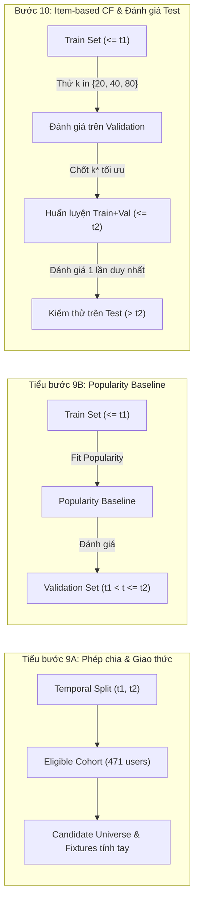

# Giao thức Đánh giá Hệ thống Gợi ý (Q2 - Top-5 Movie Recommendation)

## 1. Giới thiệu & Bối cảnh Bài toán

Bài toán Q2 đặt mục tiêu xây dựng hệ sinh thái gợi ý phim (Top-5 Movie Recommendation) dựa trên lọc cộng tác theo hướng đồ vật (Item-based Collaborative Filtering) trên tập dữ liệu chuẩn MovieLens 1M.

Để bảo đảm tính khách quan, khả năng ứng dụng thực tế và chuẩn mực học máy công nghiệp, giao thức đánh giá được thiết kế với các nguyên tắc cốt lõi:
1. **Chia tập theo trục thời gian thực tế (Temporal Split):** Mô phỏng chính xác kịch bản triển khai hệ thống: dữ liệu quá khứ dùng để huấn luyện mô hình, dữ liệu tương lai dùng để kiểm thử. Tuyệt đối không xáo trộn ngẫu nhiên (Random Split) để tránh rò rỉ thông tin tương lai (data leakage / temporal leakage).
2. **Không dùng negative sampling:** Đánh giá xếp hạng Top-5 trên toàn bộ không gian ứng viên (unranked candidate universe) của từng người dùng, không rút gọn xuống tập 100 hay 1000 items ngẫu nhiên.
3. **Cách ly tuyệt đối giữa Q1 và Q2:** Tuyệt đối không sử dụng đặc trưng hành vi toàn lịch sử hoặc nhãn phân cụm K-Means của Q1 làm đầu vào cho mô hình hay phép chia Q2.

---

## 2. Phép chia Dữ liệu theo Thời gian (Temporal Split)

### 2.1. So sánh Temporal Split và Random Split

| Tiêu chí | Random Split (Chia ngẫu nhiên) | Temporal Split (Chia thời gian) |
| :--- | :--- | :--- |
| **Bản chất** | Xáo trộn ratings độc lập và chia tỷ lệ 70/15/15 | Cắt theo dòng thời gian toàn cục của hệ thống |
| **Rò rỉ thời gian** | **Nghiêm trọng:** Mô hình học ratings tương lai để dự đoán ratings quá khứ của cùng user/item | **Triệt tiêu:** Quá khứ huấn luyện, tương lai kiểm thử |
| **Độ chân thực triển khai** | Sai lệch cao (thổi phồng metric do ghi nhớ tương quan thời gian ngắn) | Phản ánh chính xác hiệu năng khi triển khai thực tế |
| **Đánh giá Cold-start & Item mới** | Hầu hết items xuất hiện ở cả train và test | Đánh giá thực chất khả năng thích ứng với phim mới ra mắt |

### 2.2. Thuật toán Chọn Mốc Thời gian Toàn cục ($t_1, t_2$)

1. **Đầu vào chuẩn:** Toàn bộ bảng ratings chuẩn từ `mining/data_io.load_canonical_data()["ratings"]` (1,000,209 dòng), được kiểm tra SHA256 integrity hash đối chiếu với `data/canonical/canonical_manifest.json`.
2. **Phân vị mục tiêu:** Xác định hai mốc phân vị mục tiêu là $q_1 = 0.70$ (70%) và $q_2 = 0.85$ (85%).
3. **Xử lý giá trị trùng và ranh giới:**
   - Tìm giá trị timestamp tại phân vị mục tiêu:
     $$t_1 = \text{quantile}(\text{timestamp}, 0.70) = 974862386 \quad (\text{2000-11-22 03:06:26 UTC})$$
     $$t_2 = \text{quantile}(\text{timestamp}, 0.85) = 976422051 \quad (\text{2000-12-10 04:20:51 UTC})$$
   - **Nguyên tắc cùng phía cho timestamp hòa (Tie Handling):** Mọi bản ghi có cùng timestamp phải thuộc về cùng một phân vùng duy nhất:
     - **Train:** $\text{timestamp} \le t_1$. Mọi bản ghi có timestamp bằng đúng $t_1$ đều thuộc về Train.
     - **Validation:** $t_1 < \text{timestamp} \le t_2$. Mọi bản ghi có timestamp lớn hơn $t_1$ và nhỏ hơn hoặc bằng $t_2$.
     - **Test:** $\text{timestamp} > t_2$. Mọi bản ghi có timestamp lớn hơn $t_2$.

### 2.3. Thống kê Phân vùng Thực tế

| Thuộc tính | Train ($\le t_1$) | Validation ($t_1 < t \le t_2$) | Test ($> t_2$) | Toàn bộ dữ liệu |
| :--- | :--- | :--- | :--- | :--- |
| **Số dòng ratings** | **700,148** | **150,029** | **150,032** | **1,000,209** |
| **Tỷ lệ thực tế** | **70.0002%** | **14.9998%** | **15.0001%** | **100.0000%** |
| **Số user duy nhất** | 4,870 | 1,352 | 1,512 | 6,040 |
| **Số movie duy nhất** | 3,633 | 3,426 | 3,482 | 3,706 |
| **Timestamp Min (UTC)** | 2000-04-25 23:05:32 | 2000-11-22 03:06:30 | 2000-12-10 04:20:53 | 2000-04-25 23:05:32 |
| **Timestamp Max (UTC)** | 2000-11-22 03:06:26 | 2000-12-10 04:20:51 | 2003-02-28 17:49:50 | 2003-02-28 17:49:50 |
| **Độ lệch ranh giới** | $t_1 = 974862386$ (4 dòng) | Min $t = 974862390$ (+4s) | Min $t = 976422053$ (+2s) | Không có dòng trùng ranh giới |

- **Kiểm tra tính toàn vẹn (Integrity Checks):**
  - Giao tập giữa các phân vùng: $\text{Train} \cap \text{Val} = \emptyset$, $\text{Val} \cap \text{Test} = \emptyset$, $\text{Train} \cap \text{Test} = \emptyset$.
  - Bảo toàn kích thước: $700,148 + 150,029 + 150,032 = 1,000,209$ (không mất dòng nào).
  - Không có hiện tượng rò rỉ thời gian (khoảng cách giữa Train max và Val min là 4 giây; Val max và Test min là 2 giây).
- **Cam kết lưu trữ:** Chi tiết phân chia ratings/user được lưu trữ tạm thời trong local storage hoặc sinh on-the-fly qua `mining/split.py`; không commit file dữ liệu lớn vào Git, chỉ commit `results/mining/split_manifest.json`.

---

## 3. Giao thức Đánh giá Chi tiết (Evaluation Protocol)

### 3.1. Tiêu chí Tương tác Tích cực (Relevant / Positive Items)

Một bộ phim được coi là **Relevant** (phim yêu thích / hài lòng) đối với người dùng $u$ trong kỳ đánh giá nếu và chỉ nếu:
$$\text{rating}_{u, i} \ge 4$$
(tương ứng với thang điểm 4 sao hoặc 5 sao trên MovieLens). Các lượt đánh giá $\le 3$ sao được xem là không hài lòng / không quan tâm và không tính vào tập relevant.

### 3.2. Tập Người dùng Đánh giá Hợp lệ (Eligible Evaluation Cohort)

Một người dùng $u$ được đưa vào tập đánh giá hợp lệ ($U_{\text{eligible}}$) trong kỳ đánh giá khi thỏa mãn đồng thời hai điều kiện:
1. **Lịch sử huấn luyện đủ sâu (Historical Activity):** Người dùng phải có ít nhất **5 ratings** trong tập huấn luyện khả dụng:
   $$|\text{Ratings}_{\text{history}}(u)| \ge 5$$
   (Điều kiện này loại bỏ các người dùng hoàn toàn mới hoặc quá ít dữ liệu lịch sử để hệ thống lọc cộng tác có thể trích xuất sở thích).
2. **Kỳ đánh giá có ít nhất 1 phim tích cực (Ground Truth Relevance):** Người dùng phải có ít nhất **1 phim có rating $\ge 4$** trong kỳ đánh giá:
   $$|\text{Relevant}_{\text{eval}}(u)| \ge 1$$
   (Tránh trường hợp mẫu số Recall bằng 0 và bảo đảm bài toán gợi ý có mục tiêu đánh giá cụ thể).

#### Thống kê Cohort trên Dữ liệu Thực tế:
- **Kỳ Validation ($t_1 < t \le t_2$):**
  - Tổng số người dùng hoạt động trong kỳ Validation: 1,352 users.
  - Số user bị loại do lịch sử huấn luyện (Train) $< 5$ ratings: 849 users.
  - Số user bị loại do không có rating $\ge 4$ trong kỳ Validation: 32 users.
  - **Tập đánh giá Validation hợp lệ ($U_{\text{eligible}}^{\text{val}}$):** **471 users**.
- **Kỳ Test ($t > t_2$ - Thống kê xác minh trước, chưa đánh giá):**
  - Tổng số người dùng hoạt động trong kỳ Test: 1,512 users.
  - Số user hợp lệ ($U_{\text{eligible}}^{\text{test}}$ dựa trên lịch sử Train + Val): **1,154 users**.

### 3.3. Không gian Ứng viên (Candidate Universe) & Không Negative Sampling

Đối với mỗi người dùng $u \in U_{\text{eligible}}$:
1. **Tập mục tiêu ứng viên:**
   $$\text{CandidateUniverse}(u) = \mathcal{I}_{\text{train\_catalog}} \setminus \mathcal{I}_{\text{history}}(u)$$
   Trong đó:
   - $\mathcal{I}_{\text{train\_catalog}}$ là toàn bộ danh mục các bộ phim đã từng xuất hiện ít nhất một lần trong tập dữ liệu lịch sử huấn luyện.
   - $\mathcal{I}_{\text{history}}(u)$ là toàn bộ các bộ phim mà người dùng $u$ đã từng tương tác / đánh giá trong tập lịch sử huấn luyện.
2. **Loại trừ phim đã đánh giá:** Hệ thống không gợi ý lại những phim người dùng đã đánh giá trong quá khứ huấn luyện.
3. **Quy định nghiêm ngặt về Negative Sampling:**
   - **TUYỆT ĐỐI KHÔNG SỬ DỤNG NEGATIVE SAMPLING:** Hệ thống phải xếp hạng toàn bộ các phim trong $\text{CandidateUniverse}(u)$ (khoảng 3,000+ phim cho mỗi user).
   - Việc rút gọn xuống 100 negative samples như một số nghiên cứu cũ đã được chứng minh là làm sai lệch xếp hạng và thổi phồng metric (Krichene & Rendle, 2020).

### 3.4. Chiến lược Xếp hạng và Phá hòa (Tie-breaking Hierarchy)

Khi xếp hạng các ứng viên để chọn ra danh sách Top-5 ($\text{Top5}(u)$), hệ thống tuân thủ thứ tự ưu tiên tất định (deterministic):
1. **Mức 1 (Primary):** Điểm dự báo ($\text{predicted\_score}$) sắp xếp **GIẢM DẦN** (DESC).
2. **Mức 2 (Secondary - Phá hòa điểm số):** Độ thịnh hành trong lịch sử huấn luyện ($\text{popularity}_{\text{train}}$ - số lượt rating trong train) sắp xếp **GIẢM DẦN** (DESC).
3. **Mức 3 (Tertiary - Phá hòa độ thịnh hành):** Mã định danh phim (`movie_id`) sắp xếp **TĂNG DẦN** (ASC).

### 3.5. Xử lý các Trường hợp Biên & Phim mới (Novel Items)

1. **Trường hợp ứng viên $< 5$:**
   - Nếu $|\text{CandidateUniverse}(u)| < 5$, hệ thống trả về toàn bộ ứng viên hiện có.
   - **Mẫu số Precision@5 vẫn cố định là 5:** Việc thiếu ứng viên phản ánh danh mục gợi ý chưa đủ đáp ứng độ dài yêu cầu.
2. **Trường hợp người dùng không có seed item khả dụng:**
   - Nếu một user không có bất kỳ phim nào trong lịch sử tương đồng với các phim khác (ví dụ: tất cả phim đã đánh giá có độ tương đồng bằng 0 với toàn bộ catalog), mô hình kích hoạt cơ chế **Fallback Popularity**: Gợi ý các bộ phim thịnh hành nhất trong lịch sử huấn luyện mà user chưa đánh giá.
3. **Phân biệt rõ 3 mức thống kê phim mới (Novel Items / Cold-start Items) trong kỳ Validation:**
   - **Mức 1 (Toàn Validation):** Có đúng **36 phim mới** xuất hiện trong kỳ Validation chưa từng có trong Train catalog ($|\mathcal{I}_{\text{val}} \setminus \mathcal{I}_{\text{train}}| = 36$).
   - **Mức 2 (Toàn Validation relevant):** Có đúng **9 phim mới relevant** (được đánh giá $\ge 4$ bởi bất kỳ user nào trong số 1,352 user hoạt động tại Validation).
   - **Mức 3 (Cohort 471 user đủ điều kiện):** Có đúng **3 phim mới relevant** được đánh giá $\ge 4$ bởi người dùng thuộc cohort 471 user đủ điều kiện, bao gồm các `movie_id`: **`192`** (user 1943 đánh giá 4), **`712`** (user 1164 đánh giá 4), và **`1471`** (user 1896 đánh giá 5).
   - **Nguyên tắc mẫu số Recall@5 của từng cá nhân:**
     - Các con số 36, 9, 3 là thống kê tổng hợp cấp độ tập dữ liệu/cohort, **TUYỆT ĐỐI KHÔNG ĐƯỢC DÙNG THAY THẾ CHO MẪU SỐ RECALL CỦA TỪNG USER**.
     - Do không có trong catalog huấn luyện, phim mới không thể xuất hiện trong $\text{CandidateUniverse}(u)$ và không thể được gợi ý (đóng góp 0 vào số hits).
     - Tuy nhiên, mọi phim mà user $u$ đánh giá $\ge 4$ trong kỳ đánh giá (kể cả phim mới) **BẮT BUỘC ĐƯỢC GIỮ NGUYÊN TRONG MẪU SỐ CỦA RECALL@5**:
       $$\text{Relevant}_{\text{eval}}(u) = \{i \in \mathcal{I}_{\text{eval}}(u) \mid \text{rating}_{u, i} \ge 4\}$$
       Ví dụ: User 1943 có 141 phim relevant trong Validation (bao gồm phim mới 192). Mẫu số Recall@5 của user 1943 là $141$. Hệ thống chấp nhận hình phạt giảm Recall do cold-start item.
     - Sau khi tính Recall@5 cho từng user, hệ thống tính trung bình cộng số học (Macro-Average) trên toàn bộ 471 user trong cohort.

---

## 4. Định nghĩa Toán học các Thang đo (Evaluation Metrics)

### 4.1. Precision@5 cho Từng Người Dùng
Đo lường tỷ lệ các bộ phim được hệ thống gợi ý thực sự làm hài lòng người dùng trong kỳ đánh giá:
$$\text{Precision@5}(u) = \frac{|\text{Top5}(u) \cap \text{Relevant}_{\text{eval}}(u)|}{5}$$
*Lưu ý:* Mẫu số luôn cố định là $5$.

### 4.2. Recall@5 cho Từng Người Dùng
Đo lường tỷ lệ các bộ phim hài lòng của người dùng trong kỳ đánh giá được hệ thống bắt trúng trong Top-5:
$$\text{Recall@5}(u) = \frac{|\text{Top5}(u) \cap \text{Relevant}_{\text{eval}}(u)|}{|\text{Relevant}_{\text{eval}}(u)|}$$
*Lưu ý:* Mẫu số $|\text{Relevant}_{\text{eval}}(u)|$ bao gồm toàn bộ phim có rating $\ge 4$ của người dùng trong kỳ đánh giá, kể cả phim mới chưa từng xuất hiện trong tập huấn luyện (nằm ngoài candidate universe).

### 4.3. Tổng hợp Macro (Macro-Averaging)
Các độ đo tổng hợp cho hệ thống được tính trung bình macro không trọng số trên toàn bộ tập người dùng hợp lệ trong cùng cohort:
$$\text{Macro-Precision@5} = \frac{1}{|U_{\text{eligible}}|} \sum_{u \in U_{\text{eligible}}} \text{Precision@5}(u)$$
$$\text{Macro-Recall@5} = \frac{1}{|U_{\text{eligible}}|} \sum_{u \in U_{\text{eligible}}} \text{Recall@5}(u)$$

---

## 5. Phân Định Phạm Vi Các Bước & Quy Trình Đánh Giá

Quy trình đánh giá Q2 được phân công rành mạch theo từng bước độc lập:

### 5.1. Tiểu bước 9A: Phép chia & Giao thức
- Xác lập ngưỡng thời gian $t_1, t_2$, thống kê phân vùng, quy tắc candidate universe và fixtures tính tay độc lập.

### 5.2. Tiểu bước 9B: Popularity Baseline
- **Lịch sử huấn luyện:** Tập Train ($\text{timestamp} \le t_1$). Mọi thống kê popularity, candidate, lịch sử chỉ lấy từ Train.
- **Kỳ đánh giá:** Tập Validation ($t_1 < \text{timestamp} \le t_2$).
- **Mục tiêu:** Xây dựng Popularity Baseline (xếp hạng theo tần suất rating trong Train), đánh giá Macro-Precision@5 và Macro-Recall@5 trên cohort 471 user của Validation.

### 5.3. Bước 10: Item-based Collaborative Filtering & Đánh giá Test
- **Pha thử nghiệm $k$:** Thử nghiệm số láng giềng $k \in \{20, 40, 80\}$ của Item-based CF trên tập Validation (huấn luyện trên Train $\le t_1$) để lựa chọn cấu hình $k^*$ tối ưu.
- **Pha đánh giá Test cuối cùng:**
  - Gộp toàn bộ dữ liệu Train + Validation ($\text{timestamp} \le t_2$) làm tập huấn luyện mới.
  - Chạy mô hình tối ưu đã chọn đúng một lượt duy nhất trên tập Test ($\text{timestamp} > t_2$).
  - Tuyệt đối không dùng kết quả trên tập Test để quay lại điều chỉnh siêu tham số hoặc thay đổi kiến trúc thuật toán.

---

## 6. Trạng thái & Giới hạn của Tiểu bước 9A

- **Đã hoàn thành:**
  1. Xác lập công thức và thuật toán chia thời gian $t_1, t_2$.
  2. Xuất `results/mining/split_manifest.json` ghi nhận đầy đủ phương pháp quantile, mốc epoch nguyên, toán tử ranh giới, counts, tỷ lệ, min/max timestamp và băm canonical.
  3. Xây dựng module `mining/split.py` và `mining/evaluation.py` với kiểm thử tính tay độc lập (`test_split_evaluation.py`).
  4. Đã chứng minh các trường hợp biên: xử lý trùng timestamp, lọc cohort, candidate universe, phá hòa, phim mới và mẫu số Recall khi có item ngoài candidate universe.
- **Ranh giới hiện tại (Chưa thực hiện ở 9A):**
  1. Chưa chạy Popularity Baseline trên dữ liệu thật (nội dung Tiểu bước 9B).
  2. Chưa thử nghiệm các giá trị $k \in \{20, 40, 80\}$ hay huấn luyện Item-based CF (nội dung Bước 10).
  3. Chưa chạy đánh giá trên tập Test.
  4. Công bố PR để Điều phối viên rà soát mã nguồn trước khi triển khai 9B.
