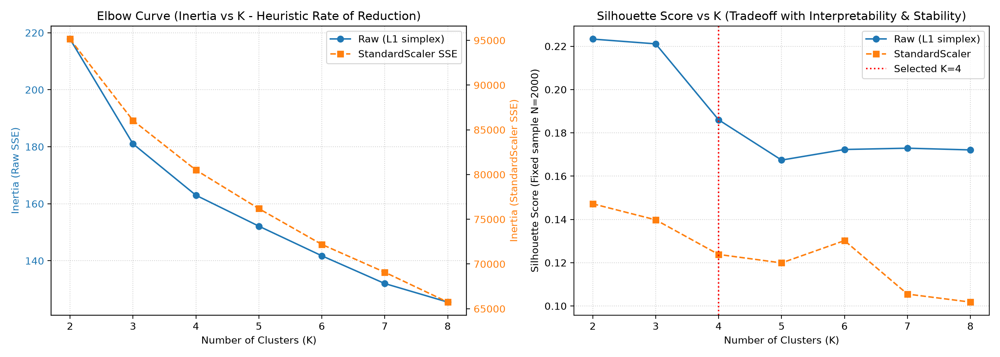

# Chương 5. Thực nghiệm K-Means và gợi ý phim

Chương này dùng kết quả đã công bố, không chạy lại pipeline/evaluator. Công thức ở [chương 2](chapter_02.md); mã bằng chứng E12–E16 theo [chỉ mục P1](../../P1/report_evidence_index.md). Candidate thực kiểm tích hợp giữ nguyên `4546d5bbd8f9130a420518b77dc3ad894bc7f42b`, không thay bằng HEAD tài liệu mới.

## 5.1. Dữ liệu và đặc trưng Q1

Nguồn chuẩn gồm 6.040 người, 3.883 phim và 1.000.209 rating. Chỉ rating ≥4 đóng góp vào feature Q1; mỗi phim đa genre góp một lượt cho mỗi genre rồi chia tổng lượt gắn genre tích cực của từng người. Ma trận đủ điều kiện có **6.038×18**, 18 genre A–Z; 2 người insufficient_evidence có cluster_id NULL và không tham gia fit. Hai người này không phải thiếu mọi rating. Giới, tuổi và nghề không đi vào khoảng cách; Q1 mô tả toàn lịch sử, không được đưa feature này vào đánh giá thời gian Q2. [Nguồn: E12, [features.py](../../../mining/features.py), [clustering_summary.json](../../../results/mining/clustering_summary.json).]

## 5.2. Thử nghiệm và chọn số cụm

Lưới gồm K=2..8 × {raw, StandardScaler}, tổng cộng 14 cấu hình. Mỗi cấu hình fit_predict trên đủ 6.038 người với random_state=42, n_init=10, max_iter=300. Inertia và quy mô cụm đo trên toàn tập fit; Silhouette dùng đúng mẫu cố định 2.000 người, seed 42, sample hash `afc27da1977cf28e45417b7eaf9ff27faa6028dc4e670367a223c758078db485`. Không diễn giải chỉ số mẫu thành chỉ số của toàn bộ 6.038 người.

**Bảng 5.1. Kết quả 14 cấu hình K-Means.** Đơn vị SSE là tổng bình phương khoảng cách trong không gian tương ứng, Silhouette không đơn vị; min/max là số người/cụm. SSE và min/max trên 6.038 người; Silhouette trung bình trong mẫu 2.000.

| K (số cụm) | Tiền xử lý | Inertia toàn tập | Silhouette mẫu | Min cụm | Max cụm |
|---:|---|---:|---:|---:|---:|
| 2 | raw | 217.7719 | 0.2233 | 2798 | 3240 |
| 3 | raw | 181.0233 | 0.2211 | 1250 | 2534 |
| 4 | raw | 162.9874 | 0.1860 | 760 | 2478 |
| 5 | raw | 152.1376 | 0.1674 | 524 | 1604 |
| 6 | raw | 141.7432 | 0.1723 | 103 | 1902 |
| 7 | raw | 132.0120 | 0.1729 | 101 | 1340 |
| 8 | raw | 125.5040 | 0.1721 | 101 | 1308 |
| 2 | standard_scaler | 95141.1138 | 0.1472 | 2360 | 3678 |
| 3 | standard_scaler | 86041.2338 | 0.1398 | 1475 | 2642 |
| 4 | standard_scaler | 80502.6686 | 0.1238 | 460 | 1982 |
| 5 | standard_scaler | 76187.4511 | 0.1199 | 350 | 2336 |
| 6 | standard_scaler | 72188.2324 | 0.1302 | 100 | 2335 |
| 7 | standard_scaler | 69077.4174 | 0.1055 | 97 | 1970 |
| 8 | standard_scaler | 65742.1832 | 0.1018 | 5 | 1960 |

Nguồn: E12, trường experiments_summary của [clustering_summary.json](../../../results/mining/clustering_summary.json). Không so trị tuyệt đối SSE raw và scaled vì khác thang đo.

*Hình 5.1. SSE và Silhouette của 14 cấu hình; nguồn ảnh lịch sử kmeans_elbow_silhouette.png (E12). Trục hoành: K=2..8; SSE tổng trên 6.038 người có hai trục tung riêng raw/scaled; Silhouette không đơn vị trên mẫu 2.000. Dùng bảng 5.1 để đọc số chính xác, không lấy giao điểm hai đường SSE làm tiêu chí.*

K=4 raw được chọn theo cân bằng khả năng diễn giải, quy mô và ổn định, **không** phải Silhouette cao nhất. K=2 và K=3 raw đạt 0,2233 và 0,2211, cao hơn 0,1860 của K=4; chúng tạo ít nhóm hơn và khó tách đủ các profile được dùng trong báo cáo. SSE raw giảm 217,7719→181,0233→162,9874→152,1376 khi K từ 2 đến 5; mức giảm biên quanh K=4 là gợi ý elbow, không chứng minh một nghiệm tối ưu duy nhất. K≥6 raw có cụm khoảng 101–103 người; scaled K=8 có cụm chỉ 5 người. StandardScaler thay trọng số khoảng cách, có thể khuếch đại biến thiên genre hiếm; lưới này không cho lý do chọn scaled thay raw.

**Bảng 5.2. Ổn định cấu hình K=4 raw khi đổi seed.** Đơn vị ARI: không đơn vị; cùng 6.038 người, n_init=10, so hai lần gán nhãn.

| Seed tham chiếu | Seed so sánh | ARI |
|---:|---:|---:|
| 42 | 0 | 0.9949 |
| 42 | 7 | 0.9763 |

Nguồn: stability_ari trong clustering_summary.json; E12. ARI gần 1 cho thấy ổn định qua **hai phép so đã công bố**, không chứng minh mọi seed hoặc mọi snapshot đều giống nhau.

## 5.3. Profile và nhân khẩu học của bốn cụm

**Bảng 5.3. Profile rút gọn của mô hình kmeans_k4_seed42.** n là số người; tỷ trọng quy mô có mẫu số 6.038 assigned. Các tỷ lệ genre là 100×trung bình vector tỷ lệ gốc trên n người của cụm, không phải % người thích genre; số genre làm tròn một chữ số thập phân.

| Cụm | Tên mô tả sau phân cụm | n | % assigned | Genre nổi bật và mean_preference (%) |
|---:|---|---:|---:|---|
| 0 | Đánh giá đa dạng | 2478 | 41.0 | Drama 17.7; Comedy 16.2; Action 10.8; Thriller 9.7 |
| 1 | Tập trung Drama và tình cảm | 1393 | 23.1 | Drama 34.3; Comedy 14.9; Romance 8.4; Thriller 8.2 |
| 2 | Tập trung Comedy | 760 | 12.6 | Comedy 36.0; Drama 16.3; Romance 11.4; Action 5.3 |
| 3 | Tập trung Action, Sci-Fi và Thriller | 1407 | 23.3 | Action 20.1; Sci-Fi 13.6; Thriller 11.6; Drama 10.4 |

Nguồn: E12, [clustering_interpretation.md, mục 4](../clustering_interpretation.md), [heatmap gốc](../../../results/mining/cluster_genre_heatmap.png) và quy mô trong summary. Nhãn cụm là tên diễn giải, không là lớp ground truth; cụm 0 vẫn có genre nổi bật chứ không phân bố đều tuyệt đối. Tổng profile đầy đủ 18 genre mỗi cụm bằng 1 trong tolerance; không cộng các genre rút gọn trong bảng để suy toàn bộ profile.

Kết quả Q1 là một phân vùng mô tả trên snapshot, không xác lập bốn kiểu người dùng phổ quát.

**Bảng 5.4. Cơ cấu nhân khẩu học mô tả sau phân cụm.** Đơn vị % người; mẫu số từng dòng lần lượt 6.038, 2.478, 1.393, 760, 1.407 assigned. Nhóm tuổi giữ nhãn contract; các cột tuổi chỉ là trích chọn nên không cộng thành 100%.

| Nhóm | Nam | Nữ | Tuổi 25–34 | Under 18 | 56+ |
|---|---:|---:|---:|---:|---:|
| Baseline assigned | 71.7 | 28.3 | 34.7 | 3.7 | 6.3 |
| Cụm 0 | 73.7 | 26.3 | 36.6 | 3.4 | 4.4 |
| Cụm 1 | 61.2 | 38.8 | 31.2 | 1.4 | 12.0 |
| Cụm 2 | 55.1 | 44.9 | 34.1 | 7.5 | 5.3 |
| Cụm 3 | 87.4 | 12.6 | 35.3 | 4.3 | 4.4 |

Nguồn: E12, mục 4.2 clustering_interpretation.md, đối chiếu [hình nhân khẩu học gốc](../../../results/mining/cluster_demographics.png). Hai người insufficient không nằm trong baseline. Cụm 1/2 có tỷ lệ nữ cao hơn baseline, cụm 3 có tỷ lệ nam cao hơn; đây là khác biệt mô tả, chưa điều chỉnh yếu tố gây nhiễu và chưa kiểm định ý nghĩa thống kê. Không suy nhân quả, động cơ xem hoặc sở thích của cùng người thay đổi theo tuổi. Các nhóm tuổi 45–49 và 50–55 là hai nhãn riêng trong contract, không tự đổi thành một chiều nguồn mới.

## 5.4. Phân chia thời gian, cohort và catalog Q2

**Bảng 5.5. Phân vùng rating theo timestamp UTC.** Đơn vị: rating, người/phim duy nhất trong từng phân vùng; mẫu số % rating là 1.000.209. Các số distinct qua phân vùng không cộng để lấy toàn bộ user/movie.

| Tập | Điều kiện | Rating | % rating | Người | Phim |
|---|---|---:|---:|---:|---:|
| Train | t≤974862386 | 700148 | 70.0002 | 4870 | 3633 |
| Validation | 974862386<t≤976422051 | 150029 | 14.9998 | 1352 | 3426 |
| Test | t>976422051 | 150032 | 15.0001 | 1512 | 3482 |

Nguồn: E14, [split_manifest.json](../../../results/mining/split_manifest.json). t₁=`2000-11-22T03:06:26Z`, t₂=`2000-12-10T04:20:51Z`; 4 rating đúng t₁ thuộc Train, không có rating đúng t₂. Tỷ lệ làm tròn có thể không cộng đúng 100%; số dòng cộng đúng 1.000.209.

**Bảng 5.6. Cohort và candidate universe dùng chung cho CF/baseline.** Đơn vị người và phim distinct; mẫu số người bị loại là người hoạt động trong kỳ, không phải 6.040 toàn bộ.

| Nội dung | Validation | Test chính thức |
|---|---:|---:|
| Người hoạt động trong kỳ | 1352 | 1512 |
| Có dưới 5 rating lịch sử | 849 | 332 |
| Đủ lịch sử nhưng không có positive kỳ đánh giá | 32 | 26 |
| Cohort đủ điều kiện | 471 | 1154 |
| Rating dùng huấn luyện | 700148 | 850177 |
| Catalog huấn luyện (phim) | 3633 | 3669 |
| Candidate/người min–max | 2193–3628 | 1941–3664 |
| Phim mới trong toàn kỳ | 36 | 37 |
| Phim mới tích cực trong toàn kỳ | 9 | 19 |
| Phim mới tích cực trong cohort | 3 | 16 |

Nguồn: E14/E15, split_manifest, [baseline validation](../../../results/mining/baseline_popularity_validation.json) và [receipt Test](../../../results/mining/cf_test_evaluation_receipt.json). Số phim mới là distinct item, không phải tổng lượt relevant dùng làm mẫu số macro Recall. Candidate là catalog huấn luyện trừ toàn bộ phim từng đánh giá; không negative sampling. Phim mới nghĩa mới xuất hiện ngoài catalog lịch sử, không nhất thiết mới phát hành. Cả 3/16 phim mới tích cực trong cohort tương ứng vẫn nằm trong tập relevant của người có đánh giá, dù mô hình không thể đề xuất chúng.

Validation dùng Train; Test dùng Train+Validation sau khi khóa neighbor_k. Cohort validation chỉ 471/1.352 người hoạt động, nên không đại diện toàn bộ người dùng ít lịch sử. Test có cohort khác; không so trực tiếp hai trị metric như cùng một nhóm hay kết luận đã cải thiện theo thời gian.

## 5.5. Chọn neighbor_k trên validation

**Bảng 5.7. Validation Top-N=5 trên cùng 471 người.** Precision/Recall là macro tỷ lệ [0,1]; mỗi người trọng số 1/471, Precision mẫu số 5, Recall mẫu số relevant từng người. Hits là tổng cặp gợi ý đúng; fallback là số người có dùng bổ sung.

| Mô hình | neighbor_k | Precision@5 | Recall@5 (công bố) | Recall chưa làm tròn | Hits | Fallback/người |
|---|---:|---:|---:|---:|---:|---:|
| Popularity | — | 0.169851 | 0.031261 | Không có trường này trong artifact baseline | 400 | — |
| CF | 20 | 0.177070 | 0.02856537 | 0.02856536704222439 | 417 | 0 |
| CF | 40 | 0.180042 | 0.03007556 | 0.03007556334371585 | 424 | 0 |
| CF | 80 | 0.184289 | 0.02866586 | 0.02866586314500013 | 434 | 0 |

Nguồn: E14, [cf_validation_experiments.json](../../../results/mining/cf_validation_experiments.json) và baseline_popularity_validation.json. Dấu — ở fallback baseline là không áp dụng cơ chế bổ sung CF; không tự tạo một kết quả đo chưa có trường riêng trong artifact baseline.

Tiêu chí đã chốt là Recall@5 validation **chưa làm tròn** cao nhất trong các cấu hình CF {20,40,80}, hòa chọn k nhỏ hơn. Do đó chọn neighbor_k=40; k80 có Precision và hits cao hơn nhưng không thắng tiêu chí Recall. K=4 là số cụm Q1; neighbor_k=40 là số láng giềng/phim seed Q2; Top-N=5 là chiều dài đầu ra, ba tham số khác nhau.

CF k40 cao hơn baseline về Precision validation nhưng **thấp hơn về Recall validation** (0,03007556 so 0,031261). Đây là kết quả cần giữ: chọn k40 trong lưới CF không đồng nghĩa CF đã thắng baseline ở mọi chỉ số. Recall macro cho mỗi người trọng số ngang nhau và mẫu số relevant khác nhau, nên tổng hits cao hơn không bắt buộc macro Recall cao hơn. Không thay tiêu chí chọn sau khi nhìn Test.

## 5.6. Test chính thức và giới hạn kết luận Q2

Receipt duy nhất dùng cho bảng sau là run `test_run_s10b_official_20261022_034458`, status OFFICIAL_COMPLETED. Lịch sử huấn luyện có 850.177 rating, 3.669 phim và 5.715 người; ma trận 3.669×5.715, nnz 850.177, dtype float32; neighbor_k=40, Top-N=5. Thời điểm thực thi và hash code/evaluator gốc được giữ trong receipt/provenance; chúng khác candidate tích hợp và commit viết báo cáo. Không gọi evaluator để viết chương này.

**Bảng 5.8. Metrics Test lấy nguyên trường metrics_comparison của receipt.** Cùng 1.154 người và candidate universe; macro tỷ lệ [0,1], % là tỷ lệ×100; hits là cặp gợi ý đúng. Mẫu số fallback rate: 1.154 người.

| Mô hình | Precision@5 | Recall@5 | Precision (%) | Recall (%) | Hits | Người fallback | Fallback (%) |
|---|---:|---:|---:|---:|---:|---:|---:|
| Popularity Baseline | 0.201733 | 0.02712408 | 20.1733 | 2.712408 | 1164 | 0 | 0.0 |
| Item-based CF k40 | 0.231023 | 0.03530289 | 23.1023 | 3.530289 | 1333 | 2 | 0.1733 |

Nguồn: E15, [cf_test_evaluation_receipt.json](../../../results/mining/cf_test_evaluation_receipt.json), đối chiếu [cf_test_evaluation.json](../../../results/mining/cf_test_evaluation.json). Recall chưa làm tròn của baseline là 0.027124083079144427, của CF là 0.03530288852963812. Không thay bảng bằng phép tính lại từ dữ liệu hoặc số làm tròn ngược.

Trong **lượt Test đã chốt**, CF cao hơn baseline ở cả Precision và Recall, với 169 hits nhiều hơn. Đây là quan sát của snapshot/giao thức/cohort này; chưa có kiểm định ý nghĩa thống kê, khoảng tin cậy hoặc đánh giá trực tuyến nên không khẳng định ưu thế tổng quát. Hai người dùng fallback là 2/1.154≈0,1733%; số này không có nghĩa chỉ 2 người toàn hệ thống gặp cold start. Recall thấp cho thấy chỉ thu hồi một phần nhỏ relevant trong danh sách 5 mục; không được gọi đó là catalog coverage hoặc tỷ lệ xem thành công.

## 5.7. CLI và tái lập từ DW trên P2

Evaluation CLI dùng model `item_based_cf_k40_eval_v1`, cutoff t₂ và training scope 850.177 rating. Demo dùng `item_based_cf_k40_DEMO_full_history_v1`, toàn lịch sử và không có giá trị đo metric offline. Score CF là tổng similarity để xếp hạng, không sao dự đoán. Ba ca công bố chỉ gồm thống kê tổng hợp; ID, lịch sử, số seed/rating và danh sách phim gắn từng người giữ cục bộ ngoài Git.

**Bảng 5.9. Ba ca CLI qua nguồn DW của P2.** Đơn vị: ca kiểm và số phim; mỗi ca yêu cầu 5, trả 5, tính duy nhất trên danh sách đó; không tính tỷ lệ thành công trên toàn bộ user.

| Ca tổng hợp | Mode | Score type | Trả/yêu cầu | Duy nhất và loại lịch sử | Kết quả |
|---|---|---|---|---|---|
| Evaluation có seed | evaluation | cf | 5/5 | Có | PASS |
| Evaluation fallback | evaluation | popularity_fallback, N/A | 5/5 | Có | PASS |
| Demo | demo | cf | 5/5 | Có | PASS |

Nguồn: E16 theo phạm vi P2, [cli_verification_summary.json](../../../results/mining/integration_p2/cli_verification_summary.json), [integration_report.md](../integration_report.md). Đây là kiểm suy luận/CLI lịch sử, không phải lượt đo lại Test từ DW.

P2 đã dùng checkout candidate cố định và venv mới trên **máy Windows 11 độc lập**, Python 3.12.6, PostgreSQL 17.4. pip check không phát hiện xung đột dependency được khai báo, không chứng minh tương thích tuyệt đối. DW-only reconstruction có transaction COMMITTED; raw/CSV/DW khớp bốn canonical counts/hash. Các count là 6.040 users, 3.883 movies, 6.408 cặp movie–genre, 1.000.209 ratings. [Nguồn: [environment](../../../results/mining/integration_p2/environment.json), [DW reconstruction](../../../results/mining/integration_p2/dw_reconstruction.json), [source equivalence](../../../results/mining/integration_p2/source_equivalence.json).]

Tái lập Q1/G3 từ DW giữ 6.038×18, K=4 raw seed42, n_init=10; hai CSV user_cluster (6.040 dòng) và cluster_genre_profile (72 dòng) khớp SHA-256 frozen. “Bit-for-bit identical” chỉ áp dụng **hai CSV đã đối chiếu**, không áp toàn manifest hoặc môi trường. [Nguồn: [g3_reproduction](../../../results/mining/integration_p2/g3_reproduction.json), [manifest](../../../results/mining/integration_p2/manifest.json).] Log 31 unit test là bằng chứng lịch sử, không phải test mới chạy khi viết báo cáo. P2 không nạp analytics G3 và không kiểm Superset/restore; phần BI và phục hồi kiểm ở P1 theo chương 4 và ma trận nghiệm thu.
