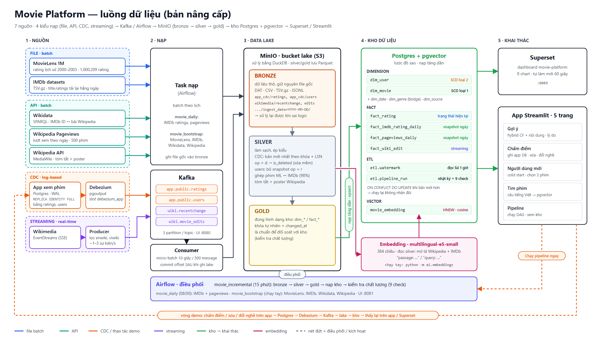

# Bản nâng cấp – Movie Platform

Tài liệu cho buổi trình bày cải tiến (5 phút, **chỉ chấm phần khác biệt so với bản cũ**).

## 1. Bản cũ và bản mới

### Sửa theo góp ý của thầy (4 điểm)

| Thầy góp ý | Bản mới |
|---|---|
| Chỉ có **1 nguồn** (MovieLens, file tĩnh 2000–2003) | **7 nguồn, 4 kiểu nạp**: file (MovieLens, IMDb), API (Wikidata, Wikipedia Pageviews, Wikipedia tóm tắt + poster), **CDC** từ database giao dịch (app xem phim), **streaming** (Wikimedia EventStreams) |
| **Không có data lake** | **MinIO** (S3) chia 3 tầng **bronze → silver → gold**, xử lý bằng **DuckDB**; bronze giữ file gốc (CSV, TSV, JSONL), silver/gold lưu Parquet |
| **Không có CDC** | **Debezium** đọc WAL của Postgres app → **Kafka** → MinIO. Bắt đủ INSERT / UPDATE / DELETE |
| Demo bằng **terminal** | **App Streamlit** 5 trang + **Airflow** + **dashboard Superset mới** tự làm mới mỗi 60 giây |

### Làm thêm

| Bản cũ | Bản mới |
|---|---|
| Nạp kho: xóa hết rồi nạp lại (`TRUNCATE`) | **Nạp tăng dần**: watermark + upsert. Lần đầu khoảng 1 triệu dòng (2 phút); các lần sau chỉ nạp dòng mới (vài giây). Chạy lại không nhân đôi |
| Chạy tay từng lệnh Python | **Airflow**: 3 DAG (`movie_incremental` mỗi 15 phút, `movie_daily`, `movie_bootstrap`) + bước **kiểm tra chất lượng** (9 kiểm tra, có đối soát gold ↔ kho) |
| Lược đồ sao 1 bảng fact | Thêm **SCD loại 2** cho `dim_user`, xóa mềm (`is_deleted`), **4 bảng fact**: rating, điểm IMDb theo ngày và lượt xem Wikipedia (periodic snapshot), lượt sửa bài Wikipedia (streaming) |
| Gợi ý item-based CF | **Hybrid CF + nội dung** (embedding đa ngôn ngữ); **tìm phim bằng câu tiếng Việt** (pgvector) |

## 2. Kiến trúc



Ảnh sinh bằng `python docs/diagram/make_dataflow.py` (bản SVG: `docs/diagram/movie_platform_dataflow.svg`). Bản rút gọn dạng chữ:

```
 MovieLens (CSV) ──────┐
 IMDb (TSV, hằng ngày) ┤                                   ┌──────────────────────────┐
 Wikidata (SPARQL) ────┤── batch / micro-batch ──┐         │  MinIO (data lake, S3)   │
 Wikipedia API ────────┘   (Airflow)             ├────────▶│  bronze → silver → gold  │
                                                 │         │  (DuckDB, Parquet)       │
 App xem phim (Postgres) ─ Debezium (WAL) ─┐     │         └────────────┬─────────────┘
 Wikimedia EventStreams ─ producer ────────┴─▶ Kafka ─▶ consumer        │ nạp tăng dần (upsert)
                                                                        ▼
                                          Postgres + pgvector (kho: lược đồ sao, SCD2, 4 fact)
                                                   │                    │
                                     Superset (dashboard)     App Streamlit (gợi ý hybrid,
                                                              chấm điểm, tìm phim, pipeline)
```

## 3. Khởi động trước khi trình bày (~5 phút)

```bash
docker compose up -d
```

```bash
docker compose -f dashboard/superset/compose.yaml --env-file dashboard/superset/.env up -d
```

```bash
.venv/Scripts/streamlit run app/streamlit_app.py
```

Mở sẵn các tab:

| Tab | Địa chỉ |
|---|---|
| App | http://localhost:8501 |
| Kafka UI | http://localhost:8080 (topic `app.public.ratings`, `wiki.recentchange`) |
| MinIO | http://localhost:9001 (bucket `lake`) |
| Airflow | http://localhost:8081 (DAG `movie_incremental`) |
| Superset | http://localhost:8089/superset/dashboard/movie-platform/ |

Chạy 1 lần để chắc chắn mọi thứ thông: bấm chạy `movie_incremental` trên Airflow, chờ 4 task xanh. Mở app sớm ít nhất 1 phút (mô hình tìm kiếm tải nền khoảng 40 giây).

## 4. Kịch bản 5 phút

| Thời gian | Làm gì | Nói gì |
|---|---|---|
| 0:00–0:40 | Slide bảng ở mục 1 | "Bản cũ thầy góp ý 4 điểm, bản mới sửa đúng 4 điểm đó; phần còn lại là làm thêm." |
| 0:40–1:10 | Sơ đồ mục 2 | Đi theo mũi tên: 7 nguồn → Kafka/Airflow → MinIO 3 tầng → kho → app/dashboard |
| 1:10–1:40 | App → **Chấm điểm** → **➕ Tạo người dùng mới** → chấm 5★ **Toy Story** và **Toy Story 2**. Panel bên phải lần lượt hiện ✅ Postgres → ✅ Kafka → ✅ MinIO | "Người mới chưa có lịch sử. Mỗi thao tác là 1 INSERT vào Postgres của app; panel theo dõi thay đổi đó qua từng chặng" |
| 1:40–2:10 | Mở **Kafka UI** → topic `app.public.ratings` → message mới (`op: "c"`, `before`, `after`); mở **MinIO** → file trong `bronze/app_cdc/ratings/` (đúng tên file panel hiện) | "Đây là CDC: Debezium đọc WAL, không truy vấn bảng nguồn. Consumer gom micro-batch 10 giây rồi ghi bronze" |
| 2:10–2:50 | Quay lại app → **▶ Chạy pipeline ngay** → panel: Airflow 1/4 … 4/4 → ✅ Kho dữ liệu ("đã vào kho sau ~25 giây") | "Silver lọc bản mới nhất theo LSN, gold đổi sang hình dạng kho, nạp tăng dần, cuối cùng 9 kiểm tra chất lượng" |
| 2:50–3:20 | Ngay dưới panel: **gợi ý trước** (phim phổ biến) và **sau** (phim hoạt hình, gắn nhãn MỚI) | "Dữ liệu mới đi hết đường ống tới tận mô hình gợi ý" |
| 3:20–3:50 | *(nếu còn giờ)* **Đổi nghề nghiệp** của user mới → chạy pipeline → panel báo dim_user có 2 phiên bản. Hoặc **Xóa** 1 rating → kho `is_deleted = true` | "SCD loại 2 / xóa mềm" |
| 3:50–4:30 | App → **Người dùng mới**: chọn 3 phim → so sánh "Chỉ CF" và "Hybrid". **Tìm phim**: gõ "phim kinh dị về cá mập" | "CF cần lịch sử nhiều; hybrid dùng mô tả phim từ Wikipedia nên gợi ý được ngay. Tìm kiếm dùng embedding đa ngôn ngữ + pgvector" |
| 4:30–5:00 | Kafka UI → `wiki.recentchange` đang chảy | "Ngoài CDC còn có luồng streaming thật từ Wikipedia, ~2–3 sự kiện/giây" |

**Dự phòng**: video demo có lồng tiếng `docs/demo/movie_platform_demo_longtieng.mp4` (~5′45″) hoặc bản chỉ có phụ đề `docs/demo/movie_platform_demo.mp4` (~4′). Video không lưu trên Git; quay lại bằng các script trong [docs/demo](demo/README.md) (cần bật đủ Docker, Superset và Streamlit ở cổng 8501).

## 5. Câu hỏi có thể bị hỏi

**CDC khác cách đọc theo `updated_at` thế nào?**
CDC dựa trên log đọc WAL – nhật ký mà Postgres vốn phải ghi. Không phải quét bảng nên không tải DB nguồn, bắt được cả DELETE (truy vấn theo `updated_at` không thấy dòng đã xóa), và giữ đúng thứ tự thay đổi (LSN).

**Vì sao cần `REPLICA IDENTITY FULL` và publication?**
`REPLICA IDENTITY FULL` để WAL ghi cả giá trị cũ, Debezium mới có trường `before` khi UPDATE/DELETE. Publication khai báo những bảng được phép phát thay đổi (plugin `pgoutput`).

**Consumer chết giữa chừng thì sao?**
Offset Kafka chỉ commit **sau khi** file đã ghi xong vào MinIO. Chết giữa chừng thì khởi động lại đọc lại từ offset cũ → không mất dữ liệu (at-least-once). Bản ghi bị ghi trùng được loại ở silver: giữ bản mới nhất theo `(user_id, movie_id)` và LSN.

**Data lake khác kho dữ liệu?**
Lake lưu mọi dạng dữ liệu (CSV, TSV, JSON, Parquet), rẻ, giữ dữ liệu thô (bronze) để có thể xử lý lại khi phát hiện lỗi logic. Kho có lược đồ chặt (lược đồ sao), tối ưu cho truy vấn phân tích.

**Vì sao Parquet?**
Lưu theo cột (chỉ đọc cột cần), nén tốt, giữ kiểu dữ liệu. Ví dụ file rating 23 MB dạng `.dat` còn 6 MB dạng Parquet.

**Nạp tăng dần làm thế nào, chạy 2 lần có nhân đôi không?**
Bảng `etl.watermark` lưu `changed_at` lớn nhất đã nạp. Lần sau đọc các dòng mới hơn **mốc trừ 1 giờ** (đọc lùi để không bỏ sót sự kiện đến muộn: Kafka có 3 partition, consumer at-least-once), rồi `INSERT … ON CONFLICT (user_id, movie_id) DO UPDATE … WHERE bản mới hơn`. Upsert theo khóa nên đọc lại phần chồng lấn hay chạy lại cũng không nhân đôi. Dữ liệu và watermark ghi trong **cùng 1 transaction**. Bước kiểm tra chất lượng đối soát số cặp, số rating đã xóa và thời điểm thay đổi mới nhất giữa gold và kho.

**Xóa rating thì kho xử lý thế nào?**
Debezium gửi sự kiện `op: d` (`after = null`, `before` có đủ dòng cũ nhờ `REPLICA IDENTITY FULL`). Silver lấy sự kiện mới nhất của cặp; nếu là xóa thì gắn `is_deleted = true`, kho **xóa mềm** (giữ dòng, đánh dấu), các view và app lọc `NOT is_deleted`. Có kiểm tra chất lượng đối soát số rating đã xóa giữa gold và kho.

**Snapshot ban đầu của Debezium là gì?**
Lần đầu chạy, Debezium đọc toàn bộ bảng hiện có (sự kiện `op: r`) rồi mới đọc WAL. Bảng `users` có 6.040 dòng nên sinh 6.040 sự kiện `r`; silver bỏ qua chúng (trùng dữ liệu MovieLens), chỉ lấy `c` và `u`.

**SCD loại 2 ở đâu?**
`dim_user`: người dùng đổi nghề trên app (tab **Chấm điểm** → *Đổi nghề nghiệp*) → đóng phiên bản cũ (`valid_to`, `is_current = false`), thêm phiên bản mới. Rating được gắn với phiên bản **có hiệu lực tại thời điểm chấm**. `dim_movie` dùng SCD loại 1 (ghi đè), vì chỉ cần thông tin mới nhất.

**Kiểm tra chất lượng có những gì?**
9 kiểm tra: rating trong 1–5; mỗi user đúng 1 phiên bản hiện tại; phiên bản SCD2 không chồng thời gian; rating trỏ đúng phiên bản tại thời điểm chấm; không có rating ở tương lai; phim nào cũng có thể loại; đối soát số cặp, số rating đã xóa, và độ tươi (kho bắt kịp thay đổi mới nhất trong lake). Khóa NULL, trùng khóa, toàn vẹn tham chiếu thì **ràng buộc PK/FK của kho** đã chặn ngay lúc ghi. Một kiểm tra sai → task đỏ, các bước sau không chạy.

**Grain của các bảng fact?**
`fact_rating`: **rating hiện tại** của mỗi cặp user × phim (chấm lại thì upsert ghi đè, xóa thì `is_deleted = true`), nên đúng hơn là bảng trạng thái chứ không phải 1 dòng cho mỗi sự kiện. Muốn giữ lịch sử từng lần chấm thì thêm 1 bảng transaction, mỗi sự kiện CDC 1 dòng. `fact_imdb_rating_daily`, `fact_pageviews_daily`: 1 phim × 1 ngày (periodic snapshot). `fact_wiki_edit`: 1 lần sửa bài.

**Ghép MovieLens với IMDb thế nào?**
2.949 phim ghép bằng `links.csv` lấy từ bộ **ml-latest-small** (ML-1M không kèm file này, nhưng movieId giữ nguyên giữa các phiên bản MovieLens). 857 phim còn lại ghép theo tên đã chuẩn hóa (bỏ dấu, chuyển "The" lên đầu, xét cả tên thay thế trong ngoặc) và năm lệch tối đa 1, ưu tiên phim nhiều vote IMDb. Tổng cộng khớp 98%; 77 phim không khớp được để trống, không đoán bừa.

**Hybrid hoạt động thế nào?**
Điểm = α·CF + (1−α)·nội dung. CF: tổng độ tương đồng cosine với các phim user đã thích. Nội dung: cosine giữa vector mô tả phim và trung bình vector các phim user thích, nhân với độ phổ biến theo thang log (không có bước này, phần nội dung toàn gợi ý phim gần như không ai xem: P@5 tụt xuống ~0,02, đo với mô hình MiniLM đời đầu). α chọn trên tập validation, báo kết quả trên tập test **cùng giao thức chia theo thời gian** với bản cũ (chạy lại CF ra đúng 0,231023 / 0,035303 như bản cũ). Chi tiết: `results/mining/hybrid_evaluation.json`.

| Tập test, 1.154 người dùng | Precision@5 | Recall@5 |
|---|---|---|
| Popularity (bản cũ) | 0,2017 | 0,0271 |
| CF (bản cũ) | 0,2310 | **0,0353** |
| Chỉ nội dung (embedding E5 từ mô tả Wikipedia + IMDb) | 0,2175 | 0,0318 |
| Hybrid (α = 0,9, chọn trên validation) | **0,2314** | 0,0352 |
| Giả lập người mới, chỉ 3 rating: CF / hybrid | 0,1055 / 0,1059 | 0,0134 / 0,0140 |

**Hybrid có tốt hơn CF không?** Chỉ **nhỉnh rất nhẹ** (P@5 0,2314 so với 0,2310), coi như ngang. Nói thẳng như vậy. Điểm đáng nói:
- **chỉ dùng mô tả phim**, không dùng hành vi chấm điểm của ai, vẫn đạt P@5 0,2175, **vượt baseline Popularity** của bản cũ. Đây là đóng góp của các nguồn dữ liệu mới (IMDb, Wikipedia);
- với người dùng mới chỉ có 3 rating, hybrid và CF **tương đương** (chênh lệch nằm trong mức nhiễu);
- gợi ý được **phim mới chưa ai chấm**, điều CF không làm được; **tìm phim bằng câu tiếng Việt**; **giải thích lý do gợi ý**.
- Thử nghiệm qua 3 phiên bản: MiniLM + chỉ tên/thể loại (nội dung P@5 0,153) → MiniLM + mô tả Wikipedia (0,170) → **E5 + mô tả Wikipedia (0,2175)**. Chất lượng dữ liệu nguồn và mô hình đều ảnh hưởng rõ.

**Embedding là gì, vì sao gõ tiếng Việt vẫn tìm được phim có mô tả tiếng Anh?**
Mô hình `intfloat/multilingual-e5-small` biến câu thành vector 384 chiều (câu hỏi thêm tiền tố `query: `, mô tả phim thêm `passage: ` – cách mô hình E5 được huấn luyện cho tìm kiếm). Câu cùng nghĩa (ở bất kỳ ngôn ngữ nào mô hình đã học) cho ra vector gần nhau. pgvector tìm vector gần nhất bằng khoảng cách cosine (`<=>`), có chỉ mục HNSW.

**Vì sao chỉ lấy lượt xem Wikipedia của 500 phim?**
Wikimedia giới hạn 10 request/phút với client không đăng ký. 500 phim nhiều rating nhất là đủ đại diện. Khai báo thông tin liên hệ (`WIKIMEDIA_CONTACT`) thì giới hạn tăng lên 200 request/phút.
