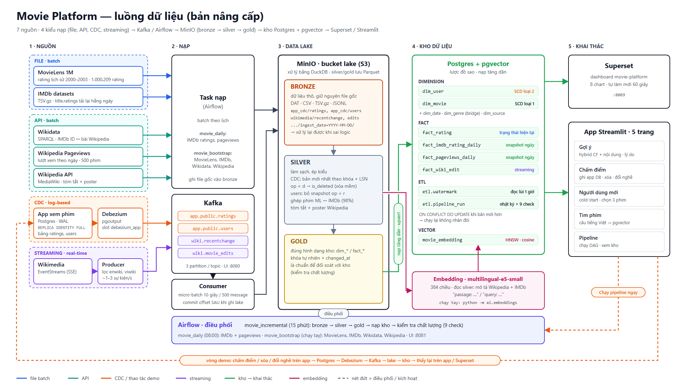

# Kế hoạch chi tiết – Movie Platform (bản nâng cấp)

Tài liệu này đi qua từng công đoạn: **làm gì** (thao tác, lệnh, chỗ bấm), **cần hiểu gì** (kiến thức core để trả lời vấn đáp), và **kiểm tra gì** trước khi chuyển sang công đoạn sau.



> Quy ước: ☐ = việc cần làm · 🔍 = lệnh/chỗ kiểm tra · ❓ = câu hỏi dễ bị hỏi.
> Đã đối chiếu với code thật (19/11/2026): các chỗ trước đây ghi *(kiểm tra trong code)* đã được điền đúng theo code.

---

## Lộ trình tổng

| Giai đoạn | Nội dung | Ước lượng |
|---|---|---|
| **0** | Sửa các điểm lệch / lỗ hổng trước khi trình bày | ✅ đã xong (trừ 0.10, không bắt buộc) |
| **1** | Môi trường: khởi động, kiểm tra từng service | 1–2 giờ |
| **2–9** | Ôn + chạy thử từng công đoạn của pipeline (nguồn → CDC → Kafka → lake → kho → Airflow → dashboard → AI) | 1–2 ngày |
| **10** | Tổng duyệt kịch bản 5 phút, quay video dự phòng | 0,5 ngày |
| **11** | Ngày trình bày | — |

---

## Giai đoạn 0 – Sửa trước khi trình bày

| # | Việc | Trạng thái |
|---|---|---|
| 0.1 | Sửa "6 nguồn, 3 kiểu nạp" | ✅ Tài liệu ghi **7 nguồn, 4 kiểu** (file, API, CDC, streaming) |
| 0.2 | Tách bảng "bản cũ / bản mới" | ✅ 2 bảng: **Sửa theo góp ý** (4 dòng) và **Làm thêm** |
| 0.3 | Xử lý DELETE ở kho | ✅ Đã có từ đầu: **xóa mềm** (`is_deleted`). Silver gắn `is_deleted = (op = 'd')`, view và app lọc `NOT is_deleted`. Đã test thật (xóa Toy Story 2 của user 1 → `is_deleted = t`) và thêm kiểm tra chất lượng "đối soát rating đã xóa gold ↔ kho". App có nút **Xóa** để demo |
| 0.4 | Watermark an toàn với dữ liệu đến muộn | ✅ Đọc lùi `changed_at > watermark − 1 giờ`; upsert chỉ ghi khi bản mới hơn (`WHERE EXCLUDED.changed_at > f.changed_at`); watermark không lùi, ghi cùng transaction với dữ liệu |
| 0.5 | Nguồn của SCD2 | ✅ Đã có từ đầu: Debezium `table.include.list = public.ratings,public.users`, publication `dbz_publication` có cả 2 bảng. App có ô **Đổi nghề nghiệp** (tab Chấm điểm) để demo |
| 0.6 | `valid_from` phiên bản đầu `dim_user` | ✅ Đã có từ đầu: `1990-01-01` (trước mọi rating MovieLens) |
| 0.7 | Cách gọi grain `fact_rating` | ✅ Tài liệu ghi "rating hiện tại của mỗi cặp user × phim" |
| 0.8 | Nguồn `links.csv` | ✅ Ghi rõ lấy từ **ml-latest-small** |
| 0.9 | Diễn đạt kết quả cold-start | ✅ Ghi "tương đương", bỏ "tăng 5%" |
| 0.10 | Đo item cold-start | ☐ Chưa làm (không bắt buộc) |

---

## Giai đoạn 1 – Môi trường

### Thao tác

```bash
# 1. Stack chính: Postgres app, Postgres kho, Kafka, Kafka Connect/Debezium, MinIO, Airflow, Kafka UI
docker compose up -d
docker compose ps                        # tất cả phải "running"/"healthy"

# 2. Superset
docker compose -f dashboard/superset/compose.yaml --env-file dashboard/superset/.env up -d

# 3. App
.venv/Scripts/streamlit run app/streamlit_app.py
```

☐ Khởi động **trước 15–20 phút** (Kafka + Airflow + Superset + model E5 khá nặng RAM).
☐ Mở sẵn 5 tab: App :8501, Kafka UI :8080, MinIO :9001, Airflow :8081, Superset :8089.
☐ Chạy thử `movie_incremental` 1 lần, chờ 4 task xanh.

### 🔍 Kiểm tra

```bash
docker stats --no-stream                              # RAM từng container
curl -s localhost:8083/connectors?expand=status       # Debezium connector app-postgres RUNNING
docker compose logs --tail 50 cdc-consumer            # consumer không lỗi
```

### Kiến thức core

- **Docker Compose**: service, network nội bộ (các service gọi nhau bằng tên service, không phải `localhost`), volume (dữ liệu còn sau khi `down`, mất khi `down -v`), healthcheck và `depends_on`.
- **Port mapping** `host:container`: vì sao trong container gọi `kafka:9092` còn từ máy host gọi `localhost:9092` (advertised listeners của Kafka).

---

## Giai đoạn 2 – Nguồn dữ liệu và nạp batch

### Thao tác

☐ Xem lại code nạp từng nguồn, ghi ra mỗi nguồn: định dạng, tần suất, khóa ghép, giới hạn.

| Nguồn | Định dạng | Tần suất | Code | Lưu ý |
|---|---|---|---|---|
| MovieLens 1M | `.dat` (`::`-separated) | 1 lần | `sources/movielens.py` | 1.000.209 rating, 6.040 user, 3.883 phim. Kèm `links.csv` của **ml-latest-small** |
| IMDb datasets | TSV gzip | `title.ratings` hằng ngày, 4 file còn lại 1 lần | `sources/imdb.py` | `title.basics`, `title.ratings`, `title.crew`, `title.principals`, `name.basics`; `\N` = NULL |
| Wikidata | SPARQL → JSONL | 1 lần (bootstrap) | `sources/wikidata.py` | Ghép IMDb ID (P345) → tên bài Wikipedia tiếng Anh/Việt, quốc gia, số Oscar |
| Wikipedia Pageviews | REST JSON | hằng ngày (`movie_daily`) | `sources/pageviews.py` | 500 phim nhiều rating nhất; giới hạn 10 request/phút |
| Wikipedia tóm tắt + poster | MediaWiki Action API (`extracts` + `pageimages`) | 1 lần (bootstrap) | `sources/wiki_summaries.py` | 20 bài/request; mô tả cho embedding, poster cho app |
| App xem phim | Postgres → Debezium | liên tục (CDC) | `app_source/`, `cdc/` | |
| Wikimedia EventStreams | JSON từng dòng | liên tục (streaming) | `streaming/wiki_producer.py` | |

Tất cả ghi vào `lake/bronze/<nguồn>/<bảng>/ingest_date=YYYY-MM-DD/`.

### Kiến thức core

- **Batch và micro-batch**: batch = chạy theo lịch, xử lý cả khối; micro-batch = gom sự kiện theo khoảng thời gian nhỏ (10 s) rồi ghi. Streaming thật = xử lý từng sự kiện.
- **Ghép thực thể (entity matching) MovieLens ↔ IMDb**:
  - Ưu tiên khóa chính xác (`links.csv` → 2.949 phim).
  - Còn lại ghép mờ: chuẩn hóa tên (bỏ dấu, lowercase, "Matrix, The" → "The Matrix", tách tên thay thế trong ngoặc), năm lệch ≤ 1, trùng nhiều thì chọn phim có `numVotes` cao nhất → thêm 857 phim.
  - 77 phim không khớp → để NULL. **Không đoán bừa** vì ghép sai còn tệ hơn thiếu dữ liệu.
  - Đo chất lượng: tỷ lệ khớp (98%) và nên kiểm tra tay một mẫu ngẫu nhiên (precision của việc ghép).
- **Gọi API lịch sự**: User-Agent có thông tin liên hệ, giới hạn tốc độ, retry với backoff khi gặp 429, cache kết quả để không gọi lại.

❓ *Ghép mờ có sai không, làm sao biết?* → Kiểm tra tay N phim ngẫu nhiên; ràng buộc năm ±1 và ưu tiên nhiều vote để giảm ghép nhầm sang bản làm lại.

---

## Giai đoạn 3 – CDC: Postgres → Debezium

### Thao tác

```sql
-- Trên Postgres của app
SHOW wal_level;                                  -- phải là 'logical'
SELECT * FROM pg_publication_tables;             -- bảng nào được phát
SELECT slot_name, plugin, active, confirmed_flush_lsn FROM pg_replication_slots;
SELECT relname, relreplident FROM pg_class
 WHERE relname IN ('ratings','users');           -- 'f' = FULL, 'd' = DEFAULT
```

☐ Thử đủ 3 thao tác và xem message tương ứng trên Kafka UI:

```sql
INSERT INTO ratings(user_id, movie_id, rating, ...) VALUES (1, 1, 5, ...);  -- op "c"
UPDATE ratings SET rating = 3 WHERE user_id = 1 AND movie_id = 1;           -- op "u", có before
DELETE FROM ratings WHERE user_id = 1 AND movie_id = 1;                     -- op "d", after = null
```

### Kiến thức core

- **WAL (Write-Ahead Log)**: Postgres ghi mọi thay đổi vào log *trước* khi ghi vào bảng để phục hồi khi sập. CDC đọc lại log này nên **không tải bảng nguồn**.
- **Logical decoding**: biến WAL (dạng vật lý, theo block) thành thay đổi theo dòng. Cần `wal_level = logical`.
- **Replication slot**: Postgres nhớ consumer đã đọc tới LSN nào và **giữ WAL** từ điểm đó. ⚠️ Nếu Debezium dừng lâu, WAL tích lại → đầy ổ đĩa. Đây là rủi ro vận hành số 1 của CDC Postgres.
- **Publication**: danh sách bảng được phát thay đổi (dùng với plugin `pgoutput`, plugin có sẵn từ Postgres 10).
- **REPLICA IDENTITY**:
  - `DEFAULT`: chỉ ghi khóa chính của dòng cũ → `before` thiếu cột.
  - `FULL`: ghi toàn bộ dòng cũ → có `before` đầy đủ cho UPDATE/DELETE. Đánh đổi: WAL to hơn.
- **LSN (Log Sequence Number)**: vị trí trong WAL, tăng dần → dùng để **sắp thứ tự** thay đổi và khử trùng.
- **Message Debezium**: `before`, `after`, `op` (`c` create, `u` update, `d` delete, `r` read khi snapshot), `source.lsn`, `ts_ms`. Debezium mặc định gửi thêm 1 **tombstone** (value = null) sau DELETE để phục vụ log compaction; dự án **tắt** (`tombstones.on.delete=false`) vì không dùng compaction.
- **Snapshot ban đầu** (`snapshot.mode=initial`): khi connector chạy lần đầu, Debezium đọc toàn bộ bảng (op `r`) rồi mới chuyển sang đọc WAL. Bảng `users` có 6.040 dòng → 6.040 sự kiện `r`; silver bỏ qua (trùng MovieLens), chỉ lấy `c`, `u`.

❓ *CDC khác truy vấn theo `updated_at`?* → Không quét bảng, bắt được DELETE, không sót các thay đổi xảy ra giữa 2 lần quét, giữ đúng thứ tự theo LSN, và không cần app phải cập nhật `updated_at` đúng.
❓ *Debezium chết thì sao?* → Slot giữ WAL, khởi động lại thì đọc tiếp từ `confirmed_flush_lsn`. Không mất dữ liệu, chỉ tốn đĩa.

---

## Giai đoạn 4 – Kafka

### Thao tác

☐ Kafka UI → Topics → `app.public.ratings`: xem partitions, số message, key/value của 1 message.
☐ Consumers → group `lake-bronze-writer`: xem **lag** (= 0 nghĩa là đã đọc kịp). Mỗi topic có 3 partition.
☐ `wiki.recentchange`: xem message chảy liên tục (chỉ giữ lần sửa trên Wikipedia tiếng Anh/Việt, khoảng 1–3 sự kiện/giây).

### Kiến thức core

- **Topic / partition / offset**: topic chia thành partition; mỗi partition là log chỉ ghi nối tiếp, mỗi message có offset tăng dần.
- **Thứ tự chỉ được đảm bảo trong 1 partition.** Debezium dùng khóa chính làm key → mọi thay đổi của cùng 1 dòng vào cùng partition → giữ đúng thứ tự cho dòng đó.
- **Consumer group**: các consumer cùng group chia nhau partition; Kafka nhớ offset đã commit của group.
- **Ngữ nghĩa giao nhận**:
  - at-most-once: commit trước rồi mới xử lý → có thể mất.
  - **at-least-once**: xử lý (ghi MinIO) xong rồi mới commit → có thể trùng, không mất. ← dự án dùng cách này.
  - exactly-once: cần transaction / sink idempotent. Ở đây đạt "hiệu quả exactly-once" nhờ **silver khử trùng + upsert ở kho**.
- **Retention**: Kafka giữ message theo thời gian/dung lượng, không xóa khi đã đọc → có thể đọc lại (replay).
- **Vì sao cần Kafka ở giữa** (thay vì Debezium ghi thẳng MinIO): tách producer và consumer, đệm khi phía sau chậm hoặc chết, nhiều consumer đọc cùng 1 luồng, có thể replay.

---

## Giai đoạn 5 – Consumer → Bronze (MinIO)

### Thao tác

☐ Đọc `cdc/kafka_to_bronze.py`, trả lời được: flush khi đủ **500 message hoặc 10 giây**; mỗi lần flush ghi 1 file `<thời điểm UTC>.jsonl` cho mỗi topic có dữ liệu; `consumer.commit(asynchronous=False)` gọi **ngay sau** `flush()`.
☐ MinIO :9001 → bucket `lake` → `bronze/app_cdc/ratings/` → file mới nhất sau khi chấm điểm.
☐ Thử kill consumer giữa chừng (`docker compose restart cdc-consumer`) → kiểm tra không mất bản ghi, bản ghi trùng (nếu có) bị loại ở silver.

### Kiến thức core

- **Object storage (S3)**: bucket + object key; "thư mục" chỉ là tiền tố (prefix) của key. Object không sửa được, chỉ ghi mới/ghi đè.
- **Data lake và data warehouse**: lake giữ mọi định dạng, rẻ, schema-on-read; kho có schema chặt (schema-on-write), tối ưu cho truy vấn phân tích.
- **Kiến trúc medallion**:
  - **Bronze**: thô, giữ nguyên như nguồn, chỉ thêm metadata (thời điểm nạp, offset). Mục đích: **xử lý lại được** khi phát hiện lỗi logic.
  - **Silver**: làm sạch, đúng kiểu, khử trùng, đã ghép.
  - **Gold**: đúng hình dạng phục vụ (dim/fact).
- **Vấn đề file nhỏ (small files)**: micro-batch 10 s sinh rất nhiều file nhỏ → đọc chậm. Cách xử lý: compaction định kỳ, hoặc tăng khoảng gom. Nên biết để trả lời nếu bị hỏi.
- **Partition theo đường dẫn** (dự án dùng `ingest_date=2026-11-19/`): giúp chỉ đọc phần cần (partition pruning).
- Bronze lưu **file gốc** (DAT, CSV, TSV.gz, JSONL), không đổi sang Parquet; Parquet bắt đầu từ silver.

---

## Giai đoạn 6 – Silver / Gold (DuckDB + Parquet)

### Thao tác

☐ Mở code silver, tìm câu khử trùng CDC. Mẫu chuẩn:

Code thật (`transform/silver.py`, hàm `app_ratings`):

```sql
WITH ev AS (
  SELECT op, coalesce(after, before) AS row, source.lsn AS lsn, ts_ms
  FROM read_json('s3://lake/bronze/app_cdc/ratings/ingest_date=*/*.jsonl', ...)
)
SELECT row.user_id, row.movie_id, row.rating, row.created_at AS rated_at,
       to_timestamp(ts_ms / 1000) AS changed_at,
       op = 'd' AS is_deleted, op
FROM ev
QUALIFY row_number() OVER (PARTITION BY row.user_id, row.movie_id
                           ORDER BY lsn DESC, ts_ms DESC) = 1;
```

☐ So sánh dung lượng `.dat` và Parquet (23 MB → 6 MB).
☐ Chạy thử 1 truy vấn DuckDB đọc thẳng từ MinIO để demo nếu bị hỏi.

### Kiến thức core

- **DuckDB**: CSDL phân tích **chạy trong tiến trình** (như SQLite nhưng theo cột), đọc trực tiếp CSV/JSON/Parquet trên S3 qua extension `httpfs`. Không cần cluster → hợp với dữ liệu cỡ GB trên 1 máy. Khi nào cần Spark: dữ liệu vượt RAM/đĩa của 1 máy, cần xử lý phân tán.
- **Parquet**:
  - Lưu theo cột → chỉ đọc cột cần.
  - Nén tốt vì các giá trị trong 1 cột giống nhau (dictionary, RLE + snappy/zstd).
  - Có schema và kiểu dữ liệu.
  - Row group có thống kê min/max → bỏ qua block không thỏa điều kiện (predicate pushdown).
- **Window function** `ROW_NUMBER() … QUALIFY`: cách chuẩn để lấy "bản mới nhất theo khóa".
- **Idempotent transformation**: chạy lại silver/gold cho cùng input ra cùng output. Đây là điều kiện để retry an toàn.

❓ *Vì sao không làm luôn trong Postgres?* → Lake giữ dữ liệu thô rẻ và tách lưu trữ khỏi tính toán, xử lý lại không ảnh hưởng kho phục vụ. Ngoài ra các định dạng tự nhiên của nguồn (TSV, JSON) không phải ép vào bảng từ đầu.

---

## Giai đoạn 7 – Kho dữ liệu (Postgres)

### 7.1 Nạp tăng dần

**Thao tác**

```sql
SELECT * FROM etl.watermark;                       -- mốc hiện tại
-- chạy movie_incremental 2 lần liên tiếp, đếm lại:
SELECT COUNT(*) FROM dw.fact_rating;               -- không đổi ở lần 2 → không nhân đôi
```

**Kiến thức core**

- **Full load và incremental**: TRUNCATE + nạp lại thì đơn giản nhưng tốn và có lúc kho trống. Incremental chỉ nạp phần mới, nhanh (vài giây).
- **Watermark**: lưu mốc lớn nhất đã nạp; lần sau đọc `> mốc` (hoặc `>=` + upsert).
- **Upsert** `INSERT … ON CONFLICT (key) DO UPDATE` cần **unique constraint** trên key.
- **Idempotency**: chạy lại N lần ra cùng kết quả → retry an toàn.
- **Dữ liệu đến muộn**: mốc theo thời gian sự kiện thì có thể bỏ sót; dự án đọc lùi `watermark − 1 giờ` và để upsert lo phần trùng (xem 0.4).
- **Xóa**: dự án xóa mềm qua cột `is_deleted` (xem 0.3).
- Thứ tự an toàn: nạp dữ liệu → cập nhật watermark **trong cùng transaction**. Nếu cập nhật watermark trước mà nạp lỗi thì mất dữ liệu.

### 7.2 Lược đồ sao và SCD

**Thao tác**

```sql
-- Xem các phiên bản của 1 user sau khi đổi nghề trên app
SELECT user_key, user_id, occupation, valid_from, valid_to, is_current
FROM dw.dim_user WHERE user_id = 1 ORDER BY valid_from;

-- Kiểm tra mỗi user chỉ có 1 bản current
SELECT user_id FROM dw.dim_user WHERE is_current GROUP BY user_id HAVING COUNT(*) > 1;
```

☐ Demo dự phòng SCD2: app → tab **Chấm điểm** → *Đổi nghề nghiệp* user 1 → **Chạy pipeline ngay** → thấy 2 phiên bản.

**Kiến thức core**

- **Lược đồ sao**: fact (số đo, sự kiện) ở giữa, dimension (ngữ cảnh) xung quanh, join bằng **surrogate key**.
- **Surrogate key** (`user_key`) và **natural key** (`user_id`): SCD2 bắt buộc cần surrogate vì 1 user có nhiều dòng.
- **SCD loại 1**: ghi đè, mất lịch sử (`dim_movie`). **Loại 2**: đóng dòng cũ (`valid_to`, `is_current = false`), thêm dòng mới, giữ lịch sử (`dim_user`). (Loại 3: thêm cột "giá trị trước", ít dùng.)
- **Join theo thời điểm (point-in-time)**:

  ```sql
  JOIN dw.dim_user u ON u.user_id = t.user_id
   AND t.rated_at >= u.valid_from
   AND (u.valid_to IS NULL OR t.rated_at < u.valid_to)
  ```

  Dự án để phiên bản hiện tại có `valid_to = NULL` (nhiều nơi dùng `'9999-12-31'`, cùng ý nghĩa).

### 7.3 Các loại fact

| Bảng | Loại | Grain | Ghi chú |
|---|---|---|---|
| `fact_rating` | trạng thái hiện tại | 1 user × 1 phim | upsert ghi đè khi chấm lại, xóa thì `is_deleted = true` |
| `fact_imdb_rating_daily` | periodic snapshot | 1 phim × 1 ngày | chụp điểm IMDb mỗi ngày → xem xu hướng |
| `fact_pageviews_daily` | periodic snapshot | 1 phim × 1 ngày | lượt xem Wikipedia |
| `fact_wiki_edit` | transaction (streaming) | 1 lần sửa bài | từ EventStreams |

- **Grain** = 1 dòng fact đại diện cho cái gì. Phải chốt grain **trước** khi chọn cột.
- **Transaction**: 1 dòng / 1 sự kiện, chỉ thêm. **Periodic snapshot**: 1 dòng / thực thể / kỳ. **Accumulating snapshot**: 1 dòng / quy trình, cập nhật qua các mốc (dự án không dùng).
- **Measure cộng được / không cộng được**: số lượt xem cộng được theo ngày; điểm IMDb **không** cộng theo ngày (chỉ lấy trung bình hoặc giá trị cuối kỳ).

❓ *Muốn giữ lịch sử chấm lại thì sao?* → Thêm bảng transaction mỗi sự kiện CDC 1 dòng (grain = 1 lần chấm), còn `fact_rating` hiện tại thì giữ làm bảng trạng thái.

---

## Giai đoạn 8 – Airflow và kiểm tra chất lượng

### Thao tác

☐ Airflow :8081 → `movie_incremental` → Graph view: nhớ tên 4 task và thứ tự.
☐ Xem log 1 task, xem thời gian chạy.
☐ Nút "Chạy pipeline ngay" trên Streamlit gọi `POST /api/v1/dags/movie_incremental/dagRuns` (Airflow 2.10.4, basic auth tài khoản `admin`).
☐ Thuộc 9 kiểm tra chất lượng (`warehouse/quality.py`):

| # | Kiểm tra |
|---|---|
| 1 | Rating nằm trong 1–5 |
| 2 | Mỗi user đúng 1 phiên bản `is_current` (SCD2) |
| 3 | Các phiên bản SCD2 không chồng lấn thời gian |
| 4 | Rating trỏ đúng phiên bản user có hiệu lực lúc chấm |
| 5 | Không có rating ở tương lai |
| 6 | Phim nào cũng có ít nhất 1 thể loại |
| 7 | Đối soát số cặp (user, phim) gold ↔ kho |
| 8 | Đối soát số rating đã xóa gold ↔ kho |
| 9 | Độ tươi: kho bắt kịp thay đổi mới nhất trong lake |

Khóa NULL, trùng khóa, toàn vẹn tham chiếu không cần kiểm tra riêng: **ràng buộc PK/FK của kho** đã chặn ngay lúc ghi.

### Kiến thức core

- **DAG / task / operator**; `schedule` (`*/15 * * * *`), `catchup=False` (không chạy bù các kỳ đã qua), `max_active_runs=1` (tránh 2 lần chạy chồng nhau cùng ghi kho).
- **Retry** chỉ an toàn khi task idempotent → liên hệ lại 6 và 7.1.
- **3 DAG, 3 nhịp**: `movie_bootstrap` nạp lần đầu (chạy 1 lần), `movie_daily` cho nguồn đổi theo ngày (IMDb, pageviews), `movie_incremental` cho CDC mỗi 15 phút.
- **Airflow là bộ điều phối, không phải công cụ xử lý**: nó chỉ ra lệnh, việc nặng do DuckDB/Postgres làm.
- **Data quality gate**: kiểm tra fail → DAG đỏ → có cảnh báo, không để dữ liệu sai lặng lẽ đi tiếp.

---

## Giai đoạn 9 – Streaming Wikimedia

### Thao tác

☐ Kafka UI → `wiki.recentchange` → thấy message đổ liên tục (~2–3/s sau khi lọc).
☐ Producer chỉ giữ sự kiện `wiki` ∈ {`enwiki`, `viwiki`} và `type` ∈ {`edit`, `new`}; gửi vào 2 topic: `wiki.recentchange` (mọi lần sửa) và `wiki.movie_edits` (chỉ bài về phim trong kho, ghép qua bảng Wikidata). `fact_wiki_edit` lấy: `event_id`, phim, ngày, `edited_at`, `wiki`, `is_bot`, `size_delta`.

### Kiến thức core

- **EventStreams** dùng **SSE (Server-Sent Events)**: một kết nối HTTP mở lâu, server đẩy sự kiện xuống. Endpoint `https://stream.wikimedia.org/v2/stream/recentchange`. Dự án gửi `Accept: application/json` nên nhận mỗi sự kiện 1 dòng JSON thay cho định dạng SSE.
- Mất kết nối thì nối lại với tham số `?since=<thời điểm sự kiện cuối>` để đọc tiếp, không mất sự kiện (tương đương `Last-Event-ID` của SSE). Trùng vài sự kiện ở chỗ nối thì silver khử theo `event_id`.
- **Event time và processing time**: thời điểm sửa bài khác thời điểm hệ thống nhận được.
- Producer → Kafka giúp tách nguồn không ổn định khỏi phần xử lý phía sau.

---

## Giai đoạn 10 – Dashboard và phần AI

### 10.1 Superset

☐ Dashboard `movie-platform`: biết từng chart truy vấn bảng nào.
☐ Auto refresh 60 s: chấm điểm → chạy pipeline → số rating tăng.
☐ Nếu số không tăng: xóa cache chart (Superset cache kết quả truy vấn).

**Kiến thức**: dataset (bảng hoặc SQL ảo) → chart → dashboard; cache; truy vấn chạy thẳng vào kho Postgres.

### 10.2 Gợi ý hybrid

☐ Thuộc bảng kết quả và cách đọc nó (mục 5 tài liệu cũ).
☐ App → Người dùng mới → chọn 3 phim → so "Chỉ CF" và "Hybrid".

**Kiến thức core**

- **Item-based CF**: độ tương đồng cosine giữa 2 phim dựa trên vector rating của người dùng; điểm của 1 phim ứng viên = tổng độ tương đồng với các phim user đã thích.
- **Content-based**: vector mô tả phim; hồ sơ user = trung bình vector các phim đã thích; điểm = cosine.
- **Hybrid tuyến tính**: `score = α·CF + (1−α)·content`. Hai điểm được **chuẩn hóa về [0, 1]** (chia cho giá trị lớn nhất) trước khi trộn. α chọn trên validation (0,9), báo cáo trên test.
- **Popularity bias**: content thuần gợi ý phim ít ai biết → nhân thêm `log(1 + số rating)`. Không nhân thì P@5 chỉ khoảng 0,02 (đo với mô hình MiniLM đời đầu); E5 có nhân đạt 0,2175; Popularity thuần là 0,2017 → cả nội dung lẫn độ phổ biến đều cần.
- **Đánh giá**:
  - Chia theo **thời gian** (không chia ngẫu nhiên, để tránh dùng tương lai đoán quá khứ).
  - **Precision@K** = số phim đúng trong top-K / K; **Recall@K** = số phim đúng trong top-K / tổng số phim liên quan của user.
  - Tái lập đúng số của bản cũ (0,231023 / 0,035303) → chứng minh giao thức đánh giá giống nhau.
- **Cold-start**: user mới (ít rating) và **item mới** (chưa ai chấm, CF không có vector) → content giải quyết item mới.

### 10.3 Tìm phim bằng câu tiếng Việt

☐ Chuẩn bị 3–4 câu demo đã thử trước và cho kết quả đẹp ("phim kinh dị về cá mập", …).

**Kiến thức core**

- **Embedding**: mô hình biến câu thành vector; câu gần nghĩa thì vector gần nhau. `multilingual-e5-small`: 384 chiều, học đa ngôn ngữ → câu tiếng Việt gần mô tả tiếng Anh cùng nghĩa.
- **Tiền tố E5**: `query:` cho câu hỏi, `passage:` cho tài liệu, đúng như lúc mô hình được huấn luyện. Thiếu tiền tố thì chất lượng giảm.
- **Chuẩn hóa vector** (độ dài = 1) → cosine = tích vô hướng.
- **pgvector**: kiểu `vector(384)`; toán tử `<=>` cosine distance, `<->` L2, `<#>` inner product âm.
- **HNSW**: chỉ mục đồ thị nhiều tầng cho tìm **gần đúng** (ANN). Nhanh, đổi lại có thể sót một ít; tham số `m`, `ef_construction` (lúc build), `ef_search` (lúc truy vấn). Với khoảng 3.900 phim thì quét toàn bộ cũng nhanh, HNSW ở đây để chứng minh khả năng mở rộng.

  ```sql
  SELECT title, 1 - (embedding <=> :q) AS sim
  FROM movie_embedding ORDER BY embedding <=> :q LIMIT 10;
  ```

- **Tiến hóa mô hình**: MiniLM + tên/thể loại (0,153) → MiniLM + mô tả Wikipedia (0,170) → E5 + mô tả (0,2175). Cả dữ liệu nguồn và mô hình đều quan trọng.

---

## Giai đoạn 11 – Tổng duyệt và ngày trình bày

### Kịch bản rút gọn (~4:30, chừa 30 s dư)

| Thời gian | Thao tác | Ý chính |
|---|---|---|
| 0:00–0:35 | Slide bảng bản cũ / mới | 4 điểm theo góp ý + phần làm thêm |
| 0:35–1:00 | Ảnh data flow | Đi theo màu: file / API / CDC / streaming → lake → kho → app |
| 1:00–1:50 | App chấm điểm → Kafka UI message `op: "c"` | CDC đọc WAL, không truy vấn bảng |
| 1:50–2:40 | Bấm "Chạy pipeline ngay" → **trong lúc chờ** mở MinIO bronze, rồi Airflow 4 task xanh | at-least-once, silver khử trùng theo LSN, nạp tăng dần |
| 2:40–3:10 | App Pipeline / Superset thấy rating mới | đã khép vòng |
| 3:10–4:00 | Người dùng mới: CF và Hybrid; Tìm phim tiếng Việt | cold-start, embedding đa ngôn ngữ |
| 4:00–4:30 | Kafka UI `wiki.recentchange` (đã mở sẵn) | streaming thật |

### Checklist tổng duyệt

- ☐ Chạy trọn kịch bản ≥ 3 lần, bấm giờ.
- ☐ Quay video dự phòng đúng kịch bản; chụp ảnh từng bước để chèn vào slide.
- ☐ Reset dữ liệu demo giữa các lần tập (xóa rating thử của user 1) để lần chạy thật ra kết quả giống lúc tập.
- ☐ Tắt thông báo, sleep máy; cắm sạc; zoom trình duyệt 125% cho dễ nhìn.
- ☐ Ôn lại các mục ❓ ở trên, tập trả lời mỗi câu ≤ 30 giây.

### Ngày trình bày

1. T−20 phút: `docker compose up -d`, Superset, Streamlit.
2. T−15: kiểm tra Debezium RUNNING, consumer lag = 0, chạy `movie_incremental` 1 lần.
3. T−5: mở 5 tab đúng thứ tự dùng, mở sẵn video dự phòng.
4. Sự cố trong lúc demo: **không debug trên sân khấu**, chuyển ngay sang video tại đúng mốc.

---

## Phụ lục – Bảng tra nhanh khái niệm

| Khái niệm | Một câu |
|---|---|
| WAL | Log ghi trước của Postgres; CDC đọc nó thay vì quét bảng |
| Replication slot | Postgres nhớ vị trí đã đọc và giữ WAL; dừng lâu thì đầy đĩa |
| REPLICA IDENTITY FULL | Ghi cả dòng cũ vào WAL → có `before` |
| LSN | Vị trí trong WAL, dùng để sắp thứ tự và khử trùng |
| at-least-once | Ghi xong mới commit offset → không mất, có thể trùng |
| Medallion | bronze thô → silver sạch → gold phục vụ |
| Parquet | Lưu theo cột, nén tốt, có schema, có thống kê để bỏ qua block |
| Watermark | Mốc lớn nhất đã nạp |
| Upsert | Có thì cập nhật, chưa có thì thêm → chạy lại không nhân đôi |
| Grain | 1 dòng fact đại diện cho cái gì |
| SCD2 | Giữ lịch sử bằng nhiều phiên bản `valid_from`/`valid_to` |
| P@K / R@K | Tỷ lệ đúng trong top-K / tỷ lệ tìm lại được phim liên quan |
| Cold-start | Thiếu lịch sử (user mới, phim mới) → CF không dùng được |
| Embedding | Vector biểu diễn nghĩa; gần nghĩa thì gần nhau |
| HNSW | Chỉ mục đồ thị cho tìm vector gần đúng, nhanh |
