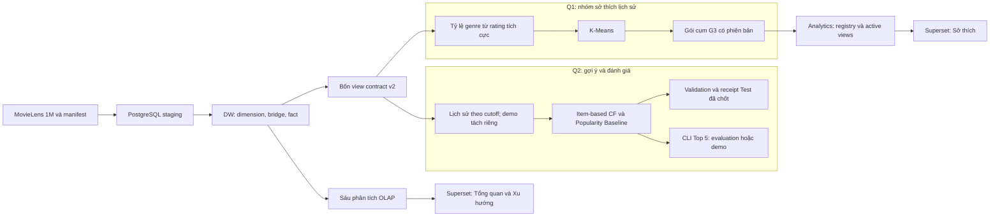
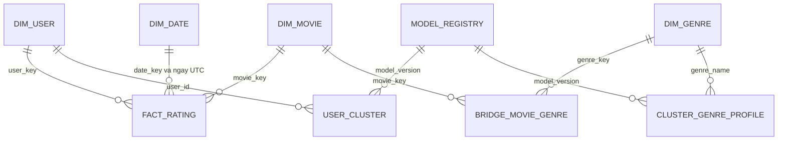

# Chương 1. Giới thiệu bài toán và phạm vi nghiên cứu

## 1.1. Bối cảnh và vấn đề đặt ra

Dữ liệu đánh giá phim có thể hỗ trợ hai nhóm công việc: mô tả những gì đã xảy ra trong lịch sử và xây dựng gợi ý dựa trên lịch sử được phép sử dụng. Hai nhóm công việc này cần một nền dữ liệu nhất quán. Nếu báo cáo BI và mô hình khai phá tự chuẩn hóa nguồn theo những cách khác nhau, cùng một câu hỏi có thể cho kết quả khác nhau dù đều được gọi là phân tích MovieLens. Đồ án vì vậy kết hợp xây dựng kho dữ liệu, truy vấn OLAP và khai phá trên một hợp đồng dữ liệu chung, thay vì chỉ trình bày riêng từng công cụ. [Nguồn: E01, E04 trong [danh mục bằng chứng](../P1/report_evidence_index.md).]

Nguồn sử dụng là MovieLens 1M của GroupLens ([R01–R02](../P1/report/references.md)). Snapshot đã khảo sát gồm 6.040 hồ sơ người dùng, 3.883 phim trong danh mục và 1.000.209 bản ghi đánh giá, trong khoảng từ 25/04/2000 đến 28/02/2003 theo UTC. Đây là dữ liệu đánh giá lịch sử: một bản ghi thể hiện số sao người dùng gửi cho phim và thời điểm gửi đánh giá. Nguồn không cung cấp lượt xem, thời lượng xem hoặc doanh thu. Do đó, các đại lượng được báo cáo trong đồ án phải được diễn đạt là số đánh giá và điểm đánh giá. [Nguồn: [data_profile.csv](../../results/eda/data_profile.csv), [source_manifest.json](../../data/source_manifest.json), E02–E03.]

Một khó khăn đặc trưng là phim có thể thuộc nhiều thể loại. Việc nối trực tiếp đánh giá với bảng thể loại rồi cộng số dòng sẽ làm một đánh giá xuất hiện nhiều lần. Khó khăn thứ hai là dữ liệu phân bố không đều theo thời gian và theo người dùng; phép tổng hợp cần ghi rõ mẫu số, còn đánh giá hệ gợi ý cần tách lịch sử huấn luyện với dữ liệu tương lai. Kiến trúc và các phép kiểm của đồ án xử lý trực tiếp những sai lệch có thể phát sinh này.

## 1.2. Mục tiêu và ba câu hỏi nghiên cứu

Mục tiêu chung là tạo được một luồng dữ liệu có thể truy vết từ nguồn đến DW, từ DW đến báo cáo và khai phá, với kết quả được đối soát theo cùng quy ước. Mục tiêu không chỉ là có bảng dữ liệu hoặc biểu đồ, mà còn giải thích được một con số được tính từ đâu, ở grain nào và trong phạm vi quan sát nào.

**Bảng 1.1. Câu hỏi, phương pháp và đầu ra.**

| Câu hỏi | Nội dung | Cách giải quyết | Đầu ra và căn cứ |
|---|---|---|---|
| Q1 | Có những nhóm sở thích nào và cơ cấu tuổi/giới của các nhóm khác nhau như thế nào trong dữ liệu lịch sử? | Tỷ lệ thể loại từ đánh giá tích cực → K-Means; ghép tuổi/giới sau phân cụm | Hồ sơ cụm, bảng thử cấu hình, heatmap và dashboard Sở thích; E12–E13 |
| Q2 | Gợi ý Top 5 phim theo lịch sử đánh giá như thế nào? | Item-based CF so với Popularity Baseline, chia thời gian và đánh giá cùng cohort | Bảng validation/test, Precision@5, Recall@5, fallback và CLI; E14–E16 |
| Q3 | Số đánh giá thuộc từng thể loại biến động như thế nào qua các quý trong thời kỳ dữ liệu? | OLAP theo quý, count, QoQ, tỷ trọng và cờ quý biên | O4/O5/O6 và dashboard Xu hướng; E10–E11 |

Nguồn bảng: [đặc tả dự án](../project_spec.md), [tiêu chí nội bộ](../acceptance.md), [danh mục bằng chứng E01–E20](../P1/report_evidence_index.md). Bảng mô tả thiết kế nghiên cứu, không thay thế kết quả thực nghiệm ở chương 4 và chương 5.

Q1 mang tính mô tả cắt ngang trên dữ liệu lịch sử; sự khác nhau giữa các nhóm tuổi không chứng minh sở thích của cùng một người thay đổi theo tuổi. Q2 đánh giá gợi ý từ lịch sử rating, không suy luận đạo diễn hoặc diễn viên vì nguồn không có các thuộc tính đó. Q3 phân tích hoạt động gửi đánh giá trong tập dữ liệu, không đại diện cho nhu cầu hiện tại của thị trường.

## 1.3. Phạm vi dữ liệu, công nghệ và sản phẩm

Đồ án sử dụng ba tệp dữ liệu nghiệp vụ users, movies và ratings cùng README nguồn để kiểm provenance và mã dữ liệu. Dữ liệu được đọc theo Latin-1 với dấu phân cách `::`, sau đó chuẩn hóa thành bốn bảng logic users, movies, movie_genres và ratings theo contract v2. ID MovieLens được giữ nguyên ở giao diện trao đổi; khóa thay thế chỉ phục vụ quan hệ nội bộ DW. ZIP code không được sử dụng. [Nguồn: [hợp đồng v2](../shared/data_contract.md), E02–E04.]

PostgreSQL đảm nhiệm lưu trữ staging, DW, các view OLAP và kết quả cụm đã kiểm nhận. Python thực hiện đọc nguồn, ETL, đối soát và khai phá. Apache Superset cung cấp giao diện phân tích với tài khoản BI có quyền đọc các view cần thiết. Môi trường Superset và metadata của nó tách khỏi DW; môi trường Python chạy ETL/ML cũng tách khỏi container Superset. Phiên bản và môi trường thực nghiệm được trình bày ở chương 4, không coi phiên bản công cụ là bằng chứng chức năng đã đạt.

**Bảng 1.2. Sản phẩm trong phạm vi và ý nghĩa kiểm chứng.**

| Thành phần | Sản phẩm | Điều cần chứng minh |
|---|---|---|
| DW | ERD, schema, từ điển, mapping, bốn view giao tiếp | Grain, khóa, UTC và dữ liệu đầu ra đúng contract |
| ETL | Staging và full refresh theo transaction | Chạy lại tương đương; lỗi không để lại dữ liệu nạp dở |
| OLAP/BI | Sáu truy vấn và ba dashboard | Chỉ số, bộ lọc và mẫu số khớp SQL độc lập |
| Q1 | K-Means và gói cụm có phiên bản | Feature đúng; lựa chọn cấu hình có lý do; thiếu bằng chứng được tách riêng |
| Q2 | CF, baseline, đánh giá và CLI | Không rò rỉ tương lai; cùng cohort/candidate; kết quả test có receipt |
| Tái lập/tài liệu | Requirements, hướng dẫn, bằng chứng, báo cáo và demo | Phân biệt đã kiểm tại P1 với xác nhận P2 và nghiệm thu cuối |

Nguồn bảng: [acceptance.md](../acceptance.md), [integration_checklist.md](../integration_checklist.md), E01/E18–E20. CF không bị đặt điều kiện phải thắng baseline; kết quả được báo theo metric thực tế.

Ngoài phạm vi hiện tại là Apriori, Power BI, website sản phẩm, streaming, học sâu, bổ sung đạo diễn/diễn viên, SCD Type 2 và ETL tăng dần. Các nội dung này không được coi là phần đã triển khai hoặc dùng để mở rộng kết luận của đồ án. [Nguồn: [project_spec.md](../project_spec.md), mục phạm vi.]

## 1.4. Kiến trúc giải pháp và phân công

Luồng dữ liệu của hệ thống được tổ chức như Hình 1.1. Các mũi tên mô tả trách nhiệm và quan hệ phụ thuộc; hình không thay thế bằng chứng chạy thực tế.



*Hình 1.1. Kiến trúc luồng dữ liệu, biên tập từ [mapping](../../database/source_to_target.md), [quy trình refresh](../../database/refresh_and_reconciliation.md) và [hướng dẫn tích hợp](../P1/integration_runbook.md). Q1 bàn giao gói cụm G3 cho analytics/BI; Q2 cung cấp kết quả đánh giá và gợi ý qua CLI, không đi qua gói cụm. Lịch sử demo được tách khỏi lịch sử evaluation theo cutoff.*

P1 phụ trách thiết kế DW, ETL, OLAP, Superset và tổng hợp tài liệu cuối. P2 phụ trách khảo sát/adapter dữ liệu, đặc trưng, K-Means, CF, baseline và đánh giá. Sự phân công dựa trên giao diện chung: P1 cung cấp bốn view đúng contract; P2 sử dụng cùng ID nguồn và serializer; kết quả cụm được P1 kiểm nhận trước khi đưa vào BI. Cách tổ chức này cho phép hai phần phát triển song song nhưng vẫn có các điểm đối soát rõ ràng. [Nguồn: [workflow](../shared/github_workflow.md), E04/E08/E13.]

P1 phụ trách DW, ETL, OLAP và BI; P2 phụ trách dữ liệu và các mô hình khai phá. Nội dung thuật toán và thực nghiệm Q1/Q2 được trình bày tập trung ở chương 2 và chương 5; chương 4 mô tả giao diện và cách sử dụng kết quả cụm trong BI.

## 1.5. Phương pháp kiểm chứng và trạng thái tích hợp

Kiểm chứng được tổ chức theo nhiều lớp. Lớp dữ liệu so nguồn, bảng canonical và view DW bằng schema, số dòng, khóa, miền, UTC và SHA-256 theo serializer chung. Lớp ETL dùng fixture tự tạo để kiểm lỗi và rollback, đồng thời so hai lần chạy trên cùng code/config. Lớp BI đối soát SQL với API/UI trên nhiều tổ hợp filter. Lớp khai phá giữ cố định giao thức validation/test và nguồn receipt, không chạy lại test để thay kết quả khi viết tài liệu. [Nguồn: E06–E18.]

Trong phép kiểm tích hợp tại P1, hai chu trình trên database thử riêng đã hoàn thành với các checkpoint sau ETL và sau nạp G3 được phân biệt. Điều đó hỗ trợ kết luận về luồng đã kiểm trên máy P1, chưa tự động chứng minh tái lập trên mọi máy hoặc mọi hệ điều hành. Chi tiết kết quả và giới hạn được trình bày ở chương 4; run/hash/lệnh dài được đưa vào phụ lục truy vết của bản thảo. [Nguồn: [summary 12A](../../results/warehouse/s12a/57c1e8e3d3f445c4b3eeddbfc3364709/summary.json), E18.]

Ngày 24/10/2026, điều phối đã nghiệm thu 12-P2 và 12B, xác nhận G4 đạt trong phạm vi ma trận I01–I15 và các giới hạn đã công bố. Candidate thực chạy giữ nguyên như phụ lục A; commit tài liệu không đại diện một lần thực nghiệm mới. P2 intake G2 đã được xác nhận trên máy Windows độc lập, Python 3.12.6/PostgreSQL 17.4; P1 dùng Windows/Python 3.12.14/PostgreSQL 17.11. Không có bằng chứng kiểm Linux, Superset trên máy P2 hoặc phục hồi toàn stack trên máy mới. [Nguồn: [ma trận nghiệm thu](../P1/integration_acceptance.md), [ghi nhận G4](../P1/g4_acceptance_20261024.json), E20.]

Các yêu cầu kỹ thuật được dùng hiện tại là tiêu chí nội bộ của nhóm, cần phân biệt với rubric chính thức của môn học. Nghiệm thu G4 không thay cho nghiệm thu báo cáo, slide và gói nộp thuộc G5; báo cáo tổng hiện chờ review và G5 chưa hoàn thành.

## 1.6. Bố cục báo cáo

Sau chương mở đầu, chương 2 trình bày cơ sở lý thuyết và phương pháp. Chương 3 mô tả dữ liệu, chất lượng, hợp đồng và mô hình DW. Chương 4 trình bày ETL, kiểm chứng, OLAP và dashboard, trong đó có kết quả trả lời Q3. Chương 5 tập trung thực nghiệm K-Means cho Q1 và CF/baseline cho Q2. Chương 6 tổng hợp kết luận, giới hạn và hướng phát triển, với trạng thái tích hợp được khóa theo nghiệm thu cuối thay vì suy ra từ riêng một báo cáo kỹ thuật.


# Chương 2. Cơ sở lý thuyết và phương pháp

Chương này giải thích phương pháp; cấu hình và kết quả đo được trình bày ở [chương 5](../P2/report/chapter_05.md). Các ví dụ dưới đây là fixture tự tạo, không trích dữ liệu cá nhân MovieLens. Mã tài liệu R và bằng chứng E được giải thích trong tài liệu tham khảo và phụ lục.

## 2.1. Kho dữ liệu, grain và mô hình chiều

Kho dữ liệu (DW) tổ chức dữ liệu đã chuẩn hóa để hỗ trợ truy vấn phân tích nhất quán. Trong dự án, staging là vùng tiếp nhận và kiểm tra nguồn; DW lưu các sự kiện đánh giá cùng chiều mô tả; analytics cung cấp các phép tổng hợp và kết quả mô hình đã kiểm. Grain phải được xác định trước khi chọn khóa và thước đo: nó diễn đạt một dòng fact đại diện sự kiện nào. Theo [Kimball, Fact Tables](https://www.kimballgroup.com/2008/11/fact-tables/) (R11), thước đo phải phù hợp grain và các dimension cung cấp ngữ cảnh phân tích.

Ở đây grain fact là **một đánh giá nguồn**, có số sao và thời điểm gửi; không phải lượt xem. Dimension user, movie, date và genre mô tả ngữ cảnh. Một phim nhiều genre được biểu diễn bằng bridge movie–genre. Mô hình sao thuận tiện cho tổng hợp qua fact và dimension; quan hệ đa trị của genre đòi hỏi thêm bridge và định nghĩa mẫu số rõ ràng. Thiết kế cụ thể và ràng buộc của dự án được trình bày ở [chương 3, mục 3.3–3.6](../P1/report/chapter_03.md), không phải một mô hình SCD/incremental đã triển khai đầy đủ.

Ví dụ fixture: một đánh giá 4 sao cho phim thuộc Action và Comedy là một dòng fact, nhưng khi nối bridge tạo hai lượt gắn genre. COUNT trên fact cho 1 đánh giá; COUNT sau nối bridge cho 2 lượt gắn genre. Hai đại lượng hợp lệ cho hai câu hỏi khác nhau, không được gọi cùng là tổng rating hệ thống. Điểm trung bình khi roll-up phải bằng tổng số sao chia tổng số đánh giá, không phải trung bình không trọng số của các điểm trung bình nhóm.

## 2.2. ETL theo lô, transaction và đối soát

ETL gồm trích xuất, biến đổi và nạp dữ liệu. Với snapshot cố định, dự án dùng full refresh theo lô: đọc nguồn theo contract, kiểm miền/khóa, ánh xạ dimension, nạp bridge và fact rồi đối soát trước commit. Count kiểm bảo toàn số dòng; canonical hash kiểm nội dung đã tuần tự hóa theo cùng schema, thứ tự cột, thứ tự dòng, UTC và quy tắc byte. Count bằng nhau riêng lẻ không chứng minh dữ liệu bằng nhau.

Transaction gom các thao tác thành đơn vị nguyên tử. BEGIN mở giao dịch, COMMIT xác nhận và ROLLBACK hủy thay đổi chưa commit; đây là cơ chế nền của PostgreSQL, không phải chỉ đặt tên trạng thái trong log. [PostgreSQL 17, Transactions](https://www.postgresql.org/docs/17/tutorial-transactions.html) (R06). Trong dự án, lỗi đối soát phải ngăn công bố snapshot mới; kết quả cụm cũ bị vô hiệu hóa khi DW refresh và chỉ được kích hoạt sau đối soát gói G3. Phạm vi rollback/restore thực kiểm thuộc chương 4 và [ma trận I04–I08, I13–I14](../P1/integration_acceptance.md). Không suy rằng mọi lỗi phần cứng hoặc mất kết nối lúc COMMIT đã được thử.

## 2.3. Các thao tác OLAP và ý nghĩa tổng hợp

OLAP phân tích dữ liệu theo nhiều chiều và cấp chi tiết. Trong phạm vi dự án, các thao tác được hiểu theo giao diện SQL/dashboard đã công bố, không hàm ý đã triển khai một máy chủ cube riêng:

- Roll-up tổng hợp từ tháng lên quý/năm; drill-down đi ngược về tháng/phim.
- Slice cố định một giá trị của chiều, chẳng hạn giới tính; dice chọn kết hợp các tập giá trị thể loại, tuổi và khoảng thời gian.
- Pivot đổi cách bố trí hàng/cột của cùng phép tổng hợp, không thay đổi grain hoặc mẫu số.

Các thao tác thực tế O1–O6 được dẫn ở [chương 4](../P1/report/chapter_04.md) và [SQL OLAP](../../olap/queries.sql). Với Q3, đặt n(g,q) là số lượt gắn genre g trong quý q. QoQ = 100 × [n(g,q) − n(g,q−1)] / n(g,q−1); mẫu số bằng 0 hoặc chưa có quý trước thì N/A. Lưới genre×quý phải điền 0 trước LAG để so đúng quý liền trước. Tỷ trọng genre dùng tổng lượt gắn tất cả genre cùng quý làm mẫu số; nó khác tỷ lệ trên tổng rating duy nhất. Ngưỡng quý trước ≥100 và loại quý biên là quy tắc thực nghiệm đã chốt, không phải một định luật OLAP.

## 2.4. Đặc trưng tỷ lệ genre và K-Means

### 2.4.1. Tạo vector sở thích từ đánh giá tích cực

Theo [mining/features.py](../../mining/features.py), một đánh giá rating ≥4 được quy ước là tích cực. Đặt G(i) là tập genre của phim i và P(u) là tập phim được đánh giá tích cực trong lịch sử dùng cho Q1:

$$C_{u,g}=\sum_{i\in P(u)}\mathbf{1}[g\in G(i)],\quad S_u=\sum_{g=1}^{18}C_{u,g},\quad p_{u,g}=C_{u,g}/S_u\;(S_u>0).$$

Mỗi phim đa genre đóng góp 1 cho **từng** genre, rồi chuẩn hóa bằng tổng lượt gắn genre tích cực; không chia mỗi phim thành trọng số 1/|G(i)|. Vector có 18 chiều theo A–Z, không âm, tổng bằng 1 trong tolerance 10⁻⁸. Nếu S(u)=0 thì status là insufficient_evidence và cluster_id NULL; không đưa vector rỗng vào K-Means. Giới/tuổi/nghề không nằm trong feature.

**Bảng 2.1. Fixture tính tay vector genre.** Đơn vị: số sao, lượt gắn và tỷ lệ; mẫu số vector là 3 lượt gắn genre tích cực của một hồ sơ giả định.

| Phim ký hiệu tự tạo | Genre | Rating giả định | Đóng góp vào C |
|---|---|---:|---|
| A | Action, Comedy | 5 | Action +1, Comedy +1 |
| B | Comedy | 4 | Comedy +1 |
| C | Drama | 2 | Không cộng |

Nguồn: fixture do tác giả tạo theo features.py; không phải bản ghi thực. Kết quả: p(Action)=1/3, p(Comedy)=2/3, 16 chiều còn lại bằng 0. Đây là tỷ lệ liên kết genre từ đánh giá tích cực, không phải tỷ lệ thời gian xem. Feature Q1 dùng toàn lịch sử chỉ để mô tả; không đưa vào đánh giá thời gian Q2.

### 2.4.2. Hàm mục tiêu và tiền xử lý

K-Means phân  N vector vào K cụm và tối thiểu hóa tổng bình phương khoảng cách Euclidean đến tâm:

$$J=\sum_{c=1}^{K}\sum_{u\in C_c}\|x_u-\mu_c\|_2^2,\qquad \mu_c=|C_c|^{-1}\sum_{u\in C_c}x_u.$$

Đây là inertia/SSE. Thuật toán lặp gán điểm về tâm gần nhất và cập nhật tâm trung bình; khởi tạo ảnh hưởng nghiệm cục bộ. [scikit-learn 1.5.2, K-Means](https://scikit-learn.org/1.5/modules/clustering.html#k-means) (R12). Dự án so sánh x=p nguyên tỷ lệ (raw) và z=(p−mean)/standard deviation theo genre. StandardScaler làm thay đổi trọng số khoảng cách; vì vậy không so trực tiếp độ lớn SSE giữa hai không gian để chọn bên tốt hơn. Profile sau phân cụm luôn là trung bình tỷ lệ **gốc** của người thuộc cụm.

### 2.4.3. Chỉ số đánh giá và độ ổn định

Với điểm u, a(u) là khoảng cách trung bình đến các điểm cùng cụm (không kể chính nó), b(u) là giá trị nhỏ nhất của khoảng cách trung bình đến từng cụm khác. Silhouette s(u)=[b(u)−a(u)]/max[a(u),b(u)], rồi lấy trung bình; cụm singleton dùng quy ước thư viện. Giá trị gần 0 thể hiện chồng lấn. [Tài liệu silhouette_score](https://scikit-learn.org/1.5/modules/generated/sklearn.metrics.silhouette_score.html) (R05). Code dự án fit trên toàn bộ assigned nhưng tính Silhouette trên một mẫu cố định; khoảng cách trong chỉ số này cũng được tính trong mẫu, không gọi là Silhouette toàn tập.

ARI so sánh hai cách gán cụm trên cùng tập điểm, điều chỉnh sự đồng thuận ngẫu nhiên: ARI=(RI−E[RI])/(max(RI)−E[RI]). Nó bất biến với hoán vị nhãn cụm. [Tài liệu adjusted_rand_score](https://scikit-learn.org/1.5/modules/generated/sklearn.metrics.adjusted_rand_score.html) (R13). Trong dự án, ARI đo ổn định giữa seed, không phải độ chính xác so với nhãn sở thích đúng.

## 2.5. Cosine item-based CF, baseline và fallback

Item-based CF khai thác quan hệ giữa các item từ ma trận đánh giá; nghiên cứu của Sarwar và cộng sự là cơ sở tiếp cận item–item, có xem xét cosine và các cách tổng hợp gợi ý. [Sarwar et al., WWW 2001](https://www.ra.ethz.ch/cdstore/www10/papers/pdf/p519.pdf) (R03). Phiên bản dự án dưới đây là quy tắc xếp hạng riêng theo code, không sao chép công thức dự đoán sao của bài báo.

Ma trận R có hàng là phim, cột là người dùng trong lịch sử huấn luyện; ô quan sát chứa rating 1..5, ô chưa quan sát bằng 0. Số 0 là cách biểu diễn thiếu tương tác, không phải đánh giá 0 sao. Không trừ trung bình người dùng. Với hai hàng phim khác nhau:

$$sim(i,j)=\frac{R_i\cdot R_j}{\|R_i\|_2\|R_j\|_2}.$$

Đặt đường chéo 0, chỉ giữ sim>0; N_k(j) là tối đa neighbor_k láng giềng của **phim seed j**, xếp similarity giảm rồi movie_id tăng. Việc cắt top-k làm quan hệ láng giềng có thể không đối xứng dù cosine đối xứng. Đặt H(u) là toàn bộ phim đã đánh giá trong lịch sử được phép, S(u) là các phim rating ≥4 trong H(u). Điểm ứng viên i chưa nằm trong H(u) là:

$$score(u,i)=\sum_{j\in S(u)}\mathbf{1}[i\in N_k(j)]\,sim(i,j).$$

Công thức khớp [recommend_for_user_cf](../../mining/cf.py): không nhân thêm số sao seed, không chia tổng similarity. Score là điểm xếp hạng tổng hợp, có thể lớn hơn 1; không phải trực tiếp một cosine hoặc sao dự đoán. Xếp theo score giảm, popularity huấn luyện giảm rồi movie_id tăng; xếp trước khi làm tròn score xuất ra.

Fixture tự tạo: hai hàng phim (4,0) và (4,3) có cosine 16/(4×5)=0,8. Nếu một ứng viên nằm trong láng giềng của hai seed với similarity 0,8 và 0,6 thì score=1,4. Ví dụ này minh họa công thức, không công bố gợi ý cho người dùng thực.

Popularity Baseline đếm **mọi** rating huấn luyện của phim, gồm cả rating dưới 4; hòa count thì movie_id tăng. Sau khi loại H(u), lấy Top-N=5. Nếu CF có dưới 5 ứng viên điểm dương, bổ sung từ cùng bảng popularity, loại lịch sử và mục đã chọn. Các dòng bổ sung mang score_type=popularity_fallback; score nội bộ None và CLI hiển thị N/A (Popularity Fallback). Không trộn số đếm popularity vào float score CF. Baseline là mô hình đối chứng độc lập; fallback là cơ chế hoàn thiện danh sách CF. [Nguồn: baseline.py, cf.py và recommend.py trong mining.]

## 2.6. Chia thời gian và đánh giá Top-5

Phân vị timestamp toàn cục ở mức 0,70 và 0,85 được nội suy tuyến tính rồi lấy int thành t₁,t₂. Train: t≤t₁; validation: t₁<t≤t₂; Test: t>t₂. Timestamp hòa giữ cùng phía. Validation chỉ học từ Train; sau chọn neighbor_k mới fit Train+Validation để đánh giá Test đóng băng. Q1 và demo toàn lịch sử không tham gia việc chọn cấu hình Q2. Đây là thiết kế giảm rò rỉ tương lai trong snapshot, không chứng minh hiệu quả triển khai trực tuyến.

Cohort gồm người có ≥5 rating trong lịch sử huấn luyện và ≥1 phim rating ≥4 trong kỳ đánh giá. Candidate universe I(u)=catalog huấn luyện trừ H(u), không negative sampling. Phim mới chưa có trong catalog huấn luyện không thể được CF/baseline đề xuất, nhưng phim tích cực mới vẫn nằm trong mẫu số Recall.

Đặt L₅(u) là danh sách gợi ý tối đa 5 phim, T(u) là toàn bộ phim tích cực kỳ đánh giá, h(u)=|L₅(u)∩T(u)|. Công thức thực thi ở [evaluation.py](../../mining/evaluation.py):

$$P@5(u)=h(u)/5,\quad R@5(u)=h(u)/|T(u)|,$$
$$macro\ P@5=|U|^{-1}\sum_{u\in U}P@5(u),\quad macro\ R@5=|U|^{-1}\sum_{u\in U}R@5(u).$$

**Bảng 2.2. Định nghĩa và mẫu số chỉ số.**

| Chỉ số | Đơn vị | Mẫu số/phạm vi |
|---|---|---|
| Precision@5 | Tỷ lệ [0,1] | 5 vị trí cố định, cả khi trả thiếu |
| Recall@5 | Tỷ lệ [0,1] | Số phim tích cực của từng người trong kỳ, gồm phim mới |
| Macro | Trung bình tỷ lệ | Số người đủ điều kiện, mỗi người trọng số ngang nhau |
| Fallback rate | % người | Người có dùng ít nhất một mục fallback / cohort ×100 |
| Inertia | Tổng bình phương khoảng cách | Tổng trên toàn assigned trong không gian fit, không chia N |
| Silhouette | Không đơn vị | Trung bình trên mẫu cố định |
| ARI | Không đơn vị | Cặp điểm của cùng tập assigned ở hai lần gán nhãn |

Nguồn: code evaluation.py/clustering.py và R12, R05, R13. Precision/Recall dựa nguyên lý số đúng trên số đề xuất/số liên quan ([tài liệu precision](https://scikit-learn.org/1.5/modules/generated/sklearn.metrics.precision_score.html), [recall](https://scikit-learn.org/1.5/modules/generated/sklearn.metrics.recall_score.html), R14–R15); macro trong dự án lấy trung bình **theo người**, không dùng trực tiếp macro theo nhãn của API phân loại.

Fixture tính tay: hồ sơ giả định A có 2 hits trong 5 gợi ý và 4 phim relevant (gồm 1 phim mới), nên P=0,4, R=0,5. Hồ sơ giả định B trả 3 gợi ý, có 1 hit và 2 relevant, nên P=0,2, R=0,5. Macro trên đúng hai hồ sơ giả định là P=0,3 và R=0,5; không đổi mẫu số Precision của B thành 3. Recall đo mức thu hồi relevant, **không phải catalog coverage**. Không kết luận tất cả phim chưa đánh giá là không thích hoặc mọi rating ≤3 là bằng chứng người dùng không quan tâm.


# Chương 3. Dữ liệu nguồn và thiết kế kho dữ liệu

## 3.1. Nguồn dữ liệu và phạm vi quan sát

Theo tài liệu nguồn [R01](../P1/report/references.md), MovieLens 1M gồm ba tệp dữ liệu chính: users mô tả người dùng, movies mô tả danh mục phim và thể loại, ratings lưu đánh giá. README đi kèm cung cấp quy ước nguồn; nó được kiểm hash nhưng không nạp thành một bảng nghiệp vụ. Mỗi máy tải nguồn theo manifest thay vì trao đổi toàn bộ thư mục raw. Cách này tách việc có cùng dữ liệu logic khỏi đường dẫn cục bộ của từng thành viên. [Nguồn: [source_manifest.json](../../data/source_manifest.json), [hợp đồng v2](../shared/data_contract.md), E02–E04 trong [chỉ mục](../P1/report_evidence_index.md).]

**Bảng 3.1. Quy mô snapshot và các bảng logic chuẩn.**

| Thành phần | Số dòng dữ liệu | Khóa logic | Ý nghĩa |
|---|---:|---|---|
| users | 6.040 | user_id | Hồ sơ người dùng nguồn |
| movies | 3.883 | movie_id | Toàn bộ phim trong danh mục |
| movie_genres | 6.408 | movie_id, genre_name | Các cặp phim–thể loại sau tách chuỗi |
| ratings | 1.000.209 | user_id, movie_id sau kiểm EDA | Đánh giá nguồn, không phải phiên xem |

Nguồn: [canonical_manifest.json](../../results/eda/canonical_manifest.json), [data_profile.csv](../../results/eda/data_profile.csv). Số dòng không tính header CSV. SHA đầy đủ và quy tắc byte được dẫn ở phụ lục truy vết, không đặt vào từng bảng nội dung.

Khoảng quan sát theo thời điểm đánh giá là `2000-04-25T23:05:32Z` đến `2003-02-28T17:49:50Z`. Hai quý ngoài cùng không chứa đủ khoảng thời gian của quý lịch. Vì vậy, sự thay đổi số rating giữa các quý cần xét cờ biên trước khi diễn giải tăng trưởng; việc có đủ khoảng ngày của quý nội bộ cũng không chứng minh dữ liệu đại diện toàn thị trường. [Nguồn: [eda_metrics.json](../../results/eda/eda_metrics.json), [olap_findings.md](../P1/olap_findings.md).]

## 3.2. Những kết quả EDA ảnh hưởng thiết kế

### 3.2.1. Khóa, quan hệ và tính đầy đủ

EDA ghi nhận không có cặp user–movie trùng trong 1.000.209 rating. Kết quả này là căn cứ cho UNIQUE của fact, không phải giả định ban đầu về hành vi người dùng. Trong DW, UNIQUE được đặt trên cặp surrogate user_key–movie_key sau khi mỗi ID nguồn đã được ánh xạ duy nhất sang dimension. Ràng buộc này không cho phép kết luận một người chỉ xem một phim một lần. [Nguồn: [data_profile.csv](../../results/eda/data_profile.csv), [schema.sql](../../database/schema.sql), E03/E05.]

Các kiểm khóa tham chiếu và miền mã được mô tả trong [data_understanding.md](../P2/data_understanding.md), manifest và đối soát DW. ETL vẫn kiểm lại ánh xạ thay vì dựa vào kết luận tổng quát “dữ liệu sạch”: thiếu dimension, rating sai miền hoặc cặp trùng phải tạo lỗi, không bị mất qua inner join hoặc tự loại bỏ.

**Bảng 3.2. Quan sát dữ liệu và hệ quả thiết kế.**

| Quan sát | Kết quả của snapshot | Quyết định |
|---|---|---|
| Trùng khóa user–movie | 0 cặp trùng | UNIQUE(user_key,movie_key) và kiểm trước commit |
| Điểm đánh giá | Số nguyên 1..5 | Kiểu smallint, NOT NULL và CHECK |
| Thể loại | 18 tên gốc, 6.408 cặp | Dimension genre và bridge, không thêm cột genre đơn vào phim |
| Phim chưa có rating | 177 trong 3.883 phim | Giữ đầy đủ danh mục; KPI danh mục khác KPI phim có rating |
| Người không có rating ≥ 4 | 2 người | Không là user thiếu mọi rating; tách insufficient_evidence trong Q1 |
| Năm phát hành | Snapshot trích xuất được; miền năm 1919–2000 | Vẫn cho phép NULL theo contract nếu không khớp mẫu ở nguồn khác |

Nguồn: [data_profile.csv](../../results/eda/data_profile.csv), [eda_metrics.json](../../results/eda/eda_metrics.json), [data_understanding.md](../P2/data_understanding.md), [từ điển](../../database/data_dictionary.md). Quy tắc NULL là thiết kế giao diện, không phải phát biểu rằng snapshot hiện tại có phim thiếu năm.

### 3.2.2. Phân bố đánh giá, hoạt động và nhân khẩu học

Mức 4 sao có 348.971 đánh giá, cao nhất trong năm mức; mức 1 sao có 56.174 đánh giá. Điểm trung bình toàn bộ snapshot xấp xỉ 3,5816. Đây là phân bố trong dữ liệu đã thu thập, không phải thước đo trực tiếp sự hài lòng của toàn bộ khán giả. Hình 3.1 cho thấy sự bất cân xứng giữa các mức sao và là cơ sở để phân biệt rating tích cực dùng cho Q1 với toàn bộ rating dùng trong kho. [Nguồn: [eda_metrics.json](../../results/eda/eda_metrics.json), E03.]


*Hình 3.1. Phân bố rating 1–5 trong MovieLens 1M. Nguồn: EDA P2, `results/eda/rating_distribution.png`; số liệu đối chiếu E03.*

Số rating mỗi người dùng có trung vị 96 và trung bình khoảng 165,60, trong khi giá trị lớn nhất là 2.314. Trung bình cao hơn trung vị cho thấy mức đóng góp không đồng đều; một nhóm người đánh giá nhiều có thể ảnh hưởng đáng kể đến thống kê theo rating. Phân tích quy mô cụm vì vậy đếm user, không đếm rating thay user. [Nguồn: [data_profile.csv](../../results/eda/data_profile.csv), nhóm users_activity.]

Hồ sơ nguồn gồm 4.331 người mang mã M và 1.709 người mang mã F; nhóm 25–34 có 2.096 hồ sơ, lớn nhất trong bảy nhóm tuổi. Những chênh lệch này cần được giữ làm ngữ cảnh khi mô tả cụm. Chúng không chứng minh mẫu đại diện cơ cấu dân số và không giải thích quan hệ nhân quả giữa tuổi/giới với sở thích. [Nguồn: [eda_metrics.json](../../results/eda/eda_metrics.json), users.gender_distribution và age_distribution.]

### 3.2.3. Phim nhiều thể loại và thời gian

Trong danh mục, 2.025 phim có một genre và 1.858 phim có nhiều genre, tối đa sáu genre. Mỗi phim vẫn chỉ có một dòng trong dim_movie. Nếu một đánh giá phim giả lập thuộc Comedy và Drama, fact có một rating, bridge có hai liên kết, còn thống kê theo genre nhận một lượt gán ở mỗi genre. Ví dụ tự tạo này minh họa quan hệ, không đưa lịch sử cá nhân thật vào báo cáo. [Nguồn số lượng: [data_profile.csv](../../results/eda/data_profile.csv); quy tắc: [schema.sql](../../database/schema.sql), E05.]

Hình 3.2 cho thấy rating tập trung mạnh ở các quý năm 2000. Việc giảm số rating sau đó có thể được mô tả bằng count/QoQ, nhưng không đủ dữ kiện để quy nguyên nhân cho thị trường phim hoặc thay đổi nhu cầu. Các nguyên nhân đó chỉ có thể là giả thuyết khi chưa có nguồn bổ sung.


*Hình 3.2. Hoạt động đánh giá theo quý UTC. Nguồn: EDA P2, `results/eda/quarterly_activity.png`, đối chiếu E03/E10. Quý 2000Q2 và 2003Q1 là quý biên có khoảng quan sát không đầy đủ.*

## 3.3. Hợp đồng dữ liệu chung

Hợp đồng v2 quy định không chỉ tên bảng mà cả kiểu, thứ tự cột, ID, xử lý NULL và serializer. users có user_id, gender, age_group, occupation; movies có movie_id, title, release_year; movie_genres có movie_id, genre_name; ratings có user_id, movie_id, rating, timestamp, rated_at. ID xuất ra là ID MovieLens, không phải surrogate của một lần nạp DW. [Nguồn: [data_contract.md](../shared/data_contract.md), E04.]

Bảy nhóm tuổi được ánh xạ từ mã nguồn thành Under 18,18–24,25–34,35–44,45–49,50–55,56+; nhãn máy đọc giữ đúng chuỗi contract, gồm `Under 18`. Gender giữ F/M và occupation giữ mã 0..20. Title được bảo toàn; release_year chỉ lấy nhóm bốn chữ số trong ngoặc cuối, không khớp thì NULL. Các phép biến đổi này hạn chế việc hai phía tự “làm sạch” khác nhau và tránh suy diễn thêm thông tin không có trong nguồn.

CSV canonical dùng UTF-8 không BOM, LF, header và thứ tự cột cố định, số nguyên không có `.0`, NULL là ô rỗng. Mỗi bảng được sort theo khóa quy định trước băm. timestamp giữ giây Unix kiểu int64; rated_at là cùng thời điểm theo UTC và xuất ISO 8601 dạng kết thúc bằng Z. Nhờ vậy, hai đường đọc raw/CSV/DW có thể đối soát byte logic thay vì chỉ so số dòng. Các hash bằng nhau là bằng chứng tương đương theo serializer đã chốt, không thay cho toàn bộ kiểm catalog và ràng buộc.

## 3.4. Kiến trúc staging, DW và analytics

### 3.4.1. Staging giữ đầu vào trước diễn giải

Ba bảng users_raw, movies_raw và ratings_raw giữ các trường nguồn cần dùng dưới dạng text cùng source_line. source_line là vị trí dòng trong từng tệp, không là ID nghiệp vụ. Tách staging cho phép phát hiện lỗi số trường, ép kiểu hoặc miền giá trị tại vị trí nguồn cụ thể trước khi hình thành quan hệ DW. Không lưu nguyên dòng users có ZIP; trường ZIP được loại có chủ đích theo contract. [Nguồn: [từ điển](../../database/data_dictionary.md), [mapping](../../database/source_to_target.md), E05/E06.]

Việc một số cột staging cho phép NULL không có nghĩa ETL chấp nhận dữ liệu nghiệp vụ thiếu. Staging là lớp giữ dữ liệu trước validation; kiểm NULL và phép ép kiểu vẫn phải đạt trước commit snapshot DW. Không tự bỏ dòng lỗi để làm count cuối khớp kỳ vọng.

### 3.4.2. Grain và quan hệ trong DW

Fact_rating có grain một bản ghi đánh giá nguồn. Bốn dimension cung cấp ngữ cảnh người dùng, phim, ngày UTC và thể loại. Bridge biểu diễn quan hệ nhiều–nhiều của phim với genre. Thiết kế sao có bridge này giữ fact ổn định trong khi vẫn cho phép phân tích theo thể loại. [Nguồn: [ERD](../../database/erd.md), [schema](../../database/schema.sql), E05.]



*Hình 3.3. ERD quan hệ rút gọn từ `database/erd.md`; `||--o{` là một cha đến 0..N dòng con. PK/FK và kiểu đầy đủ ở bảng 3.3 và ERD nguồn. FK ngày thực là ghép date_key với ngày UTC, không chỉ so khóa kỹ thuật. ERD đầy đủ, gồm trường, kiểu và khóa, được cung cấp trong nguồn liên kết.*

**Bảng 3.3. Bảng chính và quyết định khóa.**

| Bảng | Khóa chính | Thuộc tính/quan hệ quan trọng |
|---|---|---|
| dim_user | user_key integer identity | user_id unique; gender,age_group,occupation có kiểm miền |
| dim_movie | movie_key integer identity | movie_id unique; title text; release_year smallint nullable |
| dim_date | date_key integer identity | full_date unique; năm/quý/tháng/ngày GENERATED STORED |
| dim_genre | genre_key integer identity | genre_name unique, giữ tên nguồn |
| bridge_movie_genre | movie_key,genre_key | Hai FK đến dimension; mỗi cặp đúng một lần |
| fact_rating | rating_key bigint identity | FK user/movie/ngày; UNIQUE(user_key,movie_key); rating 1..5; epoch và UTC tương đương |

Nguồn: [schema.sql](../../database/schema.sql), [data_dictionary.md](../../database/data_dictionary.md). Khóa kỹ thuật có thể thay đổi sau refresh; đối soát giữa hai lần chạy dùng ID nguồn và nội dung logic, không dùng equality của identity.

Lịch ngày được sinh liên tục từ ngày UTC nhỏ nhất đến lớn nhất trong rating. Cách này hỗ trợ báo cáo có các kỳ không phát sinh đánh giá. rated_at dùng timestamptz; rated_date được sinh theo UTC. FK ghép `(date_key,rated_date)` đến `(date_key,full_date)` ngăn lỗi một fact trỏ đúng khóa tồn tại nhưng sai ngày. CHECK bảo đảm epoch và rated_at biểu diễn cùng thời điểm, tránh kết quả phụ thuộc timezone máy. [Nguồn: schema và quy trình refresh, E05/E07.]

### 3.4.3. Index và tác dụng dự kiến

PK/UNIQUE tạo index cho ID nguồn, full_date, genre_name và cặp user–movie. Index bổ sung trên fact theo movie_key hỗ trợ truy vấn từ phim; index `(date_key,movie_key)` và rated_at phục vụ lọc thời gian/tổng hợp phim trong kỳ. Bridge có index ngược `(genre_key,movie_key)` để truy từ genre sang phim. Các bảng kết quả cụm có index phục vụ lọc version/cụm và tra user/genre. [Nguồn: [schema.sql](../../database/schema.sql), các lệnh CREATE INDEX.]

Đây là lý do thiết kế theo đường truy cập, không phải khẳng định mọi truy vấn đã được tối ưu hoặc có mức tăng tốc cụ thể. Muốn kết luận hiệu năng cần kế hoạch thực thi và benchmark trong điều kiện tải xác định; bằng chứng hiện tại chủ yếu chứng minh tính đúng và chức năng của snapshot.

## 3.5. Ánh xạ nguồn–đích và giao diện dữ liệu

**Bảng 3.4. Các phép biến đổi chính.**

| Nguồn | Đích | Phép xử lý và kiểm |
|---|---|---|
| users:ID,gender,age,occupation | dim_user | Ép kiểu; ánh xạ bảy tuổi; giữ F/M và mã nghề; bỏ ZIP |
| movies:ID,title | dim_movie | Giữ title; trích năm đúng mẫu cuối; giữ ID gốc |
| movies:genres | dim_genre và bridge | Tách `|`, kiểm tên và cặp duy nhất; thiếu mapping phải lỗi |
| ratings:timestamp | dim_date và fact | Epoch → UTC, sinh lịch liên tục, kiểm ngày và thời điểm |
| ratings:user,movie,rating | fact_rating | Tra đúng một surrogate/ID; CHECK 1..5 và UNIQUE |
| G3 đã kiểm | registry,user_cluster,cluster_genre_profile | Kiểm identity/hash/cohort/genre rồi nạp cùng transaction |

Nguồn: [source_to_target.md](../../database/source_to_target.md), E05/E13. Tên bảng trong bảng được rút gọn; schema đầy đủ ở SQL nguồn.

Bốn view `dw.v_ml_users`, `dw.v_ml_movies`, `dw.v_ml_movie_genres`, `dw.v_ml_ratings` là giao diện cho adapter P2 và các thành phần dùng dữ liệu chuẩn. Đặc biệt, ratings view không join bridge. Với một phim hai genre, nó vẫn trả một dòng cho một đánh giá; chỉ view movie_genres trả hai cặp. Việc tách này bảo vệ cả số rating toàn hệ thống lẫn dữ liệu ma trận của mô hình khỏi nhân dòng. [Nguồn: schema và [dw_handoff.md](../P1/dw_handoff.md), E08.]

## 3.6. Quản lý kết quả cụm trong analytics

Registry lưu model_version, contract, source/canonical hashes, cấu hình huấn luyện, thư viện và trạng thái active/valid. User_cluster giữ một dòng mỗi user cho mỗi version; assigned có cluster_id, insufficient_evidence có NULL. Cluster_genre_profile lưu một dòng mỗi cụm×genre với mean_preference và n_users. Hai bảng cùng nối registry, tránh ghép profile và user từ hai phiên bản khác nhau. [Nguồn: [schema.sql](../../database/schema.sql), E13.]

Snapshot đã nạp tại P1 có 6.040 dòng user, gồm 6.038 assigned và 2 thiếu bằng chứng; bốn cụm có 72 dòng profile. mean_preference là trung bình tỷ lệ genre gốc của user trong cụm, không phải tỷ lệ số user “thích” một genre. n_users lặp trên 18 genre của mỗi cụm nên không được cộng toàn cột để lấy tổng người. Chi tiết thực nghiệm và tên cụm do P2 trình bày ở chương 5; chương này chỉ xác định cách lưu và ý nghĩa dữ liệu. [Nguồn: [handoff_summary11B2](../../results/warehouse/s11b2/handoff_summary.json), E12–E13.]

Hai active view chỉ trả version có cả is_active và is_valid_for_dw. Khi DW full refresh, kết quả cũ bị vô hiệu hóa; sự tồn tại của registry không đủ để BI tiếp tục dùng model đó. Loader chỉ kích hoạt lại sau khi đối soát đầy đủ nguồn hiện tại và gói. Cơ chế này bảo vệ ý nghĩa “cụm của snapshot DW đang dùng”, thay vì lựa chọn version mới nhất theo tên hoặc giữ kết quả cũ theo thói quen.

## 3.7. Ý nghĩa và giới hạn của thiết kế

Thiết kế giữ grain đánh giá, ID nguồn và UTC giúp DW phục vụ đồng thời BI và khai phá mà không buộc hai phía chia sẻ surrogate. Bridge giải quyết đa genre nhưng cũng đặt yêu cầu ghi rõ mẫu số khi tổng hợp. Staging và contract làm rõ nơi bảo toàn nguồn, nơi biến đổi và nơi xuất giao diện; registry bổ sung tính truy vết cho kết quả mô hình.

Thiết kế chỉ dùng thuộc tính có trong nguồn, không thêm đạo diễn, diễn viên, phiên xem hoặc doanh thu và không theo dõi lịch sử thay đổi nhân khẩu học. Full refresh phục vụ snapshot dự án; chưa triển khai SCD/incremental đầy đủ. Kết quả tái lập Windows độc lập của P2 đã được nghiệm thu trong G4 (I01–I15); không suy rộng sang Linux hoặc phục hồi toàn stack trên máy mới. Mốc thực chạy giữ tại phụ lục A; thực thi và OLAP ở chương 4. [Nguồn: [ma trận nghiệm thu](../P1/integration_acceptance.md), [ghi nhận G4](../P1/g4_acceptance_20261024.json).]


# Chương 4. ETL, đối soát, OLAP và dashboard

## 4.1. Môi trường và tổ chức thực thi

Phần P1 sử dụng PostgreSQL cho staging/DW/analytics, Python cho ETL và đối soát, Superset cho BI. Trong phép kiểm tích hợp 12A tại P1, môi trường mới dùng Python 3.12.14 trên Windows, PostgreSQL 17.11 và thư viện ghim trong requirements tổng. Các thư viện chính gồm numpy 2.0.2, pandas 2.3.3, scipy 1.14.1, scikit-learn 1.5.2 và psycopg2-binary 2.9.10. Cài đặt/import và kiểm dependency được lưu trong hồ sơ môi trường; Superset 6.1.0 có container/môi trường riêng, không cài chung vào venv ETL. [Nguồn: [environment.json](../../results/warehouse/s12a/57c1e8e3d3f445c4b3eeddbfc3364709/environment.json), [requirements.txt](../../requirements.txt), E18 trong [chỉ mục bằng chứng](../P1/report_evidence_index.md).]

Tách môi trường mới khỏi môi trường demo giúp phép kiểm dependency không làm thay đổi môi trường đang phục vụ trình diễn. Cấu hình kết nối, mật khẩu, key, dump và output CLI gắn người dùng được giữ cục bộ ngoài Git. Database metadata Superset cũng tách khỏi database nghiệp vụ: phục hồi giao diện không đồng nghĩa đã phục hồi dữ liệu DW, và ngược lại. [Nguồn: [runbook tích hợp](../P1/integration_runbook.md), [runbook chuẩn bị](../P1/integration_prep/README.md), E18–E19.]

Database demo và database thử tích hợp được phân biệt bằng tên, marker, owner và guard. Lệnh có khả năng ghi không được mặc định chấp nhận mọi database. Context tích hợp chỉ cho phép đúng đích thử đã xác minh; guard production gốc không bị nới để checker chạy trên một clone bất kỳ. Đây là biện pháp giới hạn phạm vi thao tác, không là cơ chế phân quyền thay thế cho PostgreSQL. Lệnh dài và identity cụ thể được đưa vào [phụ lục truy vết](../P1/report/appendix_sources.md).

## 4.2. Extract và staging: giữ nguồn trước biến đổi

Luồng đọc kiểm tệp nguồn bằng hash/manifest trước khi nạp. Mỗi dòng được giải mã Latin-1, tách bằng `::` và kiểm số trường. Staging giữ các trường cần thiết cùng source_line để đối soát; ZIP không được giữ. Việc kiểm count chỉ là điều kiện đầu tiên: nội dung trường và thứ tự dòng cũng được so với nguồn để tránh trường hợp đúng số dòng nhưng mất ký tự hoặc đổi giá trị. [Nguồn: [S05](../agent/steps/P1/S05.md), [summary S05](../../results/warehouse/s05_summary.json), E06.]

Ba bảng staging được nạp trong một transaction. Lỗi malformed line, encoding hoặc ràng buộc phải làm thất bại lượt nạp thay vì bị bỏ qua. Bằng chứng S05 có kiểm chạy lại, bảo toàn trường/source_line và rollback fixture. Các lệnh tiểu bước S05 yêu cầu DW còn rỗng chỉ phù hợp với trạng thái lịch sử đó; chúng không được dùng để nạp lại staging khi DW đã có dữ liệu. Khả năng chạy lại toàn luồng được kiểm bằng pipeline tích hợp, không bằng cách ghép các CLI có commit riêng. [Nguồn: E06–E07, [quy trình refresh](../../database/refresh_and_reconciliation.md).]

Sự khác nhau giữa staging và DW nằm ở trách nhiệm dữ liệu. Staging giữ biểu diễn nguồn để phát hiện lỗi và truy vết; DW cung cấp kiểu/ràng buộc/ngữ nghĩa phù hợp phân tích. Việc ép kiểu hoặc ánh xạ nhóm tuổi thuộc luồng biến đổi có kiểm soát, không phải thay nguồn thật.

## 4.3. Transform, Load và full refresh nguyên tử

### 4.3.1. Thứ tự nạp và ánh xạ

Dimension user, movie, genre và date được nạp trước bridge và fact. user giữ ID nguồn và ánh xạ đúng bảy nhóm tuổi; movie giữ title và trích năm ở ngoặc cuối; genre giữ tập tên gốc; date là lịch ngày liên tục theo UTC. Bridge tra movie_id và genre_name đến khóa dimension; fact tra user, movie và ngày UTC. Mỗi phép tra phải tìm đúng một ánh xạ. Thiếu hoặc nhiều ánh xạ đều là lỗi, không dùng inner join để âm thầm giảm số bản ghi. [Nguồn: [mapping](../../database/source_to_target.md), [S06](../agent/steps/P1/S06.md), E05/E07.]

Fact không join genre trong luồng nạp. Một phim nhiều genre vẫn tạo một rating nguồn trong fact; quan hệ đa genre chỉ được dùng khi truy vấn cần phân tích theo thể loại. Kiểm năm NULL, ký tự đặc biệt, nhóm tuổi, ngày sát biên UTC và khóa được thực hiện bằng fixture tự tạo, tách khỏi dữ liệu thật. Các report tiểu bước được giữ để truy vết, không sửa guard hoặc report cũ khi trạng thái DW chuyển sang bước sau. [Nguồn: summary 6A/6B/6C và E07.]

### 4.3.2. Ranh giới transaction và vòng đời model

Full refresh tích hợp dùng một connection, một transaction và khóa giao dịch chung với loader G3. Khái niệm transaction tham chiếu tài liệu PostgreSQL 17 [R06](../P1/report/references.md); việc áp dụng và kết quả kiểm của đồ án được chứng minh bằng artifact nội bộ. Trước thao tác ghi, pipeline kiểm nguồn/hash, cấu hình, marker và catalog. Sau khi khóa, registry được chuyển inactive/invalid; các bảng kết quả cụm, fact, bridge, dimension và staging được dọn theo một danh sách tường minh trong phạm vi dự án. Registry được giữ làm metadata kiểm toán, không dùng CASCADE hoặc DROP để mở rộng phạm vi ngoài danh sách. Sau đó pipeline nạp lại staging → dimension → bridge → fact. [Nguồn: [run_etl.py](../../etl/run_etl.py), [refresh_and_reconciliation.md](../../database/refresh_and_reconciliation.md), E07/E18.]

Trước COMMIT, chính connection đang nạp phải kiểm snapshot vừa hình thành. Một checker mở connection khác không thể thay bước này vì chưa đọc được dữ liệu chưa commit. Nếu phát hiện sai hash, miền, khóa hoặc UTC, toàn transaction rollback, bao gồm trạng thái active/valid của model. Nếu COMMIT thành công nhưng ghi manifest ra đĩa thất bại, database đã commit còn gói bàn giao chưa hoàn tất; không được báo rollback database trong tình huống đó. Nếu mất kết nối đúng lúc COMMIT, kết quả phải được ghi là chưa xác định và kiểm lại qua connection mới, không tự retry ghi. [Nguồn: E07, [quy trình refresh](../../database/refresh_and_reconciliation.md).]

Sau một refresh thành công, kết quả cụm cũ không còn được dùng cho BI. Loader G3 phải kiểm lại gói với DW hiện tại rồi mới kích hoạt. Nhờ vậy, một dashboard Sở thích không vô tình hiển thị cụm được tính từ snapshot khác với fact đang phân tích. Cùng version và payload/config/provenance giống nhau có thể NO-OP hoặc reload theo trạng thái hợp lệ; cùng version nhưng nội dung khác phải bị từ chối, không UPSERT để ghi đè identity. [Nguồn: [g3_transaction.py](../../etl/g3_transaction.py), [handoff 11B2](../../results/warehouse/s11b2/handoff_summary.json), E13/E18.]

### 4.3.3. Đối soát và bằng chứng chạy lại

Đối soát kiểm schema/thứ tự cột, ID nguồn, NULL, khóa/FK, rating, tổng điểm, phân bố sao, biên UTC và bốn canonical hash. Equality của surrogate không được dùng làm tiêu chí tương đương vì identity có thể thay đổi sau refresh. Hai snapshot được coi tương đương nghiệp vụ khi giao diện chuẩn và các điều kiện logic khớp, không chỉ khi count bằng nhau. [Nguồn: [dw_manifest.json](../../results/warehouse/dw_manifest.json), E08/E18.]

**Bảng 4.1. Kết quả đối soát nghiệp vụ của snapshot.**

| Chỉ tiêu | Kết quả |
|---|---:|
| users / movies / movie_genres | 6.040 / 3.883 / 6.408 |
| ratings | 1.000.209 |
| Tổng điểm rating | 3.582.313 |
| User / phim có rating | 6.040 / 3.706 |
| Phân bố sao 1→5 | 56.174 /107.557 /261.197 /348.971 /226.310 |
| Bốn hash canonical | Khớp manifest theo serializer contract 2 |

Nguồn: [summary 6D](../../results/warehouse/s06d_summary.json), [DW manifest](../../results/warehouse/dw_manifest.json), [postflight 12A](../../results/warehouse/s12a/57c1e8e3d3f445c4b3eeddbfc3364709/postflight.json). Đây là bằng chứng các lượt đã chạy, không là truy vấn mới lúc viết bản thảo.

Bằng chứng 6D ghi hai run cùng code/config và bốn hash tương đương; fixture kiểm parse, mapping/FK, rating, trùng và checksum, gồm phục hồi snapshot có sẵn cùng model state khi lỗi. Phép kiểm không dừng ở việc bảng mới trở về rỗng. Hai chu trình 12A sau khi đã có OLAP/G3 bổ sung bằng chứng về vòng đời tích hợp ở mục 4.7. Những phép kiểm này cho thấy các ca đã thử được bảo vệ; chúng không chứng minh mọi lỗi phần cứng/mất điện hoặc mọi khả năng cạnh tranh đều đã được bao phủ. [Nguồn: [rollback 6D](../../results/warehouse/s06d_rollback_5c9c553454e54e81953fded2d524877c.json), E07/E18.]

## 4.4. Sáu truy vấn OLAP và kết quả

### 4.4.1. Các phép tổng hợp và thao tác phân tích

**Bảng 4.2. Nội dung và kết quả tiêu biểu O1–O6.**

| Truy vấn | Grain / thao tác | Kết quả tiêu biểu |
|---|---|---|
| O1 | KPI toàn snapshot từ fact | 1.000.209 rating, tổng 3.582.313, mean 3,5815644530 |
| O2 | Một phim; xếp count giảm, mean giảm, ID tăng | American Beauty đứng đầu với 3.428 rating |
| O3 | Genre×nhóm tuổi; slice giới/pivot | Bản đầy đủ 126 ô; dice F/18–24 có Comedy 19.136, Drama 15.977 rating |
| O4 | Năm→quý→tháng UTC | 4 năm+12 quý+35 tháng; tổng từng cấp riêng đều 1.000.209 |
| O5 | Genre×quý, zero-fill và LAG | 18 × 12=216 ô;156 ô đủ điều kiện xếp hạng trong 9 quý |
| O6 | Dice genre/tuổi/thời kỳ, drill-down tháng/phim | Comedy/18–24, nửa cuối 2000:53.541 rating, tổng điểm 185.726 |

Nguồn: [queries.sql](../../olap/queries.sql), [views.sql](../../database/views.sql), [report S07](../../results/olap/s07_af6dbc20b40d4a47aa3ea71bde6fd107/report.json), [findings](../P1/olap_findings.md), E09–E11. Không cộng 51 hàng của các cấp O4 thành một tổng vì một rating xuất hiện ở cấp năm, quý và tháng.

Roll-up được thể hiện bằng tổng hợp tháng lên quý/năm; drill-down đi từ năm/quý xuống tháng hoặc phim. Slice cố định một chiều, chẳng hạn giới F trong O3. Dice kết hợp F, nhóm 18–24 và hai genre, hoặc genre/tuổi/thời kỳ trong O6. Pivot chuyển nhóm tuổi thành cột, genre thành hàng nhưng giữ count và mean của từng ô. Các thao tác này hữu ích vì cùng một kho có thể trả câu hỏi ở nhiều mức chi tiết mà không cần tạo một nguồn dữ liệu riêng cho mỗi biểu đồ.

Mean của nhóm được tính `SUM(rating)::numeric/COUNT`, còn khi gộp nhóm phải gộp tổng điểm và count. Trung bình của hai mean có thể sai nếu hai nhóm có số rating khác nhau. Tương tự, khi chọn nhiều genre theo điều kiện hợp trong O6, mỗi rating thỏa ít nhất một genre chỉ được đếm một lần; không cộng hai kết quả genre đang chồng lấn. [Nguồn: SQL O3/O6, [test S07](../../tests/warehouse), E10.]

### 4.4.2. Trả lời Q3: QoQ, tỷ trọng và quý biên

Gọi n(g,t) là số rating được gắn genre g trong quý t. QoQ được tính bằng `100×(n(g,t)−n(g,t−1))/n(g,t−1)`. Lưới genre×quý phải đủ và được điền 0 trước LAG để quý trước là quý lịch liền kề, không phải quý có dữ liệu gần nhất. Khi quý trước bằng 0 hoặc chưa có, QoQ trả NULL/N/A. [Nguồn: [views.sql](../../database/views.sql), O5; E11.]

Tỷ trọng genre trong quý là `100×n(g,t)/SUM_g n(g,t)`, với mẫu số là tổng lượt gán genre của mọi genre cùng quý. Một rating phim hai genre đóng góp hai lượt gán, vì vậy đây không phải tỷ lệ của tổng rating duy nhất. Việc chọn một genre để hiển thị không được làm mẫu số thu hẹp và biến share của genre đó thành 100%.

**Bảng 4.3. Một số kết quả QoQ đủ điều kiện.**

| Quý | Genre | Quý trước | Quý hiện tại | QoQ | Diễn giải |
|---|---|---:|---:|---:|---|
| 2000Q4 | Animation | 13.102 | 20.068 | +53,17% | Tăng dương trong dữ liệu đánh giá |
| 2001Q1 | Animation | 20.068 | 1.715 | −91,45% | Hạng 1 nhưng giảm ít nhất, không là tăng trưởng dương |
| 2001Q3 | Western | 179 | 189 | +5,59% | Tăng từ nền số tuyệt đối nhỏ |
| 2002Q1 | Horror | 514 | 697 | +35,60% | Tăng dương, cần trình bày cùng count |

Nguồn: [olap_findings.md](../P1/olap_findings.md), bảng kết quả O5, và [reconciliation 11C](../../dashboard/trends/evidence/reconciliation.json), E11. Quy tắc xếp hạng đang áp dụng yêu cầu quý trước có ít nhất 100 đánh giá thuộc genre; loại quý biên và cặp quý có quý trước là biên khỏi ranking. Quy tắc này được ghi trong phiên bản SQL và hồ sơ được đối soát.

Ví dụ Animation 2001Q1 có mẫu số lượt gán genre 63.335, share khoảng 2,7078% và QoQ−91,454056%. Mặc dù là hạng 1 trong tập đủ điều kiện quý đó, nó vẫn giảm so với quý trước. Chỉ nhìn thứ hạng mà gọi “tăng trưởng cao nhất” sẽ dẫn tới diễn giải sai dấu. Thống kê này mô tả lượng đánh giá đã thu thập; nó không cho phép kết luận nhu cầu hiện tại hoặc doanh thu của Animation giảm tương ứng. [Nguồn: [summary 12A](../../results/warehouse/s12a/57c1e8e3d3f445c4b3eeddbfc3364709/summary.json), các đối soát 8092; E11/E18.]

## 4.5. Dashboard và phạm vi bộ lọc

### 4.5.1. Tổng quan

Dashboard Tổng quan cung cấp tổng rating, tổng điểm/mean, số user và phim có rating, danh mục phim, Top 10 và phân bố sao. Dataset rating có grain một đánh giá, chỉ join phim theo ID duy nhất, không join bridge. Cột thời gian từ view contract được chuyển thành timestamp UTC có kiểu để Superset lọc trước GROUP BY và Top 10. Mean dùng tỷ lệ tổng điểm/tổng count. KPI 3.883 phim danh mục cố định theo toàn snapshot được tách khỏi time filter và ghi nhãn rõ. [Nguồn: [README 11A](../../dashboard/overview/README.md), [ratings_dataset.sql](../../dashboard/overview/ratings_dataset.sql), E17.]


*Hình 4.1. Dashboard Tổng quan trên instance 8089, bộ lọc thời gian No filter. Nguồn ảnh lịch sử: `dashboard/overview/evidence/all_history_charts.jpg`; định nghĩa KPI tại bảng 4.1 và E17. Ảnh không đại diện cho một lần chụp mới trên instance 8092.*

Đối soát 11A so SQL độc lập với API trên toàn lịch sử, Q3/2000 và Q1/2001. Các tổng rating tương ứng là 1.000.209,324.864 và 32.223; dataset danh mục vẫn 3.883. Kết quả khác nhau giữa các khoảng là bằng chứng filter có tác động đến nguồn rating trước tổng hợp, thay vì chỉ đổi nhãn trên một view toàn lịch sử. Top 10 và phân bố sao cũng nằm trong các ca đối soát, không chỉ KPI tổng. [Nguồn: [reconciliation 11A](../../dashboard/overview/evidence/reconciliation.json), E17.]

### 4.5.2. Xu hướng

Dashboard Xu hướng dùng riêng cấp quarter của O4 cho tổng hệ thống và O5 cho count/share/QoQ theo genre. Filter genre chỉ tác động các chart genre, không tác động chart rating duy nhất toàn hệ thống. Filter quý chọn các quý hiển thị sau khi đã tính QoQ trên chuỗi đầy đủ; do đó quý đầu vùng chọn vẫn giữ đúng số quý trước. Giao diện hướng dẫn chọn trọn quý thay vì khoảng ngày tùy ý rồi gọi đó là số liệu đầy đủ quý. [Nguồn: [README 11C](../../dashboard/trends/README.md), [quarter_dataset.sql](../../dashboard/trends/quarter_dataset.sql), [genre_dataset.sql](../../dashboard/trends/genre_dataset.sql), E17.]


*Hình 4.2. Dashboard Xu hướng trên instance 8089, chọn Animation/Horror/Western trong khoảng quý 2001Q1–2002Q2. Nguồn ảnh lịch sử: `dashboard/trends/evidence/three_genres_qoq.jpg`, E17. Ảnh minh họa dấu QoQ và bộ lọc; kết quả định lượng dẫn tại bảng 4.3 và artifact tương ứng.*

### 4.5.3. Sở thích và tránh đếm lặp user

Dashboard Sở thích đọc hai active view của analytics; dataset user join thông tin nhân khẩu học ở grain một dòng/user, dataset profile giữ một dòng/cụm×genre. Không join 72 profile vào user rồi đếm số dòng. Heatmap dùng mean_preference đã bàn giao, không tái tính sau filter tuổi/giới. [Nguồn: [README 11B3](../../dashboard/preferences/README.md), [users_dataset.sql](../../dashboard/preferences/users_dataset.sql), E13/E17.]

**Bảng 4.4. Quy mô và scope của dashboard Sở thích.**

| Nội dung | Kết quả toàn mô hình | Bộ lọc và mẫu số |
|---|---:|---|
| Assigned | 6.038 | Chịu cluster/age/gender trên chart user |
| Insufficient evidence | 2 | KPI cố định, không biến mất do clusterNULL |
| Cụm 0/1/2/3 | 2.478 /1.393 /760 /1.407 | Tỷ trọng theo baseline assigned cố định 6.038 |
| Heatmap | 72 ô | Chỉ filter cluster; tuổi/giới không tác động |
| Baseline nhân khẩu học | Toàn bộ 6.038 assigned | Cố định, không chịu cả filter cluster lẫn tuổi/giới |

Nguồn: [reconciliation 11B3](../../dashboard/preferences/evidence/reconciliation.json), [scope/metrics](../../dashboard/preferences/README.md), E13/E17. Đây là số user, không phải số rating. Hai người insufficient không tham gia tính profile.

Ca lọc cụm 1/F/25–34 trả 170 assigned; baseline vẫn 6.038, insufficient vẫn 2, profile cụm 1 vẫn đủ 18 genre. Phần trăm user trong bảng nhân khẩu học theo cụm dùng quy mô gốc cụm, nên khi lọc đồng thời tuổi/giới, tổng các tỷ lệ đang hiển thị có thể dưới 100%. Baseline giới/tuổi cố định là phân bố đơn biến toàn assigned, không phải baseline đã điều kiện hóa theo các filter còn lại. Vì thế không được diễn giải so sánh là tác động nhân quả hoặc đã điều chỉnh nhân khẩu học. [Nguồn: reconciliation và README 11B3.]

Bảng 4.4 giữ tách biệt chỉ số đếm user, hồ sơ thể loại của cụm và các mẫu số cố định. Sự tách biệt này giúp bộ lọc tương tác không làm thay đổi ý nghĩa của profile đã được bàn giao.


*Hình 4.3. Dashboard Sở thích trên instance Superset 8089, chụp ngày 24/10/2026, không chọn cụm, tuổi hoặc giới tính. Mô hình `kmeans_k4_seed42`; assigned 6.038, baseline 6.038 và insufficient_evidence 2. Nguồn: ảnh UI gốc `all_kpis.jpg`, [manifest ảnh được chọn](../P1/report/captures/20261024_preferences/selected_manifest.json). Bảng 4.4 trình bày số chính xác và mẫu số.*


*Hình 4.4. Cùng instance 8089 và ngày chụp 24/10/2026, chọn cụm 1, giới tính F, nhóm tuổi 25–34. Assigned còn 170; baseline vẫn 6.038 và insufficient_evidence vẫn 2. Nguồn: ảnh UI gốc `cluster1_F_25_34_top.jpg` và manifest ảnh. Đây là ca lọc người dùng, không phải kết quả huấn luyện lại hoặc profile thể loại được tính lại cho nhóm nhân khẩu học.*

Scope của heatmap được xác định từ dữ liệu và cấu hình, không suy riêng từ hai ảnh. [SQL profile](../../dashboard/preferences/profile_dataset.sql) đọc profile đã tính sẵn ở grain cụm × genre từ active view, không nối user hoặc trường tuổi/giới. Trong [snapshot cấu hình dashboard lấy qua API](../../dashboard/preferences/dashboard_observed.json), `json_metadata.native_filter_configuration` loại chart 19 khỏi filter tuổi và giới, nhưng không loại nó khỏi filter cụm; chart 15 và 16 được loại khỏi cả ba filter nên hai KPI thiếu bằng chứng/baseline giữ cố định. [Đối soát SQL/API](../../dashboard/preferences/evidence/reconciliation.json) cung cấp bằng chứng các tổ hợp lọc; phần scope/mẫu số vẫn theo bảng 4.4 và README 11B3. Vì vậy, chọn F/25–34 không biến heatmap thành profile đã tái tính cho nhóm này.

### 4.5.4. Tài khoản BI và tính nhất quán

Superset truy vấn bằng movielens_bi_reader. Kiểm quyền phải xét thuộc tính role, membership và quyền hiệu lực trên object, không suy từ việc đặt session READ ONLY. Phạm vi cấp là SELECT các view cần thiết và USAGE schema, không cấp quyền ghi/quản trị hoặc SELECT toàn schema. Hậu kiểm 12A xác nhận engine 8092 thực dùng roleBI trên database thử, UTC, đọc các view cần thiết và không có DML/CREATE trên object dự án. Quyền PUBLIC TEMP còn được ghi như giới hạn, không che thành “tài khoản không thể thực hiện bất kỳ thao tác ghi nào”. [Nguồn: bi_reader evidence từng dashboard, [postflight 12A](../../results/warehouse/s12a/57c1e8e3d3f445c4b3eeddbfc3364709/postflight.json), E17–E18.]

## 4.6. Khả năng phục hồi và phạm vi đã kiểm

**Bảng 4.5. Ba cơ chế phục hồi khác nhau.**

| Cơ chế | Đối tượng được kiểm | Kết quả/phạm vi | Giới hạn |
|---|---|---|---|
| pg_dump/pg_restore DW | Schema, dữ liệu, view và model trong DBclone riêng | Bốn canonical và hậu kiểm model/OLAP khớp nguồn theo hồ sơ | Database-level ACL clone khác nguồn; global roles không tự nằm trong dumpDB |
| Restore metadata Superset | Metadata dump vào instance/volume riêng 8092 | Đăng nhập, giải mã kết nối, layout/filter và chart kiểm được | Cùng máy/version, dùng DW hiện hữu và key/config cục bộ |
| Export ZIP/import | Ba dashboard và dependency theo UUID trên 8091 | Export thật, import chính thức; bổ sung phục hồi layout qua REST | ZIP không tự phục hồi đầy đủ layout; cần snapshot/mapping/script |

Nguồn: [integration_prep/README](../P1/integration_prep/README.md), [metadata_restore/README](../../dashboard/metadata_restore/README.md), [restore/README](../../dashboard/restore/README.md), E19.

Các kiểm này có giá trị thực hành nhưng không đồng nghĩa đã phục hồi toàn hệ thống trên máy mới. Dump/key/config cần thiết giữ cục bộ, không đi vào báo cáo hoặc Git. Không mô tả ZIP như backup DW, cũng không dùng kết quả đọc được archive để thay bằng chứng restore chạy thật. Kết quả restore thực tế được dẫn theo từng receipt và phạm vi trong bảng 4.5; cơ chế công cụ tham chiếu [R07–R10](../P1/report/references.md).

## 4.7. Kết quả và phạm vi nghiệm thu tích hợp

Phép kiểm 12A thực hiện hai chu trình trên database tích hợp mới, tách database demo. Luồng kiểm gồm nguồn đã xác minh → full refresh DW → đối soát → OLAP/adapter/ML CLI → nạp G3 → hậu kiểm dashboard. Registry identity và provenance gói G3 được giữ, không tái tạo model theo HEAD mới. Full refresh đã bao gồm staging trong cùng transaction; bước schema/chuẩn bị đích không bị gọi lặp để che sai lệch. [Nguồn: [summary 12A](../../results/warehouse/s12a/57c1e8e3d3f445c4b3eeddbfc3364709/summary.json), [runbook](../P1/integration_runbook.md), E18.]

**Bảng 4.6. Hai chu trình và checkpoint model.**

| Điểm kiểm | Chu trình 1 | Chu trình 2 |
|---|---|---|
| Full refresh | COMMITTED, bốn canonical khớp | COMMITTED, bốn canonical khớp, không tăng dòng |
| Ngay sau ETL | Registry chưa có version; chưa có kết quả cụm active | Giữ 1 registry, active 0/valid 0; kết quả cụm được dọn |
| Nạp G3 | INSERT_NEW_VERSION, COMMITTED | RELOAD_IDENTICAL_INVALIDATED_VERSION, COMMITTED |
| Sau G3 | 1 registry active/valid, 6040 user/72 profile | Cùng identity, 6040 user/72 profile, registered_at giữ nguyên |
| Apply kiểm lặp | COMMITTED_NO_OP | COMMITTED_NO_OP |
| Dashboard 8092 | Tổng quan/Xu hướng/Sở thích khớp ca kiểm | Khớp sau refresh cache, không dùng kết quả cũ |

Nguồn: summary 12A, các cycle_etl/cycle_g3 cùng thư mục; số hash/run đầy đủ ở phụ lục. 88 test mục tiêu trong môi trường 12A được ghi nhận ở environment.json; kết quả này thuộc phạm vi môi trường và phiên bản được ghi trong artifact.

Adapter đọc DW thử thật trước các ca CLI. Kiểm CLI dùng cấu hình evaluation đã đóng băng và demo tách riêng; hậu kiểm xét seed trong lịch sử hợp lệ, cutoff, loại phim đã biết và danh sách Top 5 không trùng. Output theo người dùng chỉ giữ cục bộ. Evaluator test chính thức không được gọi lại; metric test của chương 5 lấy từ receipt đã nghiệm thu, không mô tả như metric mới từ database thử. O1–O6 có hậu kiểm chỉ đọc riêng, không gán thời điểm chạy của một artifact cho mọi pha của hai chu trình. [Nguồn: [postflight](../../results/warehouse/s12a/57c1e8e3d3f445c4b3eeddbfc3364709/postflight.json), [olap_all_six](../../results/warehouse/s12a/57c1e8e3d3f445c4b3eeddbfc3364709/olap_all_six.json), E16/E18.]

Các ca 8092 xác nhận toàn kỳ/Q3/2000 là 1.000.209/324.864 rating; Animation 2001Q1 là 1.715 so 20.068 quý trước và QoQ−91,454056%; assigned toàn bộ/lọc là 6.038/170, baseline 6.038 và insufficient 2. Nguồn DW/model/ACL và cấu hình nghiệp vụ 8089 được báo cáo bảo toàn. Đây là kiểm tại P1; không nâng thành kết luận mọi instance hoặc hai máy đã đạt nghiệm thu cuối. [Nguồn: summary/postflight 12A.]

Ngày 24/10/2026, điều phối nghiệm thu 12-P2 và 12B, xác nhận G4 đạt trong phạm vi I01–I15. Candidate thực chạy giữ nguyên như phụ lục A; cập nhật hồ sơ không phải một lượt chạy mới. P1 đã kiểm hai chu trình trên Windows/Python 3.12.14/PostgreSQL 17.11; P2 tái tạo DW độc lập và kiểm adapter/ML/CLI trên Windows/Python 3.12.6/PostgreSQL 17.4, xác nhận nhận G2. Trên P1, helper DW-only riêng mới được kiểm plan-only, còn lõi ETL đã chạy hai chu trình; bằng chứng apply DW-only trên P2 là nguồn riêng đã được điều phối nghiệm thu. Không suy ra đã kiểm Linux hoặc Superset trên máy P2. [Nguồn: [ma trận 12B](../P1/integration_acceptance.md), [ghi nhận G4](../P1/g4_acceptance_20261024.json), [runbook](../P1/integration_runbook.md), E20.]

## 4.8. Ý nghĩa kết quả và giới hạn

Phần DW/ETL tạo được giao diện dữ liệu nhất quán cho BI và khai phá; phép đối soát từ nội dung chuẩn giúp phát hiện sai lệch mà count đơn lẻ không nhận ra. Phim nhiều genre được xử lý bằng bridge có mẫu số rõ ràng, còn view rating giữ grain nguồn. Transaction và trạng thái model bảo vệ việc sử dụng đồng thời dữ liệu kho và kết quả khai phá sau refresh.

Kết quả Q3 cho thấy số đánh giá biến động mạnh qua các quý; hạng genre phải đi kèm dấu QoQ, count và điều kiện đủ. Các dashboard hỗ trợ khám phá trong phạm vi metric đã định nghĩa, không tự tái tính một mô hình hoặc profile theo mọi filter. Giới hạn còn lại gồm dữ liệu lịch sử có thiên lệch tham gia, chưa benchmark tải đồng thời toàn diện, phục hồi cùng máy/version và chưa kiểm phục hồi toàn stack trên máy mới. G4 đã được nghiệm thu trong phạm vi công bố; G5 về báo cáo/slide/gói nộp chưa hoàn thành. Các phần này là giới hạn của bằng chứng hiện tại, không được xóa chỉ để trình bày hệ thống như đã hoàn tất.


# Chương 5. Thực nghiệm K-Means và gợi ý phim

Chương này trình bày thực nghiệm đã công bố cho Q1 và Q2. Công thức và ví dụ minh họa nằm ở chương 2; mã E12–E16 liên kết với danh mục bằng chứng trong phụ lục. Candidate thực kiểm được giữ riêng như phụ lục A.

## 5.1. Dữ liệu và đặc trưng Q1

Nguồn chuẩn gồm 6.040 người, 3.883 phim và 1.000.209 rating. Chỉ rating ≥4 đóng góp vào feature Q1; mỗi phim đa genre góp một lượt cho mỗi genre rồi chia tổng lượt gắn genre tích cực của từng người. Ma trận đủ điều kiện có **6.038×18**, 18 genre A–Z; 2 người insufficient_evidence có cluster_id NULL và không tham gia fit. Hai người này không phải thiếu mọi rating. Giới, tuổi và nghề không đi vào khoảng cách; Q1 mô tả toàn lịch sử, không được đưa feature này vào đánh giá thời gian Q2. [Nguồn: E12, [features.py](../../mining/features.py), [clustering_summary.json](../../results/mining/clustering_summary.json).]

## 5.2. Thử nghiệm và chọn số cụm

Lưới gồm K=2..8 × {raw, StandardScaler}, tổng cộng 14 cấu hình. Mỗi cấu hình fit_predict trên đủ 6.038 người với random_state=42, n_init=10, max_iter=300. Inertia và quy mô cụm đo trên toàn tập fit; Silhouette dùng đúng mẫu cố định 2.000 người, seed 42, fingerprint mẫu được ghi tại phụ lục B. Không diễn giải chỉ số mẫu thành chỉ số của toàn bộ 6.038 người.

**Bảng 5.1. Kết quả 14 cấu hình K-Means.** Đơn vị SSE là tổng bình phương khoảng cách trong không gian tương ứng, Silhouette không đơn vị; min/max là số người/cụm. SSE và min/max trên 6.038 người; Silhouette trung bình trong mẫu 2.000.

| K (số cụm) | Tiền xử lý | Inertia toàn tập | Silhouette mẫu | Min cụm | Max cụm |
|---:|---|---:|---:|---:|---:|
| 2 | raw | 217.7719 | 0.2233 | 2798 | 3240 |
| 3 | raw | 181.0233 | 0.2211 | 1250 | 2534 |
| 4 | raw | 162.9874 | 0.1860 | 760 | 2478 |
| 5 | raw | 152.1376 | 0.1674 | 524 | 1604 |
| 6 | raw | 141.7432 | 0.1723 | 103 | 1902 |
| 7 | raw | 132.0120 | 0.1729 | 101 | 1340 |
| 8 | raw | 125.5040 | 0.1721 | 101 | 1308 |
| 2 | standard_scaler | 95141.1138 | 0.1472 | 2360 | 3678 |
| 3 | standard_scaler | 86041.2338 | 0.1398 | 1475 | 2642 |
| 4 | standard_scaler | 80502.6686 | 0.1238 | 460 | 1982 |
| 5 | standard_scaler | 76187.4511 | 0.1199 | 350 | 2336 |
| 6 | standard_scaler | 72188.2324 | 0.1302 | 100 | 2335 |
| 7 | standard_scaler | 69077.4174 | 0.1055 | 97 | 1970 |
| 8 | standard_scaler | 65742.1832 | 0.1018 | 5 | 1960 |

Nguồn: E12, trường experiments_summary của [clustering_summary.json](../../results/mining/clustering_summary.json). Không so trị tuyệt đối SSE raw và scaled vì khác thang đo.


*Hình 5.1. SSE và Silhouette của 14 cấu hình; nguồn ảnh lịch sử kmeans_elbow_silhouette.png (E12). Trục hoành: K=2..8; SSE tổng trên 6.038 người có hai trục tung riêng raw/scaled; Silhouette không đơn vị trên mẫu 2.000. Dùng bảng 5.1 để đọc số chính xác, không lấy giao điểm hai đường SSE làm tiêu chí.*

K=4 raw được chọn theo cân bằng khả năng diễn giải, quy mô và ổn định, **không** phải Silhouette cao nhất. K=2 và K=3 raw đạt 0,2233 và 0,2211, cao hơn 0,1860 của K=4; chúng tạo ít nhóm hơn và khó tách đủ các profile được dùng trong báo cáo. SSE raw giảm 217,7719→181,0233→162,9874→152,1376 khi K từ 2 đến 5; mức giảm biên quanh K=4 là gợi ý elbow, không chứng minh một nghiệm tối ưu duy nhất. K≥6 raw có cụm khoảng 101–103 người; scaled K=8 có cụm chỉ 5 người. StandardScaler thay trọng số khoảng cách, có thể khuếch đại biến thiên genre hiếm; lưới này không cho lý do chọn scaled thay raw.

**Bảng 5.2. Ổn định cấu hình K=4 raw khi đổi seed.** Đơn vị ARI: không đơn vị; cùng 6.038 người, n_init=10, so hai lần gán nhãn.

| Seed tham chiếu | Seed so sánh | ARI |
|---:|---:|---:|
| 42 | 0 | 0.9949 |
| 42 | 7 | 0.9763 |

Nguồn: stability_ari trong clustering_summary.json; E12. ARI gần 1 cho thấy ổn định qua **hai phép so đã công bố**, không chứng minh mọi seed hoặc mọi snapshot đều giống nhau.

## 5.3. Profile và nhân khẩu học của bốn cụm

**Bảng 5.3. Profile rút gọn của mô hình kmeans_k4_seed42.** n là số người; tỷ trọng quy mô có mẫu số 6.038 assigned. Các tỷ lệ genre là 100×trung bình vector tỷ lệ gốc trên n người của cụm, không phải % người thích genre; số genre làm tròn một chữ số thập phân.

| Cụm | Tên mô tả sau phân cụm | n | % assigned | Genre nổi bật và mean_preference (%) |
|---:|---|---:|---:|---|
| 0 | Đánh giá đa dạng | 2478 | 41.0 | Drama 17.7; Comedy 16.2; Action 10.8; Thriller 9.7 |
| 1 | Tập trung Drama và tình cảm | 1393 | 23.1 | Drama 34.3; Comedy 14.9; Romance 8.4; Thriller 8.2 |
| 2 | Tập trung Comedy | 760 | 12.6 | Comedy 36.0; Drama 16.3; Romance 11.4; Action 5.3 |
| 3 | Tập trung Action, Sci-Fi và Thriller | 1407 | 23.3 | Action 20.1; Sci-Fi 13.6; Thriller 11.6; Drama 10.4 |

Nguồn: E12, [clustering_interpretation.md, mục 4](../P2/clustering_interpretation.md), [heatmap gốc](../../results/mining/cluster_genre_heatmap.png) và quy mô trong summary. Nhãn cụm là tên diễn giải, không là lớp ground truth; cụm 0 vẫn có genre nổi bật chứ không phân bố đều tuyệt đối. Tổng profile đầy đủ 18 genre mỗi cụm bằng 1 trong tolerance; không cộng các genre rút gọn trong bảng để suy toàn bộ profile.

Kết quả Q1 là một phân vùng mô tả trên snapshot, không xác lập bốn kiểu người dùng phổ quát.

**Bảng 5.4. Cơ cấu nhân khẩu học mô tả sau phân cụm.** Đơn vị % người; mẫu số từng dòng lần lượt 6.038, 2.478, 1.393, 760, 1.407 assigned. Nhóm tuổi giữ nhãn contract; các cột tuổi chỉ là trích chọn nên không cộng thành 100%.

| Nhóm | Nam | Nữ | Tuổi 25–34 | Under 18 | 56+ |
|---|---:|---:|---:|---:|---:|
| Baseline assigned | 71.7 | 28.3 | 34.7 | 3.7 | 6.3 |
| Cụm 0 | 73.7 | 26.3 | 36.6 | 3.4 | 4.4 |
| Cụm 1 | 61.2 | 38.8 | 31.2 | 1.4 | 12.0 |
| Cụm 2 | 55.1 | 44.9 | 34.1 | 7.5 | 5.3 |
| Cụm 3 | 87.4 | 12.6 | 35.3 | 4.3 | 4.4 |

Nguồn: E12, mục 4.2 clustering_interpretation.md, đối chiếu [hình nhân khẩu học gốc](../../results/mining/cluster_demographics.png). Hai người insufficient không nằm trong baseline. Cụm 1/2 có tỷ lệ nữ cao hơn baseline, cụm 3 có tỷ lệ nam cao hơn; đây là khác biệt mô tả, chưa điều chỉnh yếu tố gây nhiễu và chưa kiểm định ý nghĩa thống kê. Không suy nhân quả, động cơ xem hoặc sở thích của cùng người thay đổi theo tuổi. Các nhóm tuổi 45–49 và 50–55 là hai nhãn riêng trong contract, không tự đổi thành một chiều nguồn mới.

## 5.4. Phân chia thời gian, cohort và catalog Q2

**Bảng 5.5. Phân vùng rating theo timestamp UTC.** Đơn vị: rating, người/phim duy nhất trong từng phân vùng; mẫu số % rating là 1.000.209. Các số distinct qua phân vùng không cộng để lấy toàn bộ user/movie.

| Tập | Điều kiện | Rating | % rating | Người | Phim |
|---|---|---:|---:|---:|---:|
| Train | t ≤ t₁ | 700148 | 70.0002 | 4870 | 3633 |
| Validation | t₁ < t ≤ t₂ | 150029 | 14.9998 | 1352 | 3426 |
| Test | t > t₂ | 150032 | 15.0001 | 1512 | 3482 |

Nguồn: E14, [split_manifest.json](../../results/mining/split_manifest.json). t là timestamp giây Unix; t₁=`974862386` (`2000-11-22T03:06:26Z`), t₂=`976422051` (`2000-12-10T04:20:51Z`); 4 rating đúng t₁ thuộc Train, không có rating đúng t₂. Tỷ lệ làm tròn có thể không cộng đúng 100%; số dòng cộng đúng 1.000.209.

**Bảng 5.6. Cohort và candidate universe dùng chung cho CF/baseline.** Đơn vị người và phim distinct; mẫu số người bị loại là người hoạt động trong kỳ, không phải 6.040 toàn bộ.

| Nội dung | Validation | Test chính thức |
|---|---:|---:|
| Người hoạt động trong kỳ | 1352 | 1512 |
| Có dưới 5 rating lịch sử | 849 | 332 |
| Đủ lịch sử nhưng không có positive kỳ đánh giá | 32 | 26 |
| Cohort đủ điều kiện | 471 | 1154 |
| Rating dùng huấn luyện | 700148 | 850177 |
| Catalog huấn luyện (phim) | 3633 | 3669 |
| Candidate/người min–max | 2193–3628 | 1941–3664 |
| Phim mới trong toàn kỳ | 36 | 37 |
| Phim mới tích cực trong toàn kỳ | 9 | 19 |
| Phim mới tích cực trong cohort | 3 | 16 |

Nguồn: E14/E15, split_manifest, [baseline validation](../../results/mining/baseline_popularity_validation.json) và [receipt Test](../../results/mining/cf_test_evaluation_receipt.json). Số phim mới là distinct item, không phải tổng lượt relevant dùng làm mẫu số macro Recall. Candidate là catalog huấn luyện trừ toàn bộ phim từng đánh giá; không negative sampling. Phim mới nghĩa mới xuất hiện ngoài catalog lịch sử, không nhất thiết mới phát hành. Cả 3/16 phim mới tích cực trong cohort tương ứng vẫn nằm trong tập relevant của người có đánh giá, dù mô hình không thể đề xuất chúng.

Validation dùng Train; Test dùng Train+Validation sau khi khóa neighbor_k. Cohort validation chỉ 471/1.352 người hoạt động, nên không đại diện toàn bộ người dùng ít lịch sử. Test có cohort khác; không so trực tiếp hai trị metric như cùng một nhóm hay kết luận đã cải thiện theo thời gian.

## 5.5. Chọn neighbor_k trên validation

**Bảng 5.7. Validation Top-N=5 trên cùng 471 người.** Precision/Recall là macro tỷ lệ [0,1]; mỗi người trọng số 1/471, Precision mẫu số 5, Recall mẫu số relevant từng người. Hits là tổng cặp gợi ý đúng; fallback là số người có dùng bổ sung.

| Mô hình | neighbor_k | Precision@5 | Recall@5 (công bố) | Hits | Fallback/người |
| --- | ---: | ---: | ---: | ---: | ---: |
| Popularity | — | 0.169851 | 0.031261 | 400 | — |
| CF | 20 | 0.177070 | 0.02856537 | 417 | 0 |
| CF | 40 | 0.180042 | 0.03007556 | 424 | 0 |
| CF | 80 | 0.184289 | 0.02866586 | 434 | 0 |

Recall@5 chưa làm tròn của từng cấu hình được giữ nguyên tại phụ lục G để đọc trọn số; bảng này dùng giá trị công bố. Tiêu chí chọn k vẫn dựa trên Recall validation chưa làm tròn, không đổi theo cách trình bày.

Nguồn: E14, [cf_validation_experiments.json](../../results/mining/cf_validation_experiments.json) và baseline_popularity_validation.json. Dấu — ở fallback baseline là không áp dụng cơ chế bổ sung CF; không tự tạo một kết quả đo chưa có trường riêng trong artifact baseline.

Tiêu chí đã chốt là Recall@5 validation **chưa làm tròn** cao nhất trong các cấu hình CF {20,40,80}, hòa chọn k nhỏ hơn. Do đó chọn neighbor_k=40; k80 có Precision và hits cao hơn nhưng không thắng tiêu chí Recall. K=4 là số cụm Q1; neighbor_k=40 là số láng giềng/phim seed Q2; Top-N=5 là chiều dài đầu ra, ba tham số khác nhau.

CF k40 cao hơn baseline về Precision validation nhưng **thấp hơn về Recall validation** (0,03007556 so 0,031261). Đây là kết quả cần giữ: chọn k40 trong lưới CF không đồng nghĩa CF đã thắng baseline ở mọi chỉ số. Recall macro cho mỗi người trọng số ngang nhau và mẫu số relevant khác nhau, nên tổng hits cao hơn không bắt buộc macro Recall cao hơn. Không thay tiêu chí chọn sau khi nhìn Test.

## 5.6. Test chính thức và giới hạn kết luận Q2

Bảng sau tham chiếu receipt Test chính thức OFFICIAL_COMPLETED; run và hash truy vết được ghi ở phụ lục. Lịch sử huấn luyện có 850.177 rating, 3.669 phim và 5.715 người; ma trận 3.669×5.715, nnz 850.177, dtype float32; neighbor_k=40, Top-N=5. Thời điểm thực thi và hash code/evaluator gốc được giữ trong receipt/provenance; chúng khác candidate tích hợp và commit viết báo cáo. Không gọi evaluator để viết chương này.

**Bảng 5.8. Metrics Test lấy nguyên trường metrics_comparison của receipt.** Cùng 1.154 người và candidate universe; macro tỷ lệ [0,1], % là tỷ lệ×100; hits là cặp gợi ý đúng. Mẫu số fallback rate: 1.154 người.

| Mô hình | Precision@5 | Recall@5 | Precision (%) | Recall (%) | Hits | Người fallback | Fallback (%) |
|---|---:|---:|---:|---:|---:|---:|---:|
| Popularity Baseline | 0.201733 | 0.02712408 | 20.1733 | 2.712408 | 1164 | 0 | 0.0 |
| Item-based CF k40 | 0.231023 | 0.03530289 | 23.1023 | 3.530289 | 1333 | 2 | 0.1733 |

Nguồn: E15, [cf_test_evaluation_receipt.json](../../results/mining/cf_test_evaluation_receipt.json), đối chiếu [cf_test_evaluation.json](../../results/mining/cf_test_evaluation.json). Recall chưa làm tròn của baseline là 0.027124083079144427, của CF là 0.03530288852963812. Không thay bảng bằng phép tính lại từ dữ liệu hoặc số làm tròn ngược.

Trong **lượt Test đã chốt**, CF cao hơn baseline ở cả Precision và Recall, với 169 hits nhiều hơn. Đây là quan sát của snapshot/giao thức/cohort này; chưa có kiểm định ý nghĩa thống kê, khoảng tin cậy hoặc đánh giá trực tuyến nên không khẳng định ưu thế tổng quát. Hai người dùng fallback là 2/1.154≈0,1733%; số này không có nghĩa chỉ 2 người toàn hệ thống gặp cold start. Recall thấp cho thấy chỉ thu hồi một phần nhỏ relevant trong danh sách 5 mục; không được gọi đó là catalog coverage hoặc tỷ lệ xem thành công.

## 5.7. CLI và tái lập từ DW trên P2

Evaluation CLI dùng model `item_based_cf_k40_eval_v1`, cutoff t₂ và training scope 850.177 rating. Demo dùng `item_based_cf_k40_DEMO_full_history_v1`, toàn lịch sử và không có giá trị đo metric offline. Score CF là tổng similarity để xếp hạng, không sao dự đoán. Ba ca công bố chỉ gồm thống kê tổng hợp; ID, lịch sử, số seed/rating và danh sách phim gắn từng người giữ cục bộ ngoài Git.

**Bảng 5.9. Ba ca CLI qua nguồn DW của P2.** Đơn vị: ca kiểm và số phim; mỗi ca yêu cầu 5, trả 5, tính duy nhất trên danh sách đó; không tính tỷ lệ thành công trên toàn bộ user.

| Ca tổng hợp | Mode | Score type | Trả/yêu cầu | Duy nhất và loại lịch sử | Kết quả |
|---|---|---|---|---|---|
| Evaluation có seed | evaluation | cf | 5/5 | Có | PASS |
| Evaluation fallback | evaluation | popularity_fallback, N/A | 5/5 | Có | PASS |
| Demo | demo | cf | 5/5 | Có | PASS |

Nguồn: E16 theo phạm vi P2, [cli_verification_summary.json](../../results/mining/integration_p2/cli_verification_summary.json), [integration_report.md](../P2/integration_report.md). Đây là kiểm suy luận/CLI lịch sử, không phải lượt đo lại Test từ DW.

P2 đã dùng checkout candidate cố định và venv mới trên **máy Windows 11 độc lập**, Python 3.12.6, PostgreSQL 17.4. pip check không phát hiện xung đột dependency được khai báo, không chứng minh tương thích tuyệt đối. DW-only reconstruction có transaction COMMITTED; raw/CSV/DW khớp bốn canonical counts/hash. Các count là 6.040 users, 3.883 movies, 6.408 cặp movie–genre, 1.000.209 ratings. [Nguồn: [environment](../../results/mining/integration_p2/environment.json), [DW reconstruction](../../results/mining/integration_p2/dw_reconstruction.json), [source equivalence](../../results/mining/integration_p2/source_equivalence.json).]

Tái lập Q1/G3 từ DW giữ 6.038×18, K=4 raw seed42, n_init=10; hai CSV user_cluster (6.040 dòng) và cluster_genre_profile (72 dòng) khớp SHA-256 frozen. “Bit-for-bit identical” chỉ áp dụng **hai CSV đã đối chiếu**, không áp toàn manifest hoặc môi trường. [Nguồn: [g3_reproduction](../../results/mining/integration_p2/g3_reproduction.json), [manifest](../../results/mining/integration_p2/manifest.json).] Hồ sơ tái lập độc lập ghi nhận 31 unit test; đó là bằng chứng của lượt kiểm trên P2. P2 không nạp analytics G3 và không kiểm Superset/restore; phần BI và phục hồi kiểm ở P1 theo chương 4 và ma trận nghiệm thu.


# Chương 6. Kết luận, giới hạn và hướng phát triển

Kết luận dựa trên [chương 4 của P1](../P1/report/chapter_04.md), [chương 5](../P2/report/chapter_05.md) và [ma trận nghiệm thu 12B](../P1/integration_acceptance.md), không là một lượt thực nghiệm mới. Các kết quả rating mô tả hoạt động đánh giá lịch sử, không phải lượt xem, thời lượng xem hoặc doanh thu.

## 6.1. Trả lời các câu hỏi nghiên cứu

**Bảng 6.1. Câu trả lời Q1–Q3, bằng chứng và giới hạn.** Đơn vị và mẫu số nằm ở từng dòng; không cộng các đại lượng khác grain.

| Câu hỏi | Kết quả trong phạm vi đã kiểm | Bằng chứng | Giới hạn diễn giải |
|---|---|---|---|
| Q1 — Nhóm sở thích và cơ cấu tuổi/giới | 6.038 vector×18 genre, 4 cụm raw: đa dạng (2.478), Drama/tình cảm (1.393), Comedy (760), Action/Sci-Fi/Thriller (1.407); 2 người insufficient | Chương 5, bảng 5.1–5.4; E12–E13 | Quy mô mẫu số 6.038 assigned; genre là trung bình tỷ lệ gốc. Nhân khẩu học chỉ mô tả sau phân cụm, không nhân quả hoặc đại diện dân số |
| Q2 — Gợi ý Top-5 | CF k40 trong Test đã chốt có macro P@5=0.231023, R@5=0.03530289; baseline 0.201733 và 0.02712408, fallback CF 2/1.154 người | Chương 5, bảng 5.7–5.9; E14–E16, receipt chính thức | Cùng cohort 1.154; Precision mẫu số 5, Recall mẫu số relevant từng người. Recall validation CF vẫn thấp hơn baseline; chưa kiểm định thống kê hoặc online |
| Q3 — Biến động đánh giá theo quý/genre | Animation 2000Q4 từ 13.102 lên 20.068 lượt gắn genre, QoQ +53,17%; 2001Q1 còn 1.715, QoQ −91,45% dù hạng 1 trong tập đủ điều kiện | Chương 4, mục 4.4–4.5; E09–E11/E17, olap_findings.md | QoQ mẫu số quý trước; prev≥100, quý biên loại khỏi hạng. Hạng cao có thể là giảm; rating không là nhu cầu thị trường |

Nguồn: [chỉ mục E](../P1/report_evidence_index.md), [kết quả OLAP](../P1/olap_findings.md), [receipt Test](../../results/mining/cf_test_evaluation_receipt.json). Số Q3 được rút gọn hai chữ số thập phân từ nguồn đã công bố; số Test chép nguyên receipt. Ba câu hỏi được trả lời theo hai hướng: Q1/Q3 mô tả snapshot, Q2 đánh giá xếp hạng với tương lai tách theo timestamp.

Q1 tạo được bốn profile thể loại được mô tả ở bảng 5.3. K=4 là quyết định đa tiêu chí; Silhouette mẫu 0,1860 không phải cao nhất. Độ ổn định ARI qua các seed đã kiểm bổ sung bằng chứng về tính nhất quán, không biến nhãn cụm thành chân lý về sở thích.

Q2 có đối chứng Popularity và quy tắc đánh giá tách bạch. K40 được chọn theo Recall validation chưa làm tròn trong lưới CF; Test được khóa và chỉ tham chiếu receipt. Kết quả Test CF cao hơn baseline ở cả hai metric là một quan sát có điều kiện. Không bỏ kết quả Recall validation bất lợi để đưa ra lời khẳng định vượt trội tổng quát. Phim mới ngoài catalog huấn luyện vẫn ở mẫu số Recall, giúp tránh làm metric đẹp hơn bằng cách xóa các relevant mà mô hình chưa thể gợi ý.

Q3 được giải bằng count, share và QoQ có mẫu số rõ ràng. Việc zero-fill trước LAG, xử lý mẫu số 0, quý biên và điều kiện quý trước ≥100 giúp bảng xếp hạng có nghĩa. Số đánh giá toàn hệ thống Q3/2000 là 324.864 và Q4/2000 là 446.574 theo chương 4; không cộng các genre để ra số này vì phim đa genre có thể đóng góp nhiều lượt gắn.

## 6.2. Đóng góp và phạm vi đã nghiệm thu

Đóng góp thứ nhất là luồng dữ liệu thống nhất từ nguồn đến bốn view contract, có đối soát count/hash và grain rating không bị nhân qua bridge. Các thành phần BI và khai phá dùng cùng dữ liệu logic nhưng giữ đúng mục đích từng phép đo. Full refresh, transaction, trạng thái model và đối soát gói giúp tránh dùng kết quả cụm không còn phù hợp snapshot DW.

Đóng góp thứ hai là hai quy trình khai phá có truy vết: Q1 xuất profile/nhãn cụm có version; Q2 có baseline, temporal split, cohort/candidate chung và receipt Test đóng băng. CLI tách evaluation khỏi demo toàn lịch sử. Đóng góp thứ ba là bằng chứng tích hợp độc lập trên hai máy Windows, với phạm vi khác nhau được ghi rõ thay vì quy toàn bộ phép kiểm về một môi trường.

**Bảng 6.2. Phạm vi tích hợp được nghiệm thu đến ngày 24/10/2026.** Đơn vị: mốc/quy trình; không phải bảng tỷ lệ pass trên mọi cấu hình. Mẫu/phạm vi kiểm ghi trong từng dòng.

| Mốc/phạm vi | Trạng thái hiện hành | Căn cứ và giới hạn |
|---|---|---|
| G2 / 12-P2 | Đã được điều phối nghiệm thu | P2 DW-only, bốn view tương đương raw/CSV/DW, Q1/G3 và ba ca CLI; candidate cố định |
| 12B / G4 | **ĐẠT trong phạm vi đã kiểm** | Nghiệm thu ngày 24/10/2026 theo phạm vi ma trận I01–I15; không suy mọi môi trường |
| P1 / Windows | Có bằng chứng tích hợp, BI và phục hồi theo ma trận I01–I15 | Python 3.12.14, PostgreSQL 17.11; Superset 6.1.0 ở môi trường/container riêng, không gọi là kiểm Linux độc lập |
| P2 / Windows 11 độc lập | Có bằng chứng tái lập DW/feature/G3/CLI | Python 3.12.6, PostgreSQL 17.4; không kiểm Superset/restore hoặc nạp analytics G3 trên P2 |
| G5 / gói nộp cuối | Chưa hoàn thành | Ngoài phạm vi nghiệm thu tích hợp G4 |

Nguồn: [ma trận I01–I16](../P1/integration_acceptance.md), [môi trường P2](../../results/mining/integration_p2/environment.json), [ghi nhận G4](../P1/g4_acceptance_20261024.json).

Candidate thực kiểm và code hash của run lịch sử được giữ nguyên trong phụ lục A, tách biệt với phiên bản tài liệu. Hai CSV G3 tái lập từ DW khớp fingerprint; không tuyên bố toàn bộ môi trường/manifest giống từng byte. pip check đạt chỉ nói không phát hiện xung đột dependency được khai báo.

## 6.3. Giới hạn dữ liệu và phương pháp

MovieLens là mẫu người tự tham gia với dữ liệu lịch sử; rating quan sát không đồng nghĩa bộ phim đã được xem đầy đủ và không có thời lượng xem. Thiếu rating cũng không chứng minh không thích. Khoảng UTC quan sát từ 25/04/2000 đến 28/02/2003 không đại diện nhu cầu hiện tại. Dữ liệu tuổi/giới là thuộc tính nguồn tĩnh, không theo dõi quá trình một người lớn tuổi lên và thay đổi sở thích. Do đó không suy quan hệ nhân quả hoặc khuyến nghị kinh doanh hiện tại từ cơ cấu cụm.

Feature Q1 đếm liên kết genre tích cực, nên phim nhiều genre đóng góp nhiều lượt liên kết. Chuẩn hóa giảm ảnh hưởng số lượng hoạt động nhưng vẫn bỏ qua thứ tự thời gian, độ tin cậy theo số đánh giá và mức khác biệt giữa 4/5 sao. Chỉ thử 14 cấu hình K-Means trong hai không gian; Silhouette trên mẫu cố định 2.000 không có khoảng tin cậy. Ổn định seed trên snapshot chưa chứng minh ổn định khi dữ liệu thay đổi.

Q2 dùng cosine trên ma trận thưa với ô chưa quan sát bằng 0, không có nội dung để xử lý item hoàn toàn mới. Cohort đòi ≥5 rating lịch sử và có relevant kỳ đánh giá, nên loại một phần đáng kể người ít hoạt động. Kết quả không phản ánh chất lượng cho toàn bộ 6.040 người hoặc cold start chưa có lịch sử. Top-N=5 thu hồi hữu hạn; Recall không là catalog coverage và chưa đo độ đa dạng, tính mới, công bằng hay mức hài lòng. Chưa có kiểm định ý nghĩa thống kê hoặc thực nghiệm online.

## 6.4. Giới hạn hạ tầng và khả năng tái lập

Tích hợp đã kiểm trên hai máy Windows với patch Python/PostgreSQL khác nhau. Không tuyên bố đã kiểm Linux, mọi dependency/version hoặc kết nối BI từ P2 sang P1. P2 tái dựng từ nguồn thay vì phục hồi toàn bộ hạ tầng P1. BI và restore thuộc P1 theo chương 4, gồm DW clone, metadata Superset và ZIP import bổ sung REST layout; đó là ba cơ chế khác nhau, không phải một backup toàn stack đã phục hồi trên máy mới. Quyền database-level của clone khác nguồn và PUBLIC TEMP còn là giới hạn đã công bố.

Hiệu năng hiện có là quan sát trong các lượt thực nghiệm cụ thể, chưa benchmark tải đồng thời toàn diện. Receipt/hash giúp truy vết và phát hiện thay đổi, không phải chữ ký số hoặc chứng minh tuyệt đối chưa từng có một lượt chạy khác. Hồ sơ lịch sử giữ nguyên; viết báo cáo không tạo thêm bằng chứng thực chạy.

## 6.5. Hướng phát triển

Các hướng sau là **đề xuất, chưa triển khai**: đánh giá thêm các cửa sổ thời gian/snapshot với tiêu chí định trước; báo cáo khoảng tin cậy trên kết quả đánh giá được phép trong một nghiên cứu mới; khảo sát độ ổn định profile theo dữ liệu; bổ sung thước đo đa dạng/catalog coverage và phương pháp hybrid cho item mới; kiểm phục hồi trên máy khác và tải đồng thời với cấu hình được khóa. Không thực hiện các đề xuất này bằng cách chạy lại hoặc tune lượt Test đã chốt của đồ án.

G4 ĐẠT trong phạm vi tích hợp đã kiểm; G5 và toàn bộ gói nộp chưa hoàn thành.


# Phụ lục truy vết dữ liệu và thực nghiệm

Phụ lục tập hợp identity, hash, nguồn kiểm chứng và lệnh tái lập của báo cáo. Lệnh chỉ dùng khi có cấu hình cục bộ và phạm vi thực thi hợp lệ; việc liệt kê lệnh không là bằng chứng đã chạy lại.

## A. Các mốc không được đồng nhất

| Mốc | Giá trị | Phạm vi |
|---|---|---|
| Base12A / PR24 merge | `01d51a2db91ea4e4b390da23f9c9ca2f0aebfc02` | Nền code trước lượt thực thi12A |
| Code công bố12A | `3334ff8388cb0627c1af3d0b0c289f08f7e6e65e` | Commit công bố, khác hash code working tree lúc chạy |
| Candidate | `4546d5bbd8f9130a420518b77dc3ad894bc7f42b` | Merge PR25, candidate thực chạy đã được P2 kiểm nhận; điều phối nghiệm thu G4 ngày 24/10/2026, phạm vi I01–I15 |
| Run12A | `57c1e8e3d3f445c4b3eeddbfc3364709` | Hai chu trình trên P1,833.922giây |
| Database12A | `movielens_btl_int_20261023_57c1e8e3` | Database thử, khác movielens_btl demo |
| Bundle runtime12A | `3114721fd957a9c98da89b0bfcf615500ae6d6833bfdae31ad58111d23424e22` | SHA256 JSON sortkeys của dictionary code_sha256 trong summary; code chưa commit lúc chạy |

Nguồn: [summary12A](../../results/warehouse/s12a/57c1e8e3d3f445c4b3eeddbfc3364709/summary.json), [code_reference](../P1/12a_publication/code_reference.json), [ghi nhận P2](../P1/p2_intake_reported_20261024.json). Không gán commit công bố vào report runtime cũ.

## B. Canonical và receipt

| Bảng | Row_count | SHA256 canonical |
|---|---:|---|
| users | 6040 | `7fd7a662d8fd243983382ad87d83fa8be70dfe9f77c4a521b322ffbd585bbe6f` |
| movies | 3883 | `154219ea4c70227bb993568931ee79ea788eca8c860624d3f5729b81c033245b` |
| movie_genres | 6408 | `9a6b012d0df0929ddd2eac199f2419fc0c36d2b64a1c0317302067470e379dbf` |
| ratings | 1000209 | `06860cbf2d36881c8eae37db14b5a32cfbfdfd2c384258603e720143291407cf` |

Receipt Test chính thức: `test_run_s10b_official_20261022_034458`. File [cf_test_evaluation_receipt.json](../../results/mining/cf_test_evaluation_receipt.json), SHA256 byte `57c16c3c45feea756b771d0b206cb6ec957135205736a4ae40cbb25255af4b50`. SHA byte file khác trường checksum nội bộ; không thay trường nội bộ để ép tự tham chiếu. Metrics tại metrics_comparison là nguồn chương5/chỉ mục, không phải kết quả đánh giá lại từ DW12A.

GóiG3 dùng producer `bab0b4049d4e0b1724418b8a92d8afbeda4bc775`, model `kmeans_k4_seed42`. Hai CSV frozen:

- user_cluster.csv: `5812d961fab8cab72f3e9f2589b66619ba2b6a11f2b3f20d9e00ead2f7ab3b93`.
- cluster_genre_profile.csv: `59f9237ee12e02992d09add9cb940808902a247fcefeda9dbcd72808c9ad533d`.

Payload theo user không đính kèm báo cáo. Provenance giữ nguyên, không đổi theo HEAD công bố mới.

Fingerprint mẫu Silhouette 2.000 người, seed42: `afc27da1977cf28e45417b7eaf9ff27faa6028dc4e670367a223c758078db485`. Nguồn: experiments_summary trong results/mining/clustering_summary.json.

## C. Lệnh và khả năng tái lập

Lệnh dưới trích từ [integration_runbook.md](../P1/integration_runbook.md), chạy ở root với cấu hình cục bộ hợp lệ. Các trạng thái cũ trong runbook được đối chiếu ghi nhận hiện hành ngày24/10, không dùng làm xác nhận mới của P2. Hai lệnh mặc định chỉ lập kế hoạch:

```text
python etl/run_integration.py
python etl/recreate_integration_dw.py
```

Helper DW-only tạo database mới, schema, ETL, đối soát và OLAP khi được apply. Trên P1, lệnh riêng này mới được kiểm plan-only; không mô tả apply riêng đã chạy. Lõi ETL đã được kiểm trong hai chu trình12A. P2 tái lập Windows bằng đường DW-only là nguồn riêng đã được điều phối nghiệm thu sau PR28/PR29, không phải lần apply riêng trên P1. Nguồn hiện hành: [ma trận 12B](../P1/integration_acceptance.md), [ghi nhận G4](../P1/g4_acceptance_20261024.json). Lệnh tái lập:

```text
python etl/recreate_integration_dw.py --apply --raw-dir <local-ml-1m-dir> --env-file .env --date <YYYYMMDD> --report <new-local-report.json>
```

Các ca CLI được ghi dưới dạng không gắn user thật:

```text
python -m mining.recommend --source dw --user-id <case-user> --mode evaluation --top-n 5 --output-json <ignored-local-path>
python -m mining.recommend --source dw --user-id <case-user> --mode demo --top-n 5 --output-json <ignored-local-path>
```

PGDATABASE trỏ đúng đích thử. Credential truyền qua cấu hình/environment cục bộ, không đưa URI có mật khẩu vào lệnh hoặc báo cáo. Không gọi evaluator Test để tái tạo metric. Khác biệt cú pháp venv/network giữa Windows và Linux phải được kiểm trên máy tương ứng; không có bằng chứng Linux trong phạm vi hiện tại.

## D. Nguồn kiểm thử và phục hồi

- ETL6D: [summary](../../results/warehouse/s06d_summary.json), [rollback](../../results/warehouse/s06d_rollback_5c9c553454e54e81953fded2d524877c.json).
- OLAP: [reportS07](../../results/olap/s07_af6dbc20b40d4a47aa3ea71bde6fd107/report.json), [findings](../P1/olap_findings.md).
- Tích hợp12A: [postflight](../../results/warehouse/s12a/57c1e8e3d3f445c4b3eeddbfc3364709/postflight.json), [environment](../../results/warehouse/s12a/57c1e8e3d3f445c4b3eeddbfc3364709/environment.json), [hậu kiểm OLAP](../../results/warehouse/s12a/57c1e8e3d3f445c4b3eeddbfc3364709/olap_all_six.json).
- DW restore/metadata: [runbook chuẩn bị](../P1/integration_prep/README.md); ZIP và REST layout: [runbook import](../../dashboard/restore/README.md). Dump/key/private config không nằm trong phụ lục.
- Tài liệu ngoài repository: [references.md](../P1/report/references.md), phân biệt nguồn chính thức/nghiên cứu gốc với artifact nội bộ.

## E. Đối chiếu bằng chứng cho sáu chương

| Mã | Nội dung | Nguồn trong repository |
|---|---|---|
| E01 | Phạm vi và tiêu chí nội bộ | docs/project_spec.md; docs/acceptance.md |
| E02 | Nguồn và hash gốc | data/source_manifest.json |
| E03 | EDA và canonical | results/eda/data_profile.csv; eda_metrics.json; canonical_manifest.json |
| E04 | Giao diện và serializer | docs/shared/data_contract.md; mining/data_io.py |
| E05 | Thiết kế DW | database/schema.sql; erd.md; data_dictionary.md; source_to_target.md |
| E06 | Staging và rollback | results/warehouse/s05_summary.json |
| E07 | Full refresh và rollback toàn pipeline | results/warehouse/s06d_summary.json; s06d_rollback_5c9c553454e54e81953fded2d524877c.json |
| E08 | Gói DW | results/warehouse/dw_manifest.json; docs/P1/dw_handoff.md |
| E09 | SQL và fixture OLAP | olap/queries.sql; database/views.sql; tests/warehouse/ |
| E10 | O1–O4/O6 | results/olap/s07_af6dbc20b40d4a47aa3ea71bde6fd107/report.json |
| E11 | Q3 theo quý | docs/P1/olap_findings.md; dashboard/trends/evidence/reconciliation.json |
| E12 | Đặc trưng và K-Means | mining/features.py; results/mining/clustering_summary.json; docs/P2/clustering_interpretation.md |
| E13 | G3 và model active | results/warehouse/s11b2/handoff_summary.json; etl/g3_transaction.py |
| E14 | Split và validation | results/mining/split_manifest.json; cf_validation_experiments.json; baseline_popularity_validation.json |
| E15 | Test chính thức | results/mining/cf_test_evaluation_receipt.json; cf_test_evaluation.json; evaluator_provenance_trace.json |
| E16 | CLI qua DW | results/mining/integration_p2/cli_verification_summary.json; docs/P2/integration_report.md |
| E17 | Ba dashboard và filter | dashboard/overview/README.md; dashboard/trends/README.md; dashboard/preferences/README.md; evidence/reconciliation.json trong từng thư mục |
| E18 | Hai chu trình P1 | results/warehouse/s12a/57c1e8e3d3f445c4b3eeddbfc3364709/summary.json; environment.json; postflight.json |
| E19 | Ba cơ chế phục hồi | docs/P1/integration_prep/README.md; dashboard/metadata_restore/README.md; dashboard/restore/README.md |
| E20 | Tái lập P2 và nghiệm thu G4 | results/mining/integration_p2/manifest.json; docs/P2/integration_report.md; docs/P1/integration_acceptance.md; g4_acceptance_20261024.json |

## F. Nguồn chương và phiên bản tài liệu

Phần P1 kế thừa chương 1/3/4 và phụ lục đã duyệt tại HEAD `d018921be66b12dc275933e1de9c2e755b74241a`, bổ sung hình/checklist đã merge cùng PR27 tại `03d9bc9932f7919c5eb5d04075f0235a1e0448fc` và cập nhật G4 cục bộ theo nghiệm thu ngày 24/10/2026. Phần P2 chương 2/5/6 lấy từ HEAD được duyệt `f090eff8b5a58242f8391469772cb3bd329f43f4`, PR31 merge `a2021a9f591c56222f5ae16e169f278bf3cec5a7`. Đây là nguồn biên tập, không thay candidate thực chạy.

Bản tổng WAITING_REVIEW; G4 ĐẠT trong phạm vi I01–I15, G5 chưa hoàn thành. Nguồn chương riêng được bảo toàn; mọi thay đổi biên tập bản tổng nằm trong editorial_manifest.json.

## G. Recall validation chưa làm tròn

Các số dưới đây chép nguyên giá trị từ bảng 5.7 của chương P2 được duyệt và cf_validation_experiments.json; không phải kết quả chạy lại. Mẫu số/cohort giữ theo chương 2 và mục 5.5, 471 người đủ điều kiện.

- neighbor_k=20: `0.02856536704222439`.
- neighbor_k=40: `0.03007556334371585`.
- neighbor_k=80: `0.02866586314500013`.

Baseline: Không có trường này trong artifact baseline; không suy số chưa làm tròn từ giá trị công bố. Trong lưới CF, neighbor_k=40 có Recall validation chưa làm tròn cao nhất; hòa thì chọn k nhỏ hơn. Top-N=5 và các metric Test không thay đổi.


# Tài liệu tham khảo

## Nguồn dữ liệu nghiên cứu và tài liệu chính thức

**R01.** GroupLens Research. *MovieLens 1M Dataset*. [Trang bộ dữ liệu](https://grouplens.org/datasets/movielens/1m/); [README chính thức](https://files.grouplens.org/datasets/movielens/ml-1m-README.txt). Dùng để xác định nguồn, ngữ nghĩa trường và điều kiện sử dụng. Số liệu snapshot chính xác trong báo cáo đối chiếu manifest/EDA của dự án, không thay bằng con số xấp xỉ trên trang giới thiệu.

**R02.** Harper, F. Maxwell và Konstan, Joseph A. (2015). *The MovieLens Datasets: History and Context*. ACM Transactions on Interactive Intelligent Systems, 5(4), Article 19. [DOI:10.1145/2827872](https://doi.org/10.1145/2827872); [bản tác giả tại GroupLens](https://files.grouplens.org/papers/harper-tiis2015.pdf). Tài liệu nền về lịch sử và bối cảnh sử dụng MovieLens. Bản tác giả có metadata xuất bản tạm; không sao chép DOI placeholder của PDF. Không dùng bài này làm bằng chứng metric do nhóm đo.

**R03.** Sarwar, Badrul; Karypis, George; Konstan, Joseph; Riedl, John (2001). *Item-Based Collaborative Filtering Recommendation Algorithms*. Proceedings of WWW10. [Bản tại GroupLens](https://files.grouplens.org/papers/www10_sarwar.pdf); [bản proceedings HTML](https://www.ra.ethz.ch/CDstore/www10/papers/519/). Tài liệu nền cho hướng item-based CF; không đồng nhất mọi lựa chọn similarity, split hoặc metric trong bài gốc với cấu hình cụ thể của đồ án.

**R04.** scikit-learn developers. *KMeans — scikit-learn 1.5.2 documentation*. [Tài liệu lớp KMeans](https://scikit-learn.org/1.5/modules/generated/sklearn.cluster.KMeans.html). Dùng tra tham số và hành vi thư viện đúng dòng phiên bản; K/seed/n_init thực dùng lấy từ cấu hình và artifact P2.

**R05.** scikit-learn developers. *silhouette_score — scikit-learn 1.5.2 documentation*. [Tài liệu silhouette_score](https://scikit-learn.org/1.5/modules/generated/sklearn.metrics.silhouette_score.html). Dùng tra định nghĩa/tham số metric; mẫu 2.000 user và giá trị thực nghiệm phải dẫn artifact P2, không suy từ ví dụ tài liệu.

**R06.** PostgreSQL Global Development Group. *PostgreSQL 17 Documentation, 3.4 Transactions*. [Tài liệu transaction](https://www.postgresql.org/docs/17/tutorial-transactions.html). Nguồn khái niệm transaction; kết quả rollback/full refresh của dự án dẫn I03/I05.

**R07.** PostgreSQL Global Development Group. *PostgreSQL 17 Documentation: pg_dump*. [Tài liệu pg_dump](https://www.postgresql.org/docs/17/app-pgdump.html). Dùng tra phạm vi backup và tùy chọn; phiên bản công cụ, snapshot và checksum dump thực nằm trong receipt nội bộ.

**R08.** PostgreSQL Global Development Group. *PostgreSQL 17 Documentation: pg_restore*. [Tài liệu pg_restore](https://www.postgresql.org/docs/17/app-pgrestore.html). Dùng tra phục hồi archive và transaction; không thay bằng chứng restore đã chạy hoặc kết luận ACL của clone.

**R09.** Apache Software Foundation. *Apache Superset — Dashboards API*. [API dashboard](https://superset.apache.org/developer-docs/api/dashboards/). Nguồn giao diện API chính thức, gồm export/import. Tài liệu website là bản cập nhật liên tục, không được gọi là snapshot tài liệu 6.1.0.

**R10.** Apache Software Foundation. *Apache Superset — Importing and Exporting Datasources*. [Tài liệu import/export](https://superset.apache.org/admin-docs/configuration/importing-exporting-datasources/). Website hiển thị Version: Next tại lần tra cứu; chỉ dùng tham khảo cơ chế chung. Instance thực dùng Superset 6.1.0 và kết quả ZIP/REST layout, metadata restore được dẫn artifact nội bộ, không suy từ tài liệu Next rằng bản đang chạy hỗ trợ mọi tính năng mới.

**R11.** Kimball, R. (2008). *Fact Tables*. Kimball Group, 5/11/2008. [Bài gốc](https://www.kimballgroup.com/2008/11/fact-tables/).

**R12.** scikit-learn developers. *scikit-learn 1.5.2 — Clustering, §2.3.2 K-means*. [Tài liệu chính thức](https://scikit-learn.org/1.5/modules/clustering.html#k-means).

**R13.** scikit-learn developers. *adjusted_rand_score*, phiên bản 1.5.2. [Tài liệu chính thức](https://scikit-learn.org/1.5/modules/generated/sklearn.metrics.adjusted_rand_score.html). ARI dự án so hai seed, không có ground truth.

**R14.** scikit-learn developers. *precision_score*, phiên bản 1.5.2. [Tài liệu chính thức](https://scikit-learn.org/1.5/modules/generated/sklearn.metrics.precision_score.html). Không gọi API phân loại này để tính metric đồ án.

**R15.** scikit-learn developers. *recall_score*, phiên bản 1.5.2. [Tài liệu chính thức](https://scikit-learn.org/1.5/modules/generated/sklearn.metrics.recall_score.html).

## Tài liệu và bằng chứng nội bộ

Mã I chỉ nguồn nội bộ của nhóm; mã E ánh xạ phép kiểm và artifact trong phụ lục. Các tài liệu này không thay rubric chính thức của giảng viên. Ngày tra cứu nguồn web của hai phần: 24/10/2026.

**I01.** Nhóm đồ án. [Đặc tả](../project_spec.md), [tiêu chí nghiệm thu nội bộ](../acceptance.md), [hợp đồng dữ liệu v2](../shared/data_contract.md), [quy trình GitHub](../shared/github_workflow.md). Căn cứ phạm vi và giao diện. Các dòng trạng thái cũ đọc theo cập nhật hiện hành, không sửa lịch sử để tạo xác nhận mới.

**I02.** P2. [Source manifest](../../data/source_manifest.json), [canonical manifest](../../results/eda/canonical_manifest.json), [data profile](../../results/eda/data_profile.csv), [data understanding](../P2/data_understanding.md). Bằng chứng nguồn và EDA, tương ứng E02–E04.

**I03.** P1. [Schema](../../database/schema.sql), [ERD](../../database/erd.md), [summary6D](../../results/warehouse/s06d_summary.json), [OLAP findings](../P1/olap_findings.md) và report được dẫn. Tài liệu thiết kế và kiểm chứng DW/ETL/OLAP, tương ứng E05–E11.

**I04.** P2. [Clustering summary](../../results/mining/clustering_summary.json), [split manifest](../../results/mining/split_manifest.json), [receipt Test chính thức](../../results/mining/cf_test_evaluation_receipt.json). Kết quả Q1/Q2 đã công bố; không chạy lại evaluator để viết báo cáo, tương ứng E12–E16.

**I05.** P1. [Chỉ mục E01–E20](../P1/report_evidence_index.md), [phụ lục truy vết](../P1/report/appendix_sources.md), [summary12A](../../results/warehouse/s12a/57c1e8e3d3f445c4b3eeddbfc3364709/summary.json), [ghi nhận P2 qua điều phối](../P1/p2_intake_reported_20261024.json). Phân biệt kết quả P1 với tái lập độc lập P2. Trạng thái hiện hành: [nghiệm thu 12B](../P1/integration_acceptance.md), [G4 đạt ngày 24/10/2026](../P1/g4_acceptance_20261024.json), phạm vi I01–I15; receipt cũ giữ nguyên lịch sử.

**I06.** P2. Dữ liệu chia thời gian, validation, đánh giá chính thức và tái lập độc lập. `results/mining/split_manifest.json`; `cf_validation_experiments.json`; `baseline_popularity_validation.json`; `cf_test_evaluation_receipt.json`; `results/mining/integration_p2/manifest.json`; `docs/P2/integration_report.md`. Tương ứng E14–E16/E20; metrics Test là kết quả tham chiếu, không đánh giá lại.
